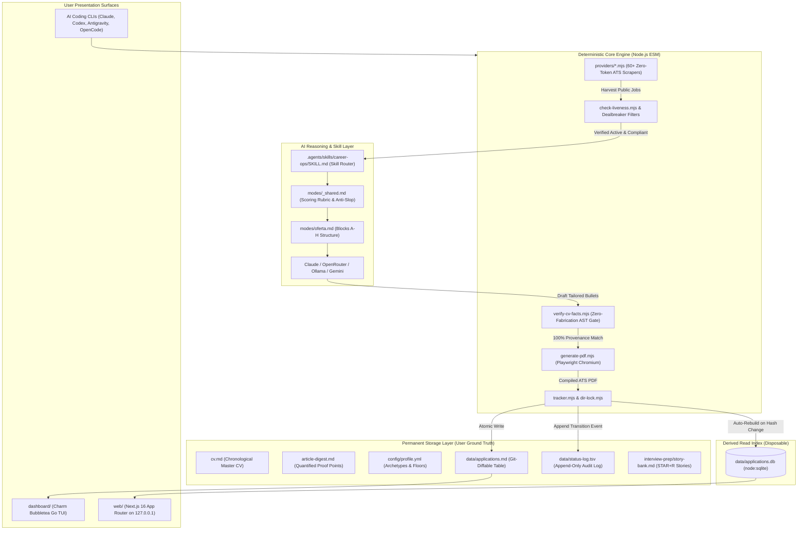
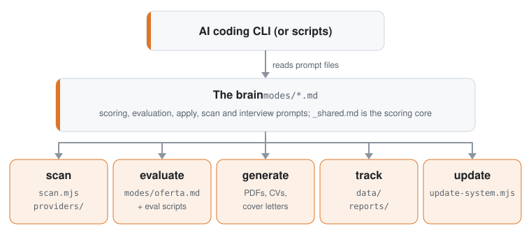
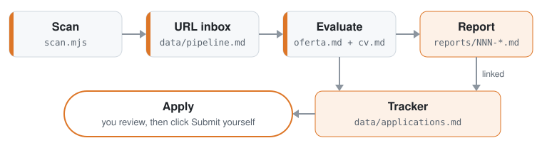
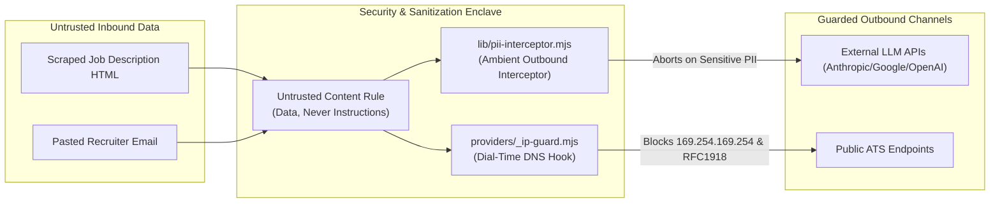

# System Architecture & Technical Specifications — career-ops

> **Document Status**: Production / Authoritative  
> **Target Version**: v1.38.0  
> **Audience**: Staff Engineers, Core Contributors, Solutions Architects, Security Auditors  

---

## 1. Executive Architectural Overview

`career-ops` is an industrial-grade, local-first candidate operations system. It reverses the asymmetric recruitment landscape by placing an autonomous, deterministic-gated AI operating system directly on the candidate's personal computer.

Unlike generic resume generators or cloud-hosted application bots, `career-ops` couples **stochastic LLM reasoning** with **deterministic verification gates**. The file system serves as the permanent single source of truth, while fast indices (SQLite) and visual interfaces (Next.js 16, Charm Bubbletea Go TUI) operate strictly as derived projections.



---

## 2. Core Architectural Principles

1. **Local-First Data Sovereignty**: All candidate intelligence, resume variations, notes, and compensation targets reside locally on the user's hard drive in human-readable plain text (Markdown, YAML, TSV). No central cloud database exists.
2. **AI-Agnostic Execution Engine**: The system logic is expressed as modular Markdown prompts under `modes/`. Any tool following the [open agent skill standard](https://agentskills.io)—including Claude Code, Cursor, Codex, OpenCode, Antigravity, Gemini CLI, Grok, or offline Ollama instances—can execute the platform.
3. **Deterministic Fact Grounding**: Stochastic models are never permitted to publish unverified assertions. The rule is absolute: *"Keywords get reformulated, never fabricated."* Every tool, metric, and company claim in tailored output must trace directly to primary user files.
4. **Strict Human-in-the-Loop (HITL)**: career-ops prepares application dossiers and form answers, but the human candidate must verify the content and submit the application manually. Robotic auto-submission is rejected by design.

---

## 3. The Data Contract: System Layer vs. User Layer

The fundamental organizing boundary in career-ops is the strict separation between the **System Layer** (the versioned, auto-updatable engine) and the **User Layer** (the candidate's personal ground truth).

```
┌────────────────────────────────────────────────────────────────────────┐
│ USER LAYER (Candidate Ground Truth — NEVER Auto-Updated)               │
│ - Primary Facts: cv.md, article-digest.md, config/profile.yml          │
│ - Personal Framing: modes/_profile.md, modes/_custom.md, voice-dna.md  │
│ - Pipeline State: data/applications.md, data/status-log.tsv, pipeline  │
│ - Dossiers: reports/*.md, output/*.pdf, interview-prep/*               │
└───────────────────────────────────┬────────────────────────────────────┘
                                    │ Read & Written By
┌───────────────────────────────────▼────────────────────────────────────┐
│ SYSTEM LAYER (Tooling & Logic — Safely Auto-Updatable)                 │
│ - Agent Prompts: modes/_shared.md, modes/oferta.md, modes/apply.md     │
│ - Discovery Core: providers/*.mjs, scan.mjs, scan-ats-full.mjs         │
│ - Deterministic Tools: verify-cv-facts.mjs, generate-pdf.mjs, tracker  │
│ - Interfaces: dashboard/* (Go TUI), web/* (Next.js 16 Web UI)          │
│ - Lifecycle: update-system.mjs, lib/update-manifest.mjs                │
└────────────────────────────────────────────────────────────────────────┘
```

### Path Resolution Precedence (`path-resolver.mjs`)
The User Layer location (Data Root) is resolved dynamically using strict precedence:
1. **Environment Variables**: `CAREER_OPS_ROOT` or `CAREER_OPS_DATA_DIR` (overrides all paths; checked for path traversal security).
2. **Marker File**: A `.career-ops-data` file in the repository root pointing to an absolute or relative data path.
3. **Plugin Install Default**: If running inside Claude Code plugin cache (`~/.claude/plugins/`), defaults to `~/career-ops-data` to prevent data deletion on plugin updates.
4. **Repository Default**: The repository root itself.

---

## 4. Storage Architecture: Files as Canonical, Databases as Derived

Settled architectural doctrine (RFC #918) mandates that flat Markdown and TSV files remain the **permanent, git-diffable single source of truth**:

1. **`data/applications.md`**: Human-readable, git-diffable Markdown table tracking application state.
2. **`data/status-log.tsv`**: Append-only transactional transition ledger (`{tracker_id}\t{date}\t{from}\t{to}\t{source}\t{note}`) recording the exact history of every status mutation.
3. **Derived SQLite Cache (`data/applications.db`)**: Built dynamically using Node's built-in `node:sqlite`. Read queries (search, filter, stats) execute against SQLite for microsecond performance; however, SQLite is disposable and automatically rebuilds whenever the source Markdown file hash changes.

---

## 5. Subsystem Decomposition

<p align="center"><picture><source media="(prefers-color-scheme: dark)" srcset="docs/architecture-component-map-dark.svg"></picture></p>

### 5.1 Discovery Subsystem (`scan.mjs` & `providers/`)
Finds open roles from public, unauthenticated sources with zero LLM API cost:
- **60+ Provider Adapters**: Covers Greenhouse, Ashby, Lever, Workday, BambooHR, SmartRecruiters, Taleo, SuccessFactors, Dayforce, etc.
- **Reverse-ATS Keyword Sweeps**: `scan-ats-full.mjs` traverses complete public company datasets, checkpointing progress every 500 companies.
- **SSRF Defense Core**: Every request routes through `providers/_ip-guard.mjs`, which patches `node:dns.lookup` inside an `AsyncLocalStorage` scope to reject loopback, RFC1918 private subnets, and cloud instance metadata (`169.254.169.254`).

### 5.2 Pre-Flight Gating Subsystem
Disqualifies invalid opportunities before spending tokens or time:
- **Liveness Gate (`check-liveness.mjs`)**: Verifies HTTP 200 and examines the DOM for closure indicators ("no longer accepting applications", expired Ashby/Lever tags).
- **Blacklist Gate (`data/blacklist.md`)**: Evaluates company names and domain patterns against candidate-defined exclusions.
- **Dealbreaker Gate**: Quotas, salary floors, and remote jurisdiction rules evaluated against JD text.

### 5.3 AI Evaluation Subsystem (`modes/oferta.md` & `_shared.md`)
Produces structured A–H evaluation dossiers:
- **Block A**: Role summary, archetype match, culture screen.
- **Block B**: Requirement mapping (CV match vs. gaps with mitigation strategy).
- **Block C**: Leveling strategy (IC vs. Management, title calibration).
- **Block D**: Compensation research (bounded WebSearch vs. market quartiles).
- **Block E**: CV personalization plan (mapping candidate proof points).
- **Block F**: STAR+R behavioral interview preparation.
- **Block G**: Posting legitimacy screening (ghost job detection, age, repost churn).
- **Block H**: Application form answer drafting (conditional on score $\ge 4.5$).
- **Scoring**: Holistic 1.0–5.0 rating across 5 dimensions (no naive arithmetic averaging).

### 5.4 Fact Verification Subsystem (`verify-cv-facts.mjs`)
The platform's anti-hallucination firewall:
- Parses generated Markdown, HTML, or LaTeX CV payloads.
- Extracts every tool, language, framework, company, date range, and quantified metric.
- Compares claims against the candidate's primary sources (`cv.md`, `article-digest.md`).
- Halts generation and logs a fatal error if any novel assertion is introduced.

### 5.5 Rendering Subsystem (`generate-pdf.mjs` & `generate-latex.mjs`)
Compiles ATS-optimized documents:
- **Playwright Chromium**: Converts clean HTML templates into single-column, pixel-perfect PDFs.
- **Page Budgeting**: Enforces strict 1-page or 2-page ceilings with automated trimming guidance.
- **LaTeX Engine**: Compiles academic and technical CVs via local `pdflatex` or Overleaf templates.

### 5.6 Concurrency & Locking Subsystem (`lib/dir-lock.mjs`)
- Advisory file locking across Windows, Linux, and macOS.
- Prevents write collisions during parallel batch runs (`batch/batch-runner.sh --parallel 3`).
- Atomic write-temp-then-rename semantics via `writeFileAtomic`.

---

<p align="center"><picture><source media="(prefers-color-scheme: dark)" srcset="docs/architecture-data-flow-dark.svg"></picture></p>

## 6. Security Architecture & Threat Model



1. **SSRF & DNS Rebinding**: Hooked at the socket connection level, preventing attacks aimed at AWS/GCP/Azure instance metadata services.
2. **Prompt Injection Containment**: Inbound JD text is strictly labeled as untrusted data. Any imperative commands directed at the AI reviewer are quoted as Block G anomalies and ignored.
3. **Ambient PII Interception**: All outbound requests to cloud LLMs are intercepted; candidate phone numbers, addresses, and secrets trigger a `PrivacyGuardError` unless explicitly opted into token redaction (`PRIVACY_REDACT=1`).
4. **Local Loopback Default**: The Next.js web server binds to loopback (`127.0.0.1`) by default and refuses non-loopback hosts. `-H` or `CAREER_OPS_WEB_ALLOWED_HOSTS` widens the bind and the host allow-list. There is no authentication, so any widened bind exposes the dashboard to whoever can reach that port.

---

## 7. Quality Assurance Architecture

The codebase enforces a multi-tiered test pyramid:
- **Syntax Check (`scripts/check-syntax.mjs`)**: Compiles 1,960+ `.mjs` files in $< 4.0$s using Node's native parser.
- **Discovered Unit Suites (`tests/**/*.test.mjs`)**: Isolated suites testing parsers, locks, and providers.
- **Data Contract & Migration Gates (`updater-migration-tests.mjs`)**: Asserts that upgrades never overwrite User Layer files.
- **Visual Regression Testing (`playwright.cv.config.mjs`)**: Compares rendered PDF snapshots against golden images to detect layout drift.

---

## 8. Architectural Roadmap

1. **Monolith Deconstruction**: Disassemble legacy inline sections in `test-all.mjs` into dedicated `tests/` suites.
2. **TypeScript Domain Package**: Extract shared data models (`Job`, `Application`, `Report`) into a typed `@career-ops/types` package.
3. **Autofill Browser Extension**: Implement an open-source, local-first browser extension bridging the local Next.js API with ATS application forms.
4. **Local Audio Mock Interviewer**: WebRTC/Whisper audio agent providing conversational behavioral interview practice from the candidate's STAR story bank.
