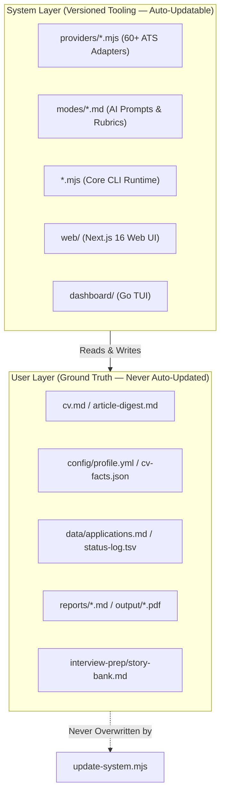

<p align="center"><picture><source media="(prefers-color-scheme: dark)" srcset="docs/wordmark-dark.svg"></picture></p>

<p align="center">The open-source AI job search agent.</p>

<p align="center">
  <a href="README.md">English</a> |
  <a href="README.es.md">Español</a> |
  <a href="README.de.md">Deutsch</a> |
  <a href="README.fr.md">Français</a> |
  <a href="README.pt-BR.md">Português (Brasil)</a> |
  <a href="README.ko-KR.md">한국어</a> |
  <a href="README.ja.md">日本語</a> |
  <a href="README.cn.md">简体中文</a> |
  <a href="README.zh-TW.md">繁體中文</a> |
  <a href="README.ua.md">Українська</a> |
  <a href="README.ru.md">Русский</a> |
  <a href="README.pl.md">Polski</a> |
  <a href="README.da.md">Dansk</a> |
  <a href="README.ta.md">தமிழ்</a> |
  <a href="README.ar.md">العربية</a> |
  <a href="README.hi.md">हिन्दी</a> |
  <a href="README.tr.md">Türkçe</a> |
  <a href="README.vi.md">Tiếng Việt</a> |
  <a href="README.id.md">Bahasa Indonesia</a>
</p>

<!-- The non-breaking spaces (&nbsp;) and word joiners (&#8288;) below decide where each line wraps on a phone. Keep them when editing. -->

<p align="center">career-ops was created by Santiago Fernández de Valderrama; this is a fork maintained by the owner of this repository.</p>

<p align="center">
Paste a job. On your machine, it tells you if it's still&nbsp;open and if it&nbsp;fits.<br>
It tailors your CV and drafts your&nbsp;answers. <strong>You&nbsp;press&nbsp;Submit.</strong>
</p>

<p align="center">
  
</p>

<p align="center">
  <a href="https://wired.com.gr/article/to-ai-ergaleio-pou-fernei-epanastasi-ston-tropo-pou-psachnoume-douleia/" rel="noopener noreferrer nofollow"><picture><source media="(prefers-color-scheme: dark)" srcset="docs/press/wired-dark.svg"></picture></a>
  &nbsp;&nbsp;&nbsp;&nbsp;
  <a href="https://www.businessinsider.com/how-i-built-tool-filter-job-listings-landed-head-ai-2026-4" rel="noopener noreferrer nofollow"><picture><source media="(prefers-color-scheme: dark)" srcset="docs/press/business-insider-dark.svg"></picture></a>
</p>

<p align="center">
  <a href="https://www.producthunt.com/products/santifer-io?utm_source=badge-featured&utm_medium=badge" rel="noopener noreferrer"></a>
</p>

---

## What is career-ops?

`career-ops` is a private, local-first candidate operations system. It automates every step of the job search—from discovering openings via direct ATS APIs to validating posting liveness, detecting ghost postings, generating fact-checked resumes, and tracking progress—directly on your machine.

### The Four Tenets
1. **Local-First & Sovereign**: Runs on your files. No candidate data ever leaves your computer without your explicit authorization.
2. **AI-Agnostic Engine**: Prompts live in Markdown files under `modes/`. Executes inside Claude Code, Cursor, Codex, OpenCode, Antigravity, Gemini CLI, Grok Build CLI, or offline with local Ollama models.
3. **Deterministic Fact Grounding**: Generative AI is strictly bounded by `verify-cv-facts.mjs`. It will never invent metrics, skills, or employment history.
4. **Human-in-the-Loop (HITL)**: career-ops prepares, scores, filters, and drafts. You review, verify, and click Submit. It never spams applications.

---

## Executive Feature Matrix

| Capability | What it does | Engineering Mechanism |
| :--- | :--- | :--- |
| **Human-in-the-Loop (HITL)** | AI evaluates and recommends, you decide and act. The system never submits an application. You always have the final call. <!-- hitl: absolute guarantee. Do not add "automatically", "by itself", "without your permission" or any other hedge when translating this row. --> | `apply` and `email` stop before Submit or Send. Nothing is sent on your behalf. |
| **Zero-Token Discovery** | Finds jobs from Greenhouse, Ashby, Lever, Workday, etc. without LLM API costs. | 60+ modular REST/JSON/RSS adapters in `providers/`. |
| **Deterministic Liveness Gate** | Verifies a posting is live before spending tokens on evaluation. | `check-liveness.mjs` inspects HTTP status and DOM elements. |
| **Anti-Ghost Legitimacy (Block G)** | Flags scam jobs, zombie postings, and repost churn. | Cross-references posting age, repost cadence, and layoff alerts. |
| **Holistic 5-Dimension Scoring** | Evaluates CV match, North Star fit, comp, culture, and red flags (1.0–5.0). | Integrated qualitative judgment in `modes/_shared.md`. |
| **Fact-Gated Tailoring** | Tailors CV phrasing while strictly forbidding hallucinations. | `verify-cv-facts.mjs` verifies every metric against `cv.md`. |
| **ATS-Parseable PDF & LaTeX** | Generates single-column, ATS-optimized PDFs and Overleaf-ready LaTeX. | `generate-pdf.mjs` (Playwright Chromium) and `generate-latex.mjs`. |
| **STAR Story Bank with Provenance** | Prepares interview responses grounded in your real achievements. | `lib/story-bank.mjs` with strict provenance markers (#2947). |
| **Derived CQRS SQLite Index** | Blazing-fast querying over Markdown tracker tables. | Native `node:sqlite` derived cache in `tracker.mjs` (RFC #918). |

---

## Quick Start (Installation)

### Prerequisites
- **Node.js**: `^22.13.0 || >=23.4.0`
- **Git**: For version tracking and safe system updates
- **AI Coding CLI**: Claude Code, Cursor, Codex, Antigravity CLI, or OpenCode

```bash
# 1. Clone the repository
git clone https://github.com/CJCreator/Jobs_Automated.git
cd Jobs_Automated

# 2. Install dependencies & Playwright Chromium
npm install

# 3. Verify system health
npm run doctor

# 4. Initialize configuration templates
cp .env.example .env
cp config/profile.example.yml config/profile.yml
cp config/cv-facts.example.json config/cv-facts.json
```

### Initial Setup
1. Author your master CV in `cv.md` (Markdown format, chronological experience).
2. Configure your target archetypes, location rules, and comp floors in `config/profile.yml`.
3. Add curated companies or job boards to `portals.yml`.

The full setup guide, including scanning through an outbound proxy, is in [docs/SETUP.md](docs/SETUP.md).

---

## Usage

Paste a job URL or description into your AI CLI. career-ops checks that a linked posting is still live (pasted text has no link to check), scores it against your CV, writes a report, tailors your CV (a PDF by default) and adds a row to your tracker. That covers most days. Everything else is a mode you ask for by name. If a posting can't be read, the pipeline stops and asks you to paste the text or share a screenshot.

### Asking for a mode

| CLI | How you ask for `scan` |
| --- | --- |
| Claude Code, OpenCode, Antigravity CLI (`agy`), Grok Build CLI | `/career-ops scan` |
| Pi | `/skill:career-ops scan` |
| Codex, Qwen, Cursor, or any other supported CLI | Plain language: "Run the career-ops scan mode" |

`/career-ops` with nothing after it shows the command menu in the CLIs that use it. Plain language works in every supported CLI. As a Claude Code plugin, the command is `/career-ops:career-ops`.

All of them share one router, `.agents/skills/career-ops/SKILL.md`, and the same `modes/*.md` files, so every CLI routes a request the same way (browser-heavy modes also need Playwright tools). Slash commands are not guaranteed in Codex: ask in plain language, or run one prompt headless with `codex exec "Evaluate this JD with career-ops auto-pipeline: https://company.com/jobs/123"` ([docs/CODEX.md](docs/CODEX.md)). How to run it in each supported CLI, headless commands where a CLI has one, and per-CLI setup notes are in [docs/SUPPORTED_CLIS.md](docs/SUPPORTED_CLIS.md).

### The everyday commands

| Command | What it does |
| --- | --- |
| *paste a URL or JD* | Full pipeline: liveness check (URLs only), A-G evaluation plus H at high scores, report, tailored CV (PDF by default), tracker row |
| `scan` | Scan your portals for new postings and add them to the inbox (`data/pipeline.md`) |
| `pipeline` | Work through the URLs waiting in the inbox (the standard and premium tiers may skip obvious mismatches) |
| `apply` | Fill an application form with you, field by field. It stops before Submit |
| `tracker` | Where every application stands |
| `followup` | Which applications are due a follow-up, with drafts |

<details>
<summary><b>All commands, by stage of the search</b></summary>

`oferta`, `ofertas` and `contacto` keep their original Spanish names: offer, offers, contact.

**Find roles**

| Command | What it does |
| --- | --- |
| [`scan`](modes/scan.md) | Scan portals and discover new offers |
| [`discover`](modes/discover.md) | Resolve a list of company names to scannable ATS boards. Previews by default; adds them to `portals.yml` only with `--write` (zero-token) |
| [`pipeline`](modes/pipeline.md) | Process pending URLs from the inbox (`data/pipeline.md`) |
| [`triage`](modes/triage.md) | Fast first-pass go/no-go score from `modes/_brief.md`, before a full evaluation (writes no files) |
| [`batch`](modes/batch.md) | Evaluate many postings with headless workers (parallel with Claude, one at a time with other CLIs) |
| [`titles`](modes/titles.md) | Suggest adjacent job titles from your CV to broaden the search |

**Evaluate a role**

| Command | What it does |
| --- | --- |
| *paste a URL or JD* | [Auto-pipeline](modes/auto-pipeline.md): evaluation + report + tailored CV (PDF by default) + tracker entry |
| [`oferta`](modes/oferta.md) | Evaluation only, Blocks A to G plus H at high scores (no PDF) |
| [`ofertas`](modes/ofertas.md) | Compare and rank several offers |
| [`deep`](modes/deep.md) | Deep research prompt about the company |
| [`eu-swe`](modes/regional/eu-swe.md) | Calibrate a European software-engineering application before CV, apply or interview |

**Apply**

| Command | What it does |
| --- | --- |
| [`pdf`](modes/pdf.md) | ATS-optimized CV as a PDF |
| [`ats`](modes/ats.md) | ATS-friendliness check of a generated CV: score and fixable issues |
| [`text`](modes/text.md) | Tailored CV as markdown (mirrors `cv.md`, no PDF) |
| [`latex`](modes/latex.md) | Export the CV as LaTeX/Overleaf `.tex` |
| [`latex-tex`](modes/latex-tex.md) | Tailor your own `resume.tex` in place (opt-in; `cv.md` stays the default) |
| [`cover`](modes/cover.md) | Cover letter, from a pasted JD or an evaluated report (`cover {slug}`) |
| [`email`](modes/email.md) | Formal application email draft. Draft-only: never sends, submits or clicks |
| [`contacto`](modes/contacto.md) | Find the hiring manager, recruiter or a peer, and draft a LinkedIn message |
| [`apply`](modes/apply.md) | Live application assistant (Playwright from this checkout). Does not submit |

**Interview**

| Command | What it does |
| --- | --- |
| [`interview-prep`](modes/interview-prep.md) | Company-specific interview prep document |
| [`interview/plan`](modes/interview/plan.md) | Time-blocked prep plan for an upcoming interview |
| [`interview/practice`](modes/interview/practice.md) | Practice interview, one question at a time, with feedback |
| [`interview/debrief`](modes/interview/debrief.md) | Post-interview debrief: close gaps, predict the next round |
| [`interview-redflag`](modes/interview-redflag.md) | Analyze an employer's warning signs before you join |

**After you apply**

| Command | What it does |
| --- | --- |
| [`tracker`](modes/tracker.md) | Application status overview |
| [`followup`](modes/followup.md) | Follow-up cadence: flag overdue applications, generate drafts |
| [`reply-watch`](modes/reply-watch.md) | Classify employer replies and suggest tracker updates |
| [`outcome`](modes/outcome.md) | Record an application's outcome and archive its artifacts |
| [`offer-prep`](modes/offer-prep.md) | Read a received offer or contract with you: clause walk and questions for a lawyer (not legal advice) |

**Your profile and CV**

| Command | What it does |
| --- | --- |
| [`interview`](modes/interview.md) | Profile setup: an interactive interview about your experience that builds your CV and profile (not interview practice) |
| [`intake`](modes/intake.md) | Build or enrich your profile from files in `documents/` (master CV, LinkedIn export). Nothing is written without your confirmation |
| [`master-profile`](modes/master-profile.md) | Import, review and validate your Master Career Profile, and prepare selected facts as CV bullets |
| [`add`](modes/add.md) | Add a project, paper or role to your CV (fetch, preview, confirm) |
| [`expand`](modes/expand.md) | Discover competencies missing from your CV, from your profile links |
| [`retro`](modes/retro.md) | Review this session and keep what you taught it as rules (writes only the ones you accept) |

**Improve your targeting**

| Command | What it does |
| --- | --- |
| [`patterns`](modes/patterns.md) | Analyze rejection patterns and improve targeting |
| [`calibrate`](modes/calibrate.md) | Check whether your evaluation scores predict your real outcomes. Advisory: never changes scoring |
| [`upskill`](modes/upskill.md) | Skill-gap analysis across your evaluated reports |
| [`training`](modes/training.md) | Evaluate a course or certification against your North Star |
| [`project`](modes/project.md) | Evaluate a portfolio project idea |

**System**

| Command | What it does |
| --- | --- |
| [`agent-inbox`](modes/agent-inbox.md) | Queue requests for the next session, and work through them then (`data/agent-inbox.md`). `inbox` works too |
| [`update`](modes/update.md) | Update career-ops system files, with a diff preview and compatibility check |

</details>

---

## Everyday Usage

Paste a job posting URL or raw JD text directly into your AI coding CLI:

```bash
# In Claude Code, Antigravity, or OpenCode:
/career-ops oferta https://jobs.ashbyhq.com/company/job-id

# Plain language in any CLI (Cursor, Codex, Grok, Qwen):
"Evaluate this JD with career-ops: https://jobs.lever.co/company/job-id"
```

The system will:
1. Confirm the posting is live (skips dead links automatically).
2. Screen for blacklist and candidate dealbreakers.
3. Deliver a comprehensive 8-block evaluation (A–H) with a holistic 1–5 score.
4. If score $\ge 4.0$, tailor your CV and compile a verified PDF into `output/`.
5. Record the application row in `data/applications.md` and transition ledger.

### Command Reference

| Stage | Mode / Script | Action |
| :--- | :--- | :--- |
| **Discovery** | `scan` / `scan:full` | Scans configured portals or sweeps full ATS public databases. |
| **Triage** | `pipeline` | Evaluates pending URLs in `data/pipeline.md` sequentially. |
| **Evaluation** | `oferta` | Full 8-block analysis (CV match, comp, culture, ghost check). |
| **Application** | `apply` | Generates verified form answers and outreach emails. |
| **Tracking** | `tracker` | Inspects and filters your application pipeline. |
| **Cadence** | `followup` | Identifies overdue follow-ups and drafts polite check-in notes. |
| **Interview** | `interview` | Prepares company-specific STAR stories and red-flag questions. |
| **Learning** | `retro` | Captures your feedback and updates your persistent house rules. |

---

## User Interfaces

### 1. Terminal Dashboard (Go Bubbletea TUI)
For ultra-fast, keyboard-driven navigation:
```bash
npm run serve:dashboard
```
Features 10 status filter tabs, 8 sort modes, lazy-loaded report previews, and inline status updates.

### 2. Modern Web UI (Next.js 16 + React 19)
For visual Kanban boards, Markdown CV editing, and rich analytics:
```bash
cd web
npm install
npm run build
npm start
# Open http://localhost:3000
```

---

## Architecture & Data Contract

career-ops is built on a strict boundary between the **System Layer** (the versioned engine) and the **User Layer** (your private data):



For full architectural specifications, see:
- High-Level Doctrine: [ARCHITECTURE.md](ARCHITECTURE.md)
- Data Contract Boundary: [DATA_CONTRACT.md](DATA_CONTRACT.md)
- Runtime Flows: [docs/architecture/SystemArchitecture.md](docs/architecture/SystemArchitecture.md)

---

## Comprehensive Documentation Suite

| Category | Focus | Key Documents |
| :--- | :--- | :--- |
| **Product** | Vision, Strategy, Specs | [PRD](docs/product/PRD.md) · [Vision](docs/product/Vision.md) · [Personas](docs/product/UserPersonas.md) · [Roadmap](docs/product/Roadmap.md) · [Competitive Analysis](docs/product/CompetitiveAnalysis.md) · [Feature Specs](docs/product/FeatureSpecifications.md) |
| **Architecture** | System & Technical Design | [System](docs/architecture/SystemArchitecture.md) · [Frontend](docs/architecture/FrontendArchitecture.md) · [Backend](docs/architecture/BackendArchitecture.md) · [Database](docs/architecture/DatabaseArchitecture.md) · [AI](docs/architecture/AIArchitecture.md) · [Agent](docs/architecture/AgentArchitecture.md) · [Security](docs/architecture/SecurityArchitecture.md) · [Infra](docs/architecture/InfrastructureArchitecture.md) |
| **Development** | Setup & Standards | [Setup Guide](docs/development/SetupGuide.md) · [Local Dev](docs/development/LocalDevelopment.md) · [Coding Standards](docs/development/CodingStandards.md) · [Branching](docs/development/BranchingStrategy.md) · [Contributing](docs/development/ContributionGuide.md) · [Env Vars](docs/development/EnvironmentVariables.md) · [API Guide](docs/development/APIDevelopmentGuide.md) |
| **Frontend** | Web UI & Design Tokens | [Design System](docs/frontend/DesignSystem.md) · [Component Library](docs/frontend/ComponentLibrary.md) · [State Management](docs/frontend/StateManagement.md) · [Routing](docs/frontend/RoutingArchitecture.md) · [Dashboard TUI](docs/frontend/DashboardDesign.md) |
| **Backend** | Services & API Reference | [API Reference](docs/backend/APIReference.md) · [Service Architecture](docs/backend/ServiceArchitecture.md) · [Database Schema](docs/backend/DatabaseSchema.md) · [Authentication](docs/backend/Authentication.md) |
| **AI System** | Prompts, Agents & Gates | [Prompt Library](docs/ai/PromptLibrary.md) · [Agent Workflows](docs/ai/AgentWorkflows.md) · [LLM Routing](docs/ai/LLMArchitecture.md) · [Evaluation Rubric](docs/ai/EvaluationFramework.md) · [Local RAG](docs/ai/RAGArchitecture.md) · [Tool Calling](docs/ai/ToolCallingArchitecture.md) |
| **Testing** | QA Strategy & Test Suites | [Testing Strategy](docs/testing/TestingStrategy.md) · [Unit Testing](docs/testing/UnitTesting.md) · [Integration](docs/testing/IntegrationTesting.md) · [E2E Visual](docs/testing/E2ETesting.md) · [Performance](docs/testing/PerformanceTesting.md) |
| **Deployment** | DevOps, CI/CD, Scaling | [Deployment Guide](docs/deployment/DeploymentGuide.md) · [CI/CD](docs/deployment/CI-CD.md) · [Monitoring](docs/deployment/Monitoring.md) · [Scaling](docs/deployment/Scaling.md) · [Disaster Recovery](docs/deployment/DisasterRecovery.md) |
| **Business** | Commercial & Growth | [Monetization](docs/business/Monetization.md) · [Pricing Strategy](docs/business/PricingStrategy.md) · [Growth Loops](docs/business/GrowthLoops.md) · [KPI Framework](docs/business/KPIFramework.md) |
| **Structure** | Full Repository Map | [PROJECT_STRUCTURE.md](PROJECT_STRUCTURE.md) |

---

## Project Structure

```
Jobs_Automated/
├── AGENTS.md                    # Canonical agent instructions (all CLIs)
├── CLAUDE.md                    # Claude Code wrapper (imports AGENTS.md)
├── CODEX.md                     # Codex wrapper (imports AGENTS.md)
├── OPENCODE.md                  # OpenCode wrapper (imports AGENTS.md)
├── GEMINI.md                    # Legacy no-op guard to avoid Antigravity duplicate context
├── cv.md                        # Your CV (create this)
├── article-digest.md            # Your proof points (optional)
├── config/
│   └── profile.example.yml      # Template for your profile
├── modes/                       # Skill modes
│   ├── _shared.md               # Shared context (system file; local edit kept unless apply --force)
│   ├── _profile.md              # Your archetypes and framing (customize this)
│   ├── oferta.md                # Single evaluation
│   ├── pdf.md                   # PDF generation
│   ├── cover.md                 # Cover letter generation
│   ├── email.md                 # Formal application email drafts
│   ├── scan.md                  # Portal scanner
│   ├── batch.md                 # Batch processing
│   └── ...
├── templates/
│   ├── cv-template.html         # ATS-optimized CV template
│   ├── portals.example.yml      # Scanner config template
│   └── states.yml               # Canonical statuses
├── batch/
│   ├── batch-prompt.md          # Self-contained worker prompt
│   └── batch-runner.sh          # Orchestrator script
├── dashboard/                   # Go TUI pipeline viewer
├── data/                        # Your tracking data (gitignored)
├── reports/                     # Evaluation reports (gitignored)
├── output/                      # Generated PDFs (gitignored)
├── fonts/                       # Space Grotesk + DM Sans
├── docs/                        # Setup, customization, budget guide, architecture
└── examples/                    # Sample CV, report, proof points
```

---

## Community & Contributing

`career-ops` is built by over 700+ open-source engineers, career coaches, and job seekers.
- **Contributing**: Read [CONTRIBUTING.md](CONTRIBUTING.md), the [Contribution Guide](docs/development/ContributionGuide.md) and [ADDING_A_PROVIDER.md](providers/ADDING_A_PROVIDER.md).
- **Support**: Help questions go to [SUPPORT.md](SUPPORT.md), not the issue tracker.
- **Security**: Review our SSRF and PII policies in [docs/architecture/SecurityArchitecture.md](docs/architecture/SecurityArchitecture.md) and [SECURITY.md](SECURITY.md).
- **Licensing**: Open-source under the [MIT License](LICENSE). The career-ops name is governed by the [Trademark Policy](TRADEMARK.md). Use is also subject to the [Legal Disclaimer](LEGAL_DISCLAIMER.md).
