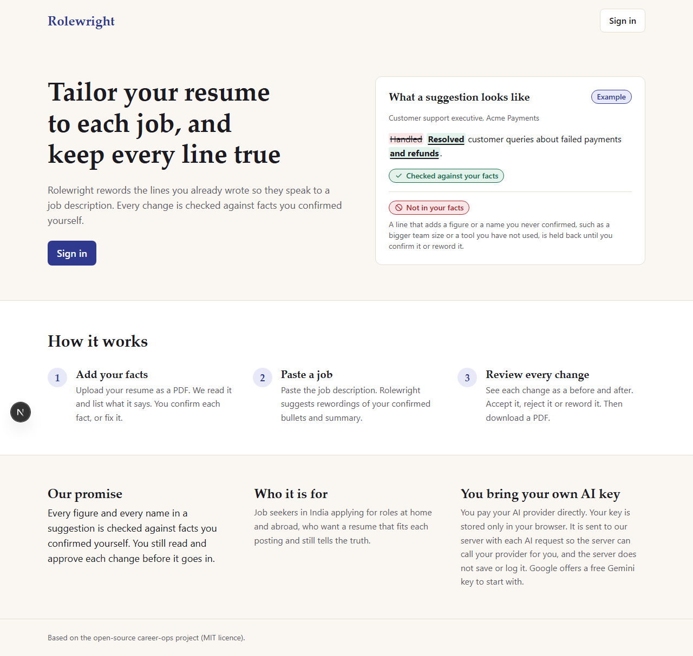
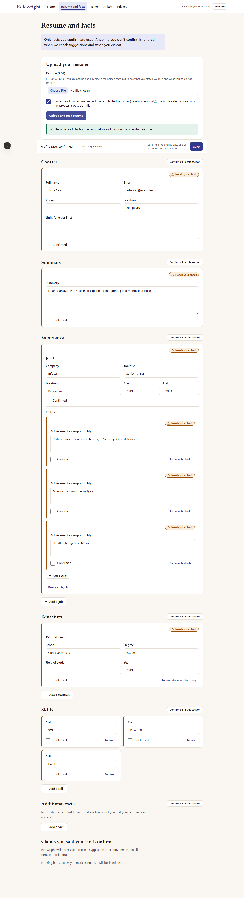
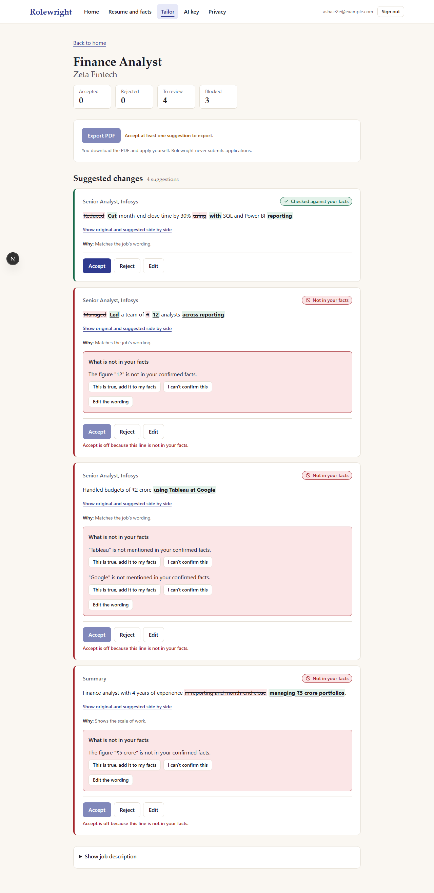
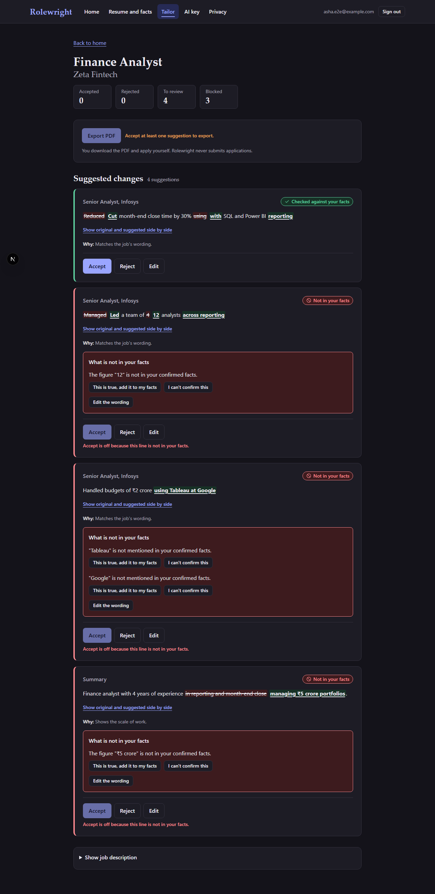

# Rolewright

Rolewright is a web app for job seekers in India. You upload your resume, confirm the facts in it, paste a job description, and review AI suggestions for rewording your resume to fit the job. A suggestion can only reach the exported PDF if every claim in it is in the facts you confirmed.

Based on the open-source career-ops project (MIT licence).

## Run it locally

Needs Node 22.18 or later (24 recommended). The tests import TypeScript files directly, which Node runs without a flag from 22.18. Dependencies for this app are in `apps/web/node_modules`; the PDF export also needs the engine package (`packages/engine`) with its own `node_modules` and Playwright's Chromium installed (`npx playwright install chromium` in that folder).

Two development flags turn on a sign-in that needs no email or Google account, and a fake AI provider that needs no key:

```bash
# bash
ROLEWRIGHT_DEV_LOGIN=1 ROLEWRIGHT_ALLOW_MOCK_LLM=1 npm run dev
```

```powershell
# PowerShell
$env:ROLEWRIGHT_DEV_LOGIN="1"; $env:ROLEWRIGHT_ALLOW_MOCK_LLM="1"; npm run dev
```

Open http://localhost:3100. With no `DATABASE_URL`, data is kept in an embedded database at `apps/web/.data/pglite`. To use the fake provider, choose provider `mock` with the key `mock-valid-key`. It deliberately invents figures, tools and employers so you can see the fact check stop them.

Both flags are refused on a **deployed host** and when `NODE_ENV` is `production`, and so is a missing `AUTH_SECRET`. A host counts as deployed when `ROLEWRIGHT_DEPLOYED=1` or when `K_SERVICE` is set to any non-empty value (Cloud Run and Knative set it), whatever `NODE_ENV` says; it is read from the process environment, never from a request. On a deployed host a missing `DATABASE_URL` is also refused, and the embedded database is never opened. The server checks this when it starts (`src/instrumentation.ts`): it logs every problem and exits with code 1, so nothing listens. The first-use checks in the sign-in module and the API routes remain as a second layer. The embedded database is refused only on a deployed host (`K_SERVICE` set, or `ROLEWRIGHT_DEPLOYED=1`). With `NODE_ENV=production` on a machine that is not deployed (the production smoke test), it is allowed but logs one warning naming its directory. Do not run a public server that way. The check is skipped while `next build` runs (Next sets `NEXT_PHASE=phase-production-build`), so building needs neither the secret nor any flag. The rule lives in `src/lib/server/env-guard.mjs`.

## Commands

| Command | What it does |
|---|---|
| `npm test` | Unit tests (`tests/**/*.test.mjs`), no server needed. |
| `npm run test:flow` | The whole flow over real HTTP: starts `next dev` on a free port (3111 if free) with the dev flags and a temporary database, signs in two users, uploads a PDF, tailors, reviews, exports, checks isolation, cross-site refusal and key hygiene, deletes an account. Prints PASS or FAIL per step. Set `FLOW_SHOW_SERVER_OUTPUT=1` to print what the server logged. It uses its own build folder (`.next-flow`) so it does not disturb a `next dev` already running. `tsconfig.json` already lists the type folders `next dev` adds for `.next`, `.next-flow` and `.next-e2e`, so a run leaves it unchanged; `next-env.d.ts` is rewritten for the last folder used and is not tracked. |
| `npm run test:prod` | Production-mode smoke test: `next build` into `.next-prod`, `next start` on port 3124 with `NODE_ENV=production` and no development flags, a session cookie minted with Auth.js's own `encode`, and a seeded database. Checks the database and row-level security, the engine fact gate (a stale stored pass is recomputed to a block), PDF export, isolation between users, cross-site refusal, the security headers with a per-request script nonce, the absence of the mock AI provider, and that the pages hydrate in Chromium with no Content Security Policy violation. |
| `npm run purge:inactive` | Deletes accounts idle for 12 months, with all their data, and prints the number deleted. The fallback to the purge endpoint (see below). |
| `npm run typecheck` | TypeScript check of `src/`. |
| `npm run build` | Production build. |

## Environment variables

Read from the process environment only. "Required when deployed" means a deployed host (`ROLEWRIGHT_DEPLOYED=1` or `K_SERVICE` set) refuses to start, or refuses the feature, without it. `AUTH_SECRET` and `DATABASE_URL` are checked at start; `ROLEWRIGHT_RATE_LIMIT_KEY` is checked when a request is limited (see its row). Everything else here is optional unless its row says otherwise. The grievance variables are required only when sign-ups are `open`, but the notice shows "not yet set" until both are valid.

| Name | Meaning |
|---|---|
| `AUTH_SECRET` | Signs and encrypts session cookies. Required in production and on a deployed host: without it the server refuses to start (see above). In development a fixed, development-only value is used when unset. Generate one with `openssl rand -base64 32`. |
| `AUTH_URL` | The public URL of the app, e.g. `https://rolewright.example`. Needed in production behind a proxy so sign-in links and callbacks use the right host (or set `AUTH_TRUST_HOST=true`). |
| `AUTH_GOOGLE_ID`, `AUTH_GOOGLE_SECRET` | Google sign-in. Offered only when both are set. Callback URL to register with Google: `<AUTH_URL>/api/auth/callback/google`. |
| `AUTH_RESEND_KEY`, `EMAIL_FROM` | Sign-in by email link, sent through Resend. Offered only when both are set. `EMAIL_FROM` must be on a domain verified in Resend. |
| `DATABASE_URL` | Postgres connection string, for the app login (not the owner). When unset, the embedded database is used, except on a deployed host, where the server refuses to start (see above). |
| `ROLEWRIGHT_DEPLOYED=1` | Marks this process as a deployed host. Only the exact value `1` counts. Turns on the same refusals as `NODE_ENV=production`, plus the `DATABASE_URL` requirement. |
| `K_SERVICE` | Set by Cloud Run and Knative. Any non-empty value marks a deployed host, the same as `ROLEWRIGHT_DEPLOYED=1`. |
| `ROLEWRIGHT_DATA_DIR` | Directory for the embedded database instead of `.data/pglite` (the flow test uses a temp directory). Ignored when `DATABASE_URL` is set. |
| `ROLEWRIGHT_DEV_LOGIN=1` | Development sign-in by email with no verification. Refused on a deployed host or when `NODE_ENV=production` (see above). |
| `ROLEWRIGHT_ALLOW_MOCK_LLM=1` | Enables the fake AI provider `mock`. Refused on a deployed host or when `NODE_ENV=production` (see above). |
| `CAREER_OPS_CODE_ROOT` | Path to the engine package. Default: `../../packages/engine` relative to the app's working directory. |
| `CAREER_OPS_ROOT`, `CAREER_OPS_DATA_DIR` | The engine's data folder. Leave unset: the server points the engine at a fresh, empty temp folder before loading it, so it never reads files from the checkout. All user data is in the database. |
| `ROLEWRIGHT_PURGE_AUDIENCE` | The audience Cloud Scheduler puts in its OIDC token: the service URL, e.g. `https://rolewright.example`. With this or the next variable unset, `POST /api/internal/purge` answers 401 to everyone. |
| `ROLEWRIGHT_PURGE_SERVICE_ACCOUNT` | Email of the service account Cloud Scheduler signs as. Only a token for exactly this email, with `email_verified` true, is accepted. |
| `ROLEWRIGHT_GRIEVANCE_NAME` | Name of the grievance contact shown on the privacy notice (ADR 0004). Until it and `ROLEWRIGHT_GRIEVANCE_EMAIL` are both set, the notice says the contact is not yet set. |
| `ROLEWRIGHT_GRIEVANCE_EMAIL` | Email address of the grievance contact, shown with the name on the privacy notice. Must be a valid email address; otherwise the notice says the contact is not yet set. |
| `ROLEWRIGHT_SIGNUPS` | Who may sign in: `closed` (only people who already have an account), `allowlist` (only addresses on `ROLEWRIGHT_SIGNUP_ALLOWLIST`) or `open` (anyone). Unset or unrecognised: `allowlist` on a deployed host or with `NODE_ENV=production`, `open` elsewhere. A deployed server refuses to start if the value is not one of the three, or if it is `open` while the grievance contact is not set. Optional. See [Sign-ups](#sign-ups). |
| `ROLEWRIGHT_SIGNUP_ALLOWLIST` | Comma-separated full addresses and `@domain` entries (for example `asha@example.com,@example.org`), compared in lower case. Malformed entries are ignored. Used only in `allowlist` mode. Needed for anyone new to get in while the mode is `allowlist`. |
| `ROLEWRIGHT_RATE_LIMIT_KEY` | A secret of at least 32 characters. Rate limits are stored under a keyed hash (HMAC-SHA-256) of the IP address or email address, never the plain value. On a deployed host or with `NODE_ENV=production`, a missing or short key makes the rate-limited routes answer 503 (it is checked when a request is limited, not at start-up); elsewhere a fixed development value is used. **Required when deployed.** Changing it resets the counts. |
| `ROLEWRIGHT_TRUSTED_PROXY_HOPS` | How many proxies beyond the first sit in front of the app, a whole number from 0 to 99. The client address for rate limits is read from `x-forwarded-for`, counting from the right: with `0` (the default) the last entry, with `1` the one before it. Never the leftmost, which a client can forge. A wrong value either lets a client choose its own address or puts everyone in one shared `unknown` bucket. Optional; set it to match your hosting. |
| `ROLEWRIGHT_EXTRA_PROVIDERS` | Comma-separated list of extra AI providers to offer in the key screen: `openai`, `groq`. Gemini, OpenRouter and Anthropic are always offered; other names are ignored. Optional. |
| `ROLEWRIGHT_TRIAL_GEMINI_KEY`, `ROLEWRIGHT_TRIAL_GEMINI_MODEL` | The free trial's Gemini key and model id (ADR 0003). The provider is used only when both are set and the model id is valid (letters, digits and `. : / _ -`, no `..`). The key stays on the server. Optional, but with neither trial provider configured the free trial answers "not available right now". |
| `ROLEWRIGHT_TRIAL_OPENROUTER_KEY`, `ROLEWRIGHT_TRIAL_OPENROUTER_MODEL` | The same for OpenRouter. The trial tries Gemini first and OpenRouter when Gemini's quota or service fails. Optional. |
| `ROLEWRIGHT_MIGRATE_DATABASE_URL` | Connection string for the owner login, used only by `npm run db:migrate`. On a deployed host `db:migrate` needs it and never falls back to `DATABASE_URL`. The running app does not read it. See [Migrations and database roles](#migrations-and-database-roles). |
| `ROLEWRIGHT_EXPECT_GRIEVANCE=1` | For `npm run test:prod` only: the smoke test then expects the privacy page to show a grievance contact; without it, it expects the contact to be unset. |
| `ROLEWRIGHT_REQUIRE_PG=1` | For tests only: makes `tests/db.test.mjs` fail instead of falling back to the embedded database when no Postgres URL is set. |
| `ROLEWRIGHT_TEST_OWNER_URL` | For tests only, with `ROLEWRIGHT_TEST_DATABASE_URL`: the owner login the database tests use to apply the schema, so the app login in the test owns nothing. |
| `PLAYWRIGHT_CHROMIUM_EXECUTABLE_PATH` | Optional. A Chromium binary to use for PDF export instead of Playwright's own download. |
| `BUILD_DIST` | Optional. A build folder other than `.next` (read by `next.config.mjs`). The flow test sets `.next-flow` so it can run beside another `next dev`. |
| `FLOW_SHOW_SERVER_OUTPUT=1` | Optional, for `npm run test:flow` only: print everything the server logged. |
| `ROLEWRIGHT_TEST_DATABASE_URL` | Optional, for `tests/db.test.mjs` only: run the database tests against a real Postgres server through the `pg` driver instead of the embedded database. Use the login the app would use (for example `postgres://rolewright_login:<password>@localhost:5432/postgres`). Every database the tests ask for is created fresh, owned by that login, and dropped at the end. |
| `ROLEWRIGHT_TEST_ADMIN_URL` | Optional, with the one above: an administrator connection used only to create and drop those test databases, so the app login needs no `CREATEDB`. Defaults to `ROLEWRIGHT_TEST_DATABASE_URL`. |

## How the server handles requests

- Every API route needs a signed-in session, checked against the `users` table on each request, so deleting an account ends its sessions at once. All user data is read and written through `withUser`, which applies row-level security in the database.
- A session cookie lasts 7 days from when it was last renewed. Auth.js renews it (a fresh 7 days) whenever `/api/auth/session` is read; API calls alone do not renew it. So 7 days is an idle timeout, not a cap on how long a session can live. **Signing out does not revoke a cookie that was copied before**: sessions are signed cookies, not database rows, so whoever holds a copied cookie can keep renewing it until the account is deleted or `AUTH_SECRET` is changed. Revocable sessions, or an absolute lifetime, are a later hardening item.
- Review actions and facts edits cannot overwrite each other. `PATCH /api/tailorings/[id]/suggestions/[sid]`, `PUT /api/facts` and `POST /api/resume` read, change and write in one transaction after locking the rows they change (`SELECT ... FOR UPDATE`, always the tailoring first and then the Fact Base, so two requests never wait on each other). A second request waits for the first and then works on its result.
- The "can't confirm" list only changes through review actions. `PUT /api/facts` ignores the `cannotConfirm` array in the facts it is sent and keeps the stored list, so a facts page opened earlier cannot undo a "can't confirm". To remove an entry, send it in `removeCannotConfirm: string[]` (matched without regard to case; unknown entries are ignored).
- Every `POST`, `PUT`, `PATCH` and `DELETE` is refused when its `Origin` header names a different host, or when the browser marks it as cross-site. JSON routes also require the JSON content type.
- Every API response carries `Cache-Control: no-store`.
- The user's AI key comes in the `x-llm-provider`, `x-llm-key` and `x-llm-model` headers on the AI routes only. It is used for that one request and is never stored, logged, returned, put in an error message or in a cookie.
- A failed request writes one log line: route, method, status, error code and user id. Bodies, resume text, job descriptions, prompts, AI output, email addresses, keys and error messages are never logged.
- Limits: JSON bodies 1 MB; uploads 5 MB (checked before the form is parsed), at most 30 pages, text capped at 60,000 characters; AI routes 20 requests per minute per user; uploads 10 per hour per user. The rate limits are counted in the `rate_events` table in Postgres, so they hold across server processes. Subjects are a user id, or a keyed hash of an IP or email address (see `ROLEWRIGHT_RATE_LIMIT_KEY`). With the embedded database they are counted in that database too. If the limiter cannot count, the route answers 503 rather than skipping the limit.
- The fact check fails closed: if the engine's fact gate cannot be loaded, creating, viewing, reviewing and exporting tailorings answer 503 instead of running with half the checks. Export recomputes every check from the current facts and never trusts a stored verdict.
- PDF export renders the plain resume template (`src/lib/resume-html.mjs`) with Playwright's Chromium directly, with JavaScript off and every network request blocked. One browser is shared across requests; nothing is written to disk.

## What production needs

- A Postgres database in an India region (for example AWS `ap-south-1` Mumbai), set up as in [Migrations and database roles](#migrations-and-database-roles) below. On a deployed host the schema is not applied when the app starts: run `npm run db:migrate` first.
- Chromium for PDF export: install the engine checkout's Playwright browser (`npx playwright install --with-deps chromium` on Linux), or point `PLAYWRIGHT_CHROMIUM_EXECUTABLE_PATH` at a Chromium binary.
- The engine checkout deployed alongside the app, with its dependencies installed, and `CAREER_OPS_CODE_ROOT` pointing at it if it is not the app's parent folder.
- `AUTH_SECRET`, `AUTH_URL` and `ROLEWRIGHT_RATE_LIMIT_KEY`.
- `ROLEWRIGHT_TRUSTED_PROXY_HOPS` matching the hosting (see the table above), and the sign-up mode you want (`ROLEWRIGHT_SIGNUPS`, and `ROLEWRIGHT_SIGNUP_ALLOWLIST` for `allowlist`).
- For the free trial: a trial key and model id for Gemini, OpenRouter or both.
- A Google OAuth client (`AUTH_GOOGLE_ID`, `AUTH_GOOGLE_SECRET`) and a Resend key with a verified sending domain (`AUTH_RESEND_KEY`, `EMAIL_FROM`).

## Sign-ups

`ROLEWRIGHT_SIGNUPS` sets who may sign in, by email link or Google:

| Mode | Who gets in |
|---|---|
| `closed` | Only someone who already has an account. |
| `allowlist` | Only addresses on `ROLEWRIGHT_SIGNUP_ALLOWLIST` (full addresses or `@domain` entries). People who already have an account are not let in unless they are on the list. |
| `open` | Anyone. A deployed server refuses to start in this mode until the grievance contact is set. |

When the variable is unset, a deployed host (or `NODE_ENV=production`) uses `allowlist` and development uses `open`. To admit one more person, add their address to `ROLEWRIGHT_SIGNUP_ALLOWLIST` and restart or redeploy the app.

For the email link, an address that is not admitted, and an address that has asked for too many links (5 an hour), both see the same "check your email" page and get no email, so the page does not show who has an account. Sign-in attempts from one network are also limited (20 in 10 minutes). The "check your email" page is Auth.js's built-in page; the app has no page of its own for it.

## Migrations and database roles

The tables are owned by one login and used by another, so that row-level security applies to the app. Four roles are involved (`infra/sql/bootstrap-roles.sql` creates them on Cloud SQL, and `.github/workflows/app-ci.yml` creates the same set for tests):

| Role | Can log in | What it is for |
|---|---|---|
| `rolewright_owner` | yes | Owns the database and the tables. Used only by `npm run db:migrate`. |
| `rolewright_login` | yes | The app's login (`DATABASE_URL`). Ordinary: no superuser, no `CREATEDB`, no `CREATEROLE`, no `BYPASSRLS`. It owns nothing. |
| `rolewright_app` | no | Every user-data query runs as this role (`SET ROLE`), under forced row-level security. It has no access to the sign-in or rate-limit tables. |
| `rolewright_system` | no | Holds the privileges on the sign-in tables (`users`, `accounts`, `verification_tokens`) and the rate-limit table (`rate_events`). The app login uses these without switching role. |

Set-up, once, as an administrator:

- Create the four roles as above, then `GRANT rolewright_app, rolewright_system TO rolewright_login;`.
- Create the database owned by `rolewright_owner`, and give `rolewright_login` `CONNECT` on it and `USAGE` on the `public` schema.
- Never grant `rolewright_owner` to the app login or to `rolewright_app`. The start-up check refuses to serve if the app login owns a user-data table or is a member of its owner, if it is a superuser or has `BYPASSRLS`, if `rolewright_app` is a superuser, has `BYPASSRLS`, owns a user-data table or is a member of `rolewright_system`, or if the login is missing either grant.

Order of a release: **migrate, then deploy.**

1. Run `npm run db:migrate` with `ROLEWRIGHT_MIGRATE_DATABASE_URL` set to the owner login's connection string. It applies the schema (every statement can safely run again), takes the same advisory lock the app takes so two runs never overlap, prints one line, and never prints the connection string. Off a deployed host it falls back to `DATABASE_URL`; on a deployed host it never does.
2. Deploy the app. On a deployed host the app runs no schema changes (`migrate` is off, and asking for it throws). At start it runs the role check above and checks that every table exists, and exits if something is missing, with a message telling you to run `npm run db:migrate`.

Off a deployed host (development, tests) the app still applies the schema itself when it connects.

Two practical consequences of forced row-level security: an operator connected as `rolewright_login` cannot read user-data tables directly (each query needs `SET ROLE rolewright_app` and `SET app.user_id` in a transaction, as `withUser` does), and maintenance that must see every row needs a superuser, or a role with `BYPASSRLS` that has been granted access to the tables.

`tests/db.test.mjs` checks this set-up against a real Postgres 16 server on every change to `apps/web`. It also checks the per-table isolation, the privileges, the row locks, and that account deletion and the 12-month purge cascade through every table. To run it yourself, create the roles on a scratch server, then: `ROLEWRIGHT_REQUIRE_PG=1 ROLEWRIGHT_TEST_DATABASE_URL=postgres://rolewright_login:<password>@localhost:5432/postgres ROLEWRIGHT_TEST_ADMIN_URL=postgres://<admin>:<password>@localhost:5432/postgres node --test tests/db.test.mjs`. Add `ROLEWRIGHT_TEST_OWNER_URL` (the owner login) to also run it in the deployed shape, where the app login owns nothing.

### Adding a table

- A table that holds user data needs a `user_id` column, forced row-level security and a policy, with `GRANT`s to `rolewright_app`.
- A table with no user data (identity, rate limits) goes in `SYSTEM_TABLES` in `src/lib/db/schema.mjs`, and `rolewright_system` gets its grants.
- `tests/db-structure.test.mjs` enforces this.

### Deleting inactive accounts (schedule this)

The privacy screen tells people that an account with no sign-in for 12 months is deleted. The app does not schedule this itself: a daily job must call `POST /api/internal/purge`. The endpoint runs `purgeInactiveUsers` (in `src/lib/db/repo.mjs`) and answers `{ "purged": <count> }`. It deletes every user whose last sign-in (`last_seen_at`) is more than 12 calendar months before now, everything they own (resumes, facts, jobs, tailorings, linked accounts), their email-link sign-in tokens, and any expired token. Deleting an account from the app removes its tokens too. It never emails anyone and logs no token or email address.

The endpoint takes no session. It accepts only a Google-signed OpenID Connect token for one service account, and answers every other POST with the same 401. Set both variables on the app, or it refuses everything:

- `ROLEWRIGHT_PURGE_AUDIENCE`: the service URL.
- `ROLEWRIGHT_PURGE_SERVICE_ACCOUNT`: the scheduler's service account email.

Cloud Scheduler job settings:

- Target: HTTP, method `POST`, URL `<service URL>/api/internal/purge`.
- Frequency: once a day, for example `17 3 * * *`.
- Auth header: OIDC token, with the service account above and **audience = the service URL** (the same value as `ROLEWRIGHT_PURGE_AUDIENCE`).
- The Cloud Run service must allow unauthenticated invocations (it is a public site); the app checks the token itself. Do not turn on Cloud Run's own IAM check for this service: the app would then be unable to verify the token.

The token's signature is checked against Google's published keys (`https://www.googleapis.com/oauth2/v3/certs`), so the server needs outbound access to `www.googleapis.com`.

Fallback: `npm run purge:inactive` does the same purge directly against `DATABASE_URL` (or the embedded database) and prints the number deleted. Run it from cron or a job runner if you cannot use the endpoint. If neither is scheduled, the promise on the privacy screen is not kept.

## Screenshots

Taken by the browser test (`E2E_SCREENS_DIR=<folder> npm run test:e2e`).








## Not yet verified

- **Google sign-in and email-link sign-in have never been run.** They are wired (provider set-up, the database adapter, the verified-email rule for Google), but no credentials were available. Only the development sign-in was exercised.
- **The production build is smoke-tested with `npm run test:prod`** (database, engine fact gate, PDF export, isolation, headers, hydration). What it cannot cover is real sign-in (Google, email link) and real AI providers.
- **Real AI providers.** The flow test uses the mock provider only. Uploading and tailoring with Gemini, OpenAI, Anthropic, OpenRouter or Groq keys has not been tried end to end.
- **Postgres.** The product's own flow test and the browser test run on the embedded database. `tests/db.test.mjs` runs against a real Postgres 16 server (`ROLEWRIGHT_TEST_DATABASE_URL`, `ROLEWRIGHT_TEST_ADMIN_URL`, `ROLEWRIGHT_REQUIRE_PG=1`), in CI on every change to `apps/web` and by hand on a scratch 16.15 server, as the non-superuser login set up above. It checks per-table isolation, privileges, 20 interleaved `withUser` calls for two users on one pool, pooled connections coming back without the role or user id, two concurrent review actions both landing under the row locks (with a negative control showing an update is lost without them), the locks themselves from a second connection, and account deletion and the purge cascading under forced row-level security. Still unverified: the app served through `pg` end to end (flow test), several server processes at once, and Cloud SQL itself. On the embedded database every transaction runs alone, so the lock probes and the lost-update negative control are skipped there; the remaining lock tests pass without proving anything about Postgres.
- **Scanned PDFs, password-protected PDFs and very long resumes** are refused or capped by code paths that no test has exercised with a real file of that kind.
- **An unsafe environment stops the process at start.** `src/instrumentation.ts` logs the problems and calls `process.exit(1)` in both `next start` and `next dev` (checked with `K_SERVICE=x`, `AUTH_SECRET` set and no `DATABASE_URL`: non-zero exit, nothing listening). Without that exit Next 16 only logs "Failed to prepare server" and keeps listening, and then every page and route answers 500; only a TCP port check or a `/_next/static` asset would miss it. The first-use checks in `src/auth.ts` and the session helper are the second layer.
