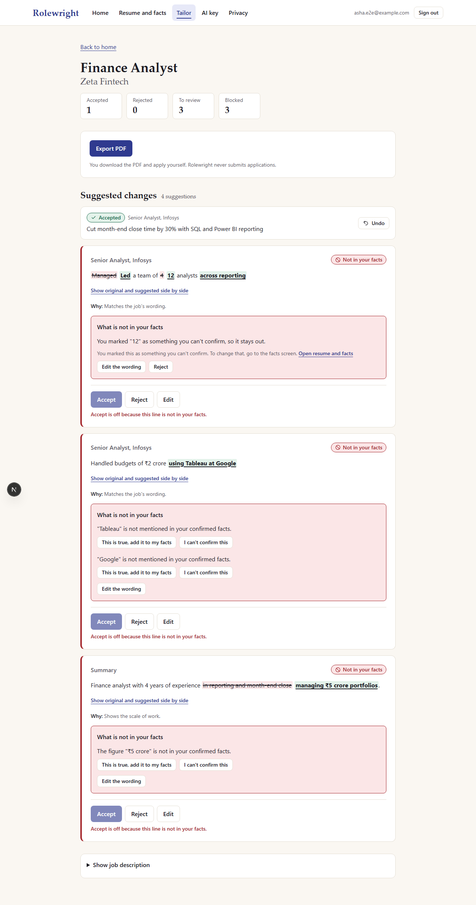
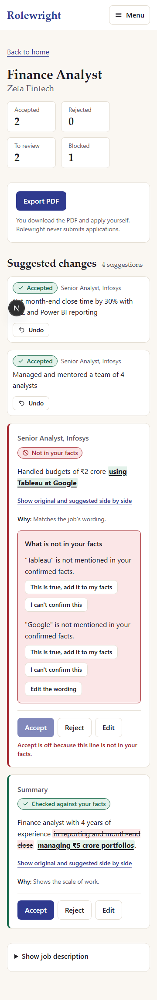

# Rolewright

Rolewright is a web app for job seekers in India. You upload your resume, confirm the facts in it, paste a job description, and review AI suggestions for rewording your resume to fit the job. A suggestion can only reach the exported PDF if every claim in it is in the facts you confirmed.

Based on the open-source career-ops project (MIT licence).

## Run it locally

Needs Node 22.13 or later. Dependencies for this app are in `apps/web/node_modules`; the PDF export also needs the engine package (`packages/engine`) with its own `node_modules` and Playwright's Chromium installed (`npx playwright install chromium` in that folder).

Two development flags turn on a sign-in that needs no email or Google account, and a fake AI provider that needs no key:

```bash
# bash
ROLEWRIGHT_DEV_LOGIN=1 ROLEWRIGHT_ALLOW_MOCK_LLM=1 npm run dev
```

```powershell
# PowerShell
$env:ROLEWRIGHT_DEV_LOGIN="1"; $env:ROLEWRIGHT_ALLOW_MOCK_LLM="1"; npm run dev
```

Open http://localhost:3100. With no `DATABASE_URL`, data is kept in an embedded database at `apps/web/.data/pglite`. To use the fake provider, choose provider `mock` with the key `mock-valid-key`. It deliberately invents figures, tools and employers so you can see the fact check stop them.

Both flags are refused on a **deployed host** and when `NODE_ENV` is `production`, and so is a missing `AUTH_SECRET`. A host counts as deployed when `ROLEWRIGHT_DEPLOYED=1` or when `K_SERVICE` is set to any non-empty value (Cloud Run and Knative set it), whatever `NODE_ENV` says; it is read from the process environment, never from a request. On a deployed host a missing `DATABASE_URL` is also refused, and the embedded database is never opened. The server checks this when it starts (`src/instrumentation.ts`): the error is logged naming every problem and every request answers 500. The first-use checks in the sign-in module and the API routes remain as a second layer. With `NODE_ENV=production` on a machine that is not deployed (the production smoke test), the embedded database is allowed but logs one warning naming its directory. The check is skipped while `next build` runs (Next sets `NEXT_PHASE=phase-production-build`), so building needs neither the secret nor any flag. The rule lives in `src/lib/server/env-guard.mjs`.

## Commands

| Command | What it does |
|---|---|
| `npm test` | Unit tests (`tests/**/*.test.mjs`), no server needed. |
| `npm run test:flow` | The whole flow over real HTTP: starts `next dev` on a free port (3111 if free) with the dev flags and a temporary database, signs in two users, uploads a PDF, tailors, reviews, exports, checks isolation, cross-site refusal and key hygiene, deletes an account. Prints PASS or FAIL per step. Set `FLOW_SHOW_SERVER_OUTPUT=1` to print what the server logged. It uses its own build folder (`.next-flow`) so it does not disturb a `next dev` already running. `tsconfig.json` already lists the type folders `next dev` adds for `.next`, `.next-flow` and `.next-e2e`, so a run leaves it unchanged; `next-env.d.ts` is rewritten for the last folder used and is not tracked. |
| `npm run test:prod` | Production-mode smoke test: `next build` into `.next-prod`, `next start` on port 3124 with `NODE_ENV=production` and no development flags, a session cookie minted with Auth.js's own `encode`, and a seeded database. Checks the database and row-level security, the engine fact gate (a stale stored pass is recomputed to a block), PDF export, isolation between users, cross-site refusal, the security headers with a per-request script nonce, the absence of the mock AI provider, and that the pages hydrate in Chromium with no Content Security Policy violation. |
| `npm run purge:inactive` | Deletes accounts idle for 12 months, with all their data, and prints the number deleted. Must be scheduled (see below). |
| `npm run typecheck` | TypeScript check of `src/`. |
| `npm run build` | Production build. |

## Environment variables

Read from the process environment only.

| Name | Meaning |
|---|---|
| `AUTH_SECRET` | Signs and encrypts session cookies. Required in production and on a deployed host: without it every route that needs a session answers 500 (see above). In development a fixed, development-only value is used when unset. Generate one with `openssl rand -base64 32`. |
| `AUTH_URL` | The public URL of the app, e.g. `https://rolewright.example`. Needed in production behind a proxy so sign-in links and callbacks use the right host (or set `AUTH_TRUST_HOST=true`). |
| `AUTH_GOOGLE_ID`, `AUTH_GOOGLE_SECRET` | Google sign-in. Offered only when both are set. Callback URL to register with Google: `<AUTH_URL>/api/auth/callback/google`. |
| `AUTH_RESEND_KEY`, `EMAIL_FROM` | Sign-in by email link, sent through Resend. Offered only when both are set. `EMAIL_FROM` must be on a domain verified in Resend. |
| `DATABASE_URL` | Postgres connection string. When unset, the embedded database is used, except on a deployed host, where the server refuses to start (see above). |
| `ROLEWRIGHT_DEPLOYED=1` | Marks this process as a deployed host. Only the exact value `1` counts. Turns on the same refusals as `NODE_ENV=production`, plus the `DATABASE_URL` requirement. |
| `K_SERVICE` | Set by Cloud Run and Knative. Any non-empty value marks a deployed host, the same as `ROLEWRIGHT_DEPLOYED=1`. |
| `ROLEWRIGHT_DATA_DIR` | Directory for the embedded database instead of `.data/pglite` (the flow test uses a temp directory). Ignored when `DATABASE_URL` is set. |
| `ROLEWRIGHT_DEV_LOGIN=1` | Development sign-in by email with no verification. Refused on a deployed host or when `NODE_ENV=production` (see above). |
| `ROLEWRIGHT_ALLOW_MOCK_LLM=1` | Enables the fake AI provider `mock`. Refused on a deployed host or when `NODE_ENV=production` (see above). |
| `CAREER_OPS_CODE_ROOT` | Path to the engine package. Default: `../../packages/engine` relative to the app's working directory. |
| `CAREER_OPS_ROOT`, `CAREER_OPS_DATA_DIR` | The engine's data folder. Leave unset: the server points the engine at a fresh, empty temp folder before loading it, so it never reads files from the checkout. All user data is in the database. |
| `PLAYWRIGHT_CHROMIUM_EXECUTABLE_PATH` | Optional. A Chromium binary to use for PDF export instead of Playwright's own download. |
| `BUILD_DIST` | Optional. A build folder other than `.next` (read by `next.config.mjs`). The flow test sets `.next-flow` so it can run beside another `next dev`. |
| `FLOW_SHOW_SERVER_OUTPUT=1` | Optional, for `npm run test:flow` only: print everything the server logged. |
| `ROLEWRIGHT_TEST_DATABASE_URL` | Optional, for `tests/db.test.mjs` only: run the database tests against a real Postgres server through the `pg` driver instead of the embedded database. Use the login the app would use (for example `postgres://rolewright_login:<password>@localhost:5432/postgres`). Every database the tests ask for is created fresh, owned by that login, and dropped at the end. |
| `ROLEWRIGHT_TEST_ADMIN_URL` | Optional, with the one above: an administrator connection used only to create and drop those test databases, so the app login needs no `CREATEDB`. Defaults to `ROLEWRIGHT_TEST_DATABASE_URL`. |

## How the server handles requests

- Every API route needs a signed-in session, checked against the `users` table on each request, so deleting an account ends its sessions at once. All user data is read and written through `withUser`, which applies row-level security in the database.
- A session cookie lasts 7 days from when it was last renewed. Auth.js renews it (a fresh 7 days) whenever `/api/auth/session` is read; API calls alone do not renew it. So 7 days is an idle timeout, not a cap on how long a session can live. **Signing out does not revoke a cookie that was copied before**: sessions are signed cookies, not database rows, so whoever holds a copied cookie can keep renewing it until the account is deleted or `AUTH_SECRET` is changed. Revocable sessions, or an absolute lifetime, are a later hardening item.
- Review actions and facts edits cannot overwrite each other. `PATCH /api/tailorings/[id]/suggestions/[sid]`, `PUT /api/facts` and `POST /api/resume` read, change and write in one transaction after locking the rows they change (`SELECT ... FOR UPDATE`, always the tailoring first and then the Fact Base, so two requests never wait on each other). A second request waits for the first and then works on its result.
- The "can't confirm" list only changes through review actions. `PUT /api/facts` ignores the `cannotConfirm` array in the facts it is sent and keeps the stored list, so a facts page opened earlier cannot undo a "can't confirm". To remove an entry, send it in `removeCannotConfirm: string[]` (matched without regard to case; unknown entries are ignored).
- Every `POST`, `PUT`, `PATCH` and `DELETE` is refused when its `Origin` header names a different host, or when the browser marks it as cross-site. JSON routes also require the JSON content type.
- Every API response carries `Cache-Control: no-store`.
- The user's AI key comes in the `x-llm-provider`, `x-llm-key` and `x-llm-model` headers on the AI routes only. It is used for that one request and is never stored, logged, returned, put in an error message or in a cookie.
- A failed request writes one log line: route, method, status, error code and user id. Bodies, resume text, job descriptions, prompts, AI output, email addresses, keys and error messages are never logged.
- Limits: JSON bodies 1 MB; uploads 5 MB (checked before the form is parsed), at most 30 pages, text capped at 60,000 characters; AI routes 20 requests per minute per user; uploads 10 per hour per user. **The rate limits are kept in memory per server process.** With more than one process they must move to a shared store (Redis or the database).
- The fact check fails closed: if the engine's fact gate cannot be loaded, creating, viewing, reviewing and exporting tailorings answer 503 instead of running with half the checks. Export recomputes every check from the current facts and never trusts a stored verdict.
- PDF export renders the plain resume template (`src/lib/resume-html.mjs`) with Playwright's Chromium directly, with JavaScript off and every network request blocked. One browser is shared across requests; nothing is written to disk.

## What production needs

- A Postgres database in an India region (for example AWS `ap-south-1` Mumbai), set up as in [Database roles](#database-roles) below. The schema is applied automatically on first connection.
- Chromium for PDF export: install the engine checkout's Playwright browser (`npx playwright install --with-deps chromium` on Linux), or point `PLAYWRIGHT_CHROMIUM_EXECUTABLE_PATH` at a Chromium binary.
- The engine checkout deployed alongside the app, with its dependencies installed, and `CAREER_OPS_CODE_ROOT` pointing at it if it is not the app's parent folder.
- `AUTH_SECRET` and `AUTH_URL`.
- A Google OAuth client (`AUTH_GOOGLE_ID`, `AUTH_GOOGLE_SECRET`) and a Resend key with a verified sending domain (`AUTH_RESEND_KEY`, `EMAIL_FROM`).
- A shared store for rate limits once there is more than one server process.

### Database roles

The app connects with an ordinary login (no superuser, no `CREATEROLE`, no `CREATEDB`, no `BYPASSRLS`) that owns the app's tables. Every user-data query switches from that login to the `rolewright_app` role, which can read and write only the user-data tables and only through the row-level-security policies. Row-level security is forced on the tables, so it applies to their owner as well; the login itself only touches the identity tables (`users`, `accounts`, `verification_tokens`).

Run this once as an administrator (on a managed database, its master user), with your own password:

```sql
-- The login the app connects as.
CREATE ROLE rolewright_login LOGIN PASSWORD 'replace-with-a-long-random-password'
  NOSUPERUSER NOCREATEDB NOCREATEROLE NOBYPASSRLS;

-- The role every user-data query switches to. Nobody logs in as it.
CREATE ROLE rolewright_app NOLOGIN NOSUPERUSER NOBYPASSRLS;

-- Lets the login run SET ROLE rolewright_app.
GRANT rolewright_app TO rolewright_login;

-- A database the login owns, so it can create the tables (and, on Postgres 15
-- and later, use the public schema, which belongs to the database owner).
CREATE DATABASE rolewright OWNER rolewright_login;
```

Then set `DATABASE_URL=postgres://rolewright_login:<password>@<host>:5432/rolewright`. If the database must stay owned by the administrator instead, replace the last statement with these two, run inside that database:

```sql
GRANT CONNECT ON DATABASE rolewright TO rolewright_login;
GRANT USAGE, CREATE ON SCHEMA public TO rolewright_login;
```

On Postgres 16 and later, an administrator that is not a true superuser (a managed database's master user usually is not) may have to run `GRANT rolewright_login TO <admin user>` before it can create a database owned by that login.

The schema (`src/lib/db/schema.mjs`, a JavaScript module holding the SQL, so no file is read at runtime) also tries `CREATE ROLE rolewright_app` and `GRANT rolewright_app TO current_user` itself; with the set-up above the first is skipped because the role exists, and the second fails quietly because the login is not allowed to grant roles, which is intended. Two practical consequences of forced row-level security: an operator connected as `rolewright_login` cannot read user-data tables directly (each query needs `SET ROLE rolewright_app` and `SET app.user_id` in a transaction, as `withUser` does), and maintenance that must see every row needs a superuser, or a role with `BYPASSRLS` that has been granted access to the tables.

This set-up has not yet been run against a real Postgres server (see below); `tests/db.test.mjs` is written to check exactly it.

### Deleting inactive accounts (schedule this)

The privacy screen tells people that an account with no sign-in for 12 months is deleted. The app does not do this by itself: run `npm run purge:inactive` (it calls `purgeInactiveUsers` in `src/lib/db/repo.mjs`) **once a day** from a scheduler such as cron, a Kubernetes CronJob or your host's job runner, with the same `DATABASE_URL` as the app. It deletes every user whose last sign-in (`last_seen_at`) is more than 12 calendar months before now, and everything they own (resumes, facts, jobs, tailorings, linked accounts) goes with them. It prints only the number deleted and never emails anyone. If it is not scheduled, the promise on the privacy screen is not kept.

## Screenshots

Taken by the browser test (`E2E_SCREENS_DIR=<folder> npm run test:e2e`).






## Not yet verified

- **Google sign-in and email-link sign-in have never been run.** They are wired (provider set-up, the database adapter, the verified-email rule for Google), but no credentials were available. Only the development sign-in was exercised.
- **The production build is smoke-tested with `npm run test:prod`** (database, engine fact gate, PDF export, isolation, headers, hydration). What it cannot cover is real sign-in (Google, email link) and real AI providers.
- **Real AI providers.** The flow test uses the mock provider only. Uploading and tailoring with Gemini, OpenAI, Anthropic, OpenRouter or Groq keys has not been tried end to end.
- **Postgres.** Everything ran on the embedded database. `tests/db.test.mjs` can run against a real server (`ROLEWRIGHT_TEST_DATABASE_URL`, `ROLEWRIGHT_TEST_ADMIN_URL`) and includes the checks that only mean something there: 20 interleaved `withUser` calls for two users on one pool, pooled connections coming back without the role or user id, two concurrent review actions both landing under the row locks, and a negative control showing an update is lost without them. That run has not happened yet (no Postgres server was available), so the `pg` driver path, the role set-up above, the row locks under real concurrency, and behaviour with several server processes are all unverified. On the embedded database every transaction runs alone, so the lock tests pass there without proving anything about Postgres.
- **Scanned PDFs, password-protected PDFs and very long resumes** are refused or capped by code paths that no test has exercised with a real file of that kind.
- **The production guards fail every request, not the process.** `src/instrumentation.ts` checks the environment at start-up, but Next 16 logs the failure ("Failed to prepare server") and keeps the process up and listening: run against `next start` with `K_SERVICE=x`, `AUTH_SECRET` set and no `DATABASE_URL`, `/sign-in` and `/api/auth/csrf` both answered 500. Under `next dev` the error is logged the same way and `/sign-in` returns no page, so no development form is shown. A health check that only pings a static page would not notice, so point it at a route that needs the app.
