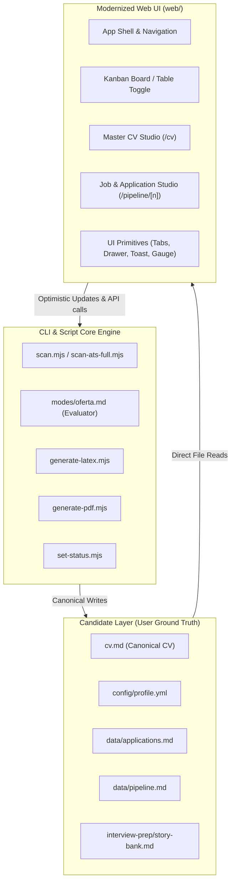

# Career-Ops Web UI & End-to-End System Blueprint

> **Notice:** This document specifies the technical architecture, UI/UX design specifications, component models, and phased implementation roadmap for the modernization of the `@career-ops/web` interface and the candidate pipeline system.

---

## 1. System Architecture & Data Flow

Career-ops operates under a strict **local-first data contract**. The Web UI (`web/`) is an interactive presentation and orchestration layer that reads directly from and writes to the local Markdown, YAML, and TSV files in the candidate layer.

---

## 2. Strategic Job Search Parameters

| Dimension | Specification | Source / Implementation |
| :--- | :--- | :--- |
| **Target Archetypes** | Engineering Leadership & Technical Product (Tech Lead, Staff+ Engineer, Engineering Manager, Technical PM) | `config/profile.yml` -> `target_roles` |
| **Location Policy** | Flexible: Hybrid in India hubs (Bengaluru, Hyderabad, Pune, Delhi NCR) + Global / Cross-border Remote | `config/profile.yml` -> `location` |
| **Scanner Portals** | Zero-token direct ATS APIs (Ashby, Greenhouse, Lever) for curated Tier-1 tech companies & startups | `portals.yml` |
| **Evaluation Cutoff** | Strict High-Signal Bar: Score $\ge 75$ (hard filters on visa, leadership level, red flags) | `modes/oferta.md` |
| **Tailored Formats** | Full Suite: Leadership HTML/PDF (`cv-template.leadership.html`), LaTeX `.tex`, ATS plain text, outreach emails | `templates/` & `generate-pdf.mjs` |
| **Interview Prep** | 5-7 Deep Pillar STAR+R stories (Architecture Trade-offs, Team Scaling, Crisis Turnaround, Stakeholders, Delivery) | `interview-prep/story-bank.md` |
| **Execution Flow** | Semi-automated: Scanners populate inbox (`data/pipeline.md`); user reviews and triggers on-demand evaluation | `web/src/app/pipeline/page.tsx` |

---

## 3. UI Component System & Primitives

All UI components adhere to the core design tokens: warm off-white (`#f7f6f3`) and dark surface (`#0a0a0a`/`#161616`) backgrounds, zinc typography, and burnt-orange accent tokens (`hsl(26 73% 51%)`).

### Primitive Registry (`web/src/components/ui/`)

1. **`tabs.tsx`**:
   - Compound component: `Tabs`, `TabsList`, `TabsTrigger`, `TabsContent`.
   - Used for Table/Board toggles, CV view modes, and Job Studio tabs.
2. **`drawer.tsx`**:
   - Accessible slide-over drawer with backdrop blur.
   - Enables reviewing job details, notes, and reports without losing Kanban board context.
3. **`toast.tsx`**:
   - React Context toast notification system (`useToast`).
   - Surfaces background worker completions, status updates, and copy confirmations.
4. **`score-gauge.tsx`**:
   - Circular and linear SVG score indicators for the 1.0–5.0 rating scale.
   - Semantic tone mapping (emerald $\ge 4.0$, amber $3.0-3.9$, rose $< 3.0$).
5. **`tooltip.tsx`**:
   - Lightweight accessible hover tooltips for ATS keyword badges and quick action controls.

---

## 4. Feature Specifications

### 4.1. Dual-View Pipeline & Interactive Kanban Board

* **Route**: `/pipeline`
* **Features**:
  * **View Mode Toggle**: Seamless switch between **Table View** and **Kanban Board** with preference preserved in local storage.
  * **Columns**:
    * `Inbox` (Unprocessed discovered postings)
    * `Lead` (Identified targets)
    * `Applied` (Submitted applications)
    * `Screening` (Recruiter / intro screen scheduled)
    * `Technical` (Technical rounds, system design, coding)
    * `Final` (Hiring Manager / Executive loop)
    * `Offer` (Active offer received)
    * `Rejected` / `Withdrawn` (Collapsible archive column)
  * **Interactivity**:
    * HTML5 Drag-and-Drop between stage columns.
    * 1-Click stage advance/retreat menu on each card (accessible for keyboard and touch devices).
    * Card click opens the slide-over **Job Quick Drawer**.
    * Optimistic UI update with atomic write back via `/api/applications`.

### 4.2. Master CV Studio (`/cv`)

* **Route**: `/cv`
* **Features**:
  * **Split-Screen Workspace**:
    * **Left Pane**: Monaco-style formatted Markdown editor with autosave indicators and section shortcuts.
    * **Right Pane**: Live formatted HTML/ATS preview with typography toggle and zoom controls.
  * **Readiness & Fact Audit**:
    * Word count and page height estimations.
    * Provenance indicator (verifying all numbers and metrics against ground-truth claims).
  * **Actions**: One-click PDF generation, version rollback, and raw copy.

### 4.3. Job Evaluation & Application Studio (`/pipeline/[n]`)

* **Route**: `/pipeline/[n]`
* **Features**:
  * **Split-Screen Workspace Toggle**:
    * **Left Pane**:
      * Header with company logo, title, and visual Score Gauge.
      * Block A Dealbreaker Check (Work Auth, Visa, Level).
      * Block B Role & CV Match Breakdown.
      * Block C Location & Compensation Signals.
      * Block D Technical Requirements & Keyword Gaps.
      * Ghost Job Forensics badge (`GhostJobBadge`).
    * **Right Pane**:
      * **Tab 1: Tailored CV**: Live preview of the tailored CV with customized bullet points.
      * **Tab 2: Outreach & Cover Letter**: Recruiter email draft, tailored cover letter, and "Negotiate Offer" integration.
      * **Tab 3: STAR+R Interview Pack**: Story mappings matched to this specific role.
  * **Quick Actions**: One-click copy for emails, download tailored PDF, and direct ATS application link.

### 4.4. 8-Agent Autonomous Enclave (`agents/*`)

* **Master Supervisor (`agents/supervisor.mjs`)**: Orchestrates end-to-end evaluation, tailoring, tracking, and interview preparation workflows.
* **Specialized Autonomous Agents**:
  1. `JobDiscoveryAgent`: Reverse-ATS radar traversing public ATS datasets.
  2. `AtsScoringAgent`: 5-dimension deterministic fit gate executing Blocks A-G.
  3. `ResumeOptimizationAgent`: AST fact-verifier ensuring zero-fabrication tailored CVs.
  4. `CoverLetterAgent`: Synthesizes 3-paragraph executive narrative grounded in proof points.
  5. `RecruiterResearchAgent`: Company health, panel profiles, and culture intelligence.
  6. `InterviewCoachAgent`: STAR story matching and interview briefing dossiers.
  7. `SalaryNegotiationAgent`: Compensation decompilation and collaborative counter-offer scripts.
  8. `ApplicationTrackingAgent`: Atomic ledger updates and SQLite index synchronization.
* **Blackboard Coordination**: File-backed event stream in `data/agent-events.jsonl`, queried via `/api/agents/events` and displayed on the dashboard via `AgentStatusHud`.

### 4.5. Offer Negotiation & Monte Carlo Simulator (`/negotiation`)

* **Route**: `/negotiation`
* **Features**:
  * **Compensation Decompilation**: 4-year vesting schedule, annual bonuses, signing incentives, and total target comp (TTC).
  * **Equity Exit Modeling**: Bear, Base, Bull, and IPO scenarios with dilution factors.
  * **3-Round Script Generator**: Collaborative counter-offer narratives, leverage points, and non-salary concession matrices.
  * **Pipeline Integration**: 1-click deep links from Kanban cards and Table rows when an application reaches `Offer` status (`/negotiation?company=...&role=...`).

### 4.6. Ghost Job Forensics (`GhostJobBadge`)

* **Component**: `web/src/components/jobs/ghost-job-badge.tsx`
* **Signals Tested**: Stale postings (>60 days), high repost frequency ($\ge 3$ reposts), layoff-active companies, and hiring velocity anomalies.
* **Surface**: Displayed on Kanban cards, Pipeline table rows, and Job Dossier headers.

---

## 5. Phased Implementation Roadmap

- [x] **Phase 1: Environment & Dependencies**
  - [x] Install `@career-ops/web` dependencies (`npm install`).
  - [x] Verify baseline typecheck (`npm run typecheck`).
- [x] **Phase 2: UI Primitives & Design System**
  - [x] `tabs.tsx`
  - [x] `drawer.tsx`
  - [x] `toast.tsx`
  - [x] `score-gauge.tsx`
  - [x] `tooltip.tsx`
- [x] **Phase 3: Interactive Kanban Board & Pipeline Toggle**
  - [x] Create `kanban-board.tsx` with drag-and-drop mechanics.
  - [x] Create `kanban-card.tsx` with score badge, logo, quick actions.
  - [x] Integrate view toggle into `pipeline-view.tsx`.
  - [x] Add slide-over job details drawer.
- [x] **Phase 4: Master CV Studio Upgrade (`/cv`)**
  - [x] Refactor `cv-editor.tsx` into an enhanced split-view layout.
  - [x] Add live metrics ribbon (word count, page fit, ATS readiness, impact claims).
  - [x] Add ATS Plain Text copy format and quick clipboard actions.
- [x] **Phase 5: Job & Application Studio Upgrade (`/pipeline/[n]`)**
  - [x] Create Studio Workspace mode for `/pipeline/[n]` in `report-view.tsx`.
  - [x] Connect tailored CV, outreach/cover letter, and STAR+R interview story tabs with copy/download actions.
- [x] **Phase 6: Quality Assurance & Launch**
  - [x] Run full typecheck (`npm run typecheck` - passed with 0 errors).
  - [x] Run Next.js production build (`npm run build` - compiled and bundled with 0 errors).

