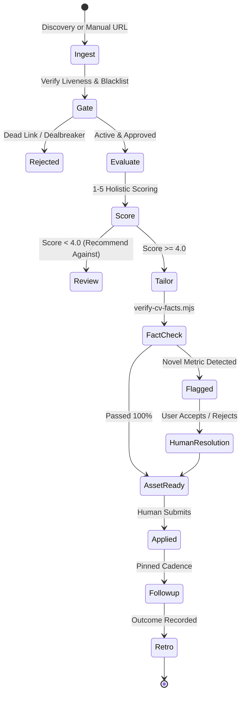

# Agent Workflows & Operational Loops — career-ops

## Purpose
Details the operational state machines, transition triggers, and agent decision loops.

## Scope
Covers discovery, triage, evaluation, tailoring, application preparation, and retrospective learning loops.

## Overview
Agents operate within a deterministic loop. Decisions are anchored by gates, ensuring that low-quality listings are rejected before incurring inference costs.

## Diagrams



## Technical Details

### Workflow Stages
1. **Intake & Triage**: Populates `data/pipeline.md`; classifies target archetypes.
2. **Pre-Flight Gating**: Evaluates hard rules (salary floors, remote policies, blacklist).
3. **Deep Evaluation**: Produces A–H structured report and holistic 1–5 score.
4. **Asset Tailoring**: Rewrites resume bullet points using candidate proof points; strictly validated by `verify-cv-facts.mjs`.
5. **Retrospective Loop**: When a candidate corrects an agent output, `modes/retro.md` extracts lasting procedural rules and saves them to `modes/_custom.md`.

## Best Practices
- Agents must never auto-submit applications on behalf of the user.

## Examples
```bash
# Run the retrospective learning workflow
/career-ops retro
```

## Future Enhancements
- Multi-agent debate: Two autonomous agent personas (Advocate vs. Skeptic) critiquing job fit.
