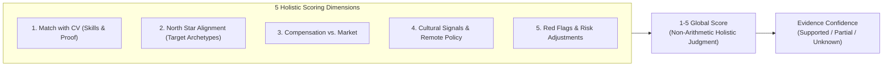

# Evaluation Framework & Scoring Rubric — career-ops

## Purpose
Formal specification of the 5-dimension holistic scoring methodology and evidence confidence grading.

## Scope
Governs `modes/_shared.md`, `modes/oferta.md`, and `eval-golden.mjs`.

## Overview
career-ops evaluates job opportunities using a holistic 1–5 rating system. Unlike naive SaaS tools that calculate arithmetic averages of keyword counts, career-ops evaluates structural career fit and evidence confidence.

## Diagrams

## Technical Details

### Scoring Rubric
- **4.5 - 5.0 (Strong Match)**: Outstanding technical and narrative alignment; top quartile compensation; recommend applying immediately.
- **4.0 - 4.4 (Good Match)**: Solid match; minor skill gaps that can be addressed in interview prep; recommend applying.
- **3.5 - 3.9 (Decent / Marginal)**: Significant misalignment or unconfirmed remote policy; recommend against applying unless specific reason exists.
- **Below 3.5 (Poor Match)**: Fundamental mismatch, predatory contract, or excessive red flags; do not apply.

### Evidence Confidence Grading
- **Supported**: Direct evidence exists in JD text and primary candidate files.
- **Partial**: Plausible inference made, but key details remain unverified.
- **Unknown**: Critical decision data is absent or contradictory.

## Best Practices
- Never let high technical fit compensate for a culture red flag: surface the warning clearly.

## Examples
- Golden evaluation benchmarking via `node eval-golden.mjs`.

## Future Enhancements
- Automated calibration against real-world interview callback rates.
