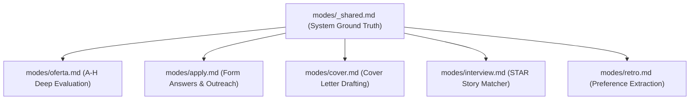

# Prompt Library & Template Specifications — career-ops

## Purpose
Catalog and reference guide for all standardized prompt files located in `modes/`.

## Scope
Covers system prompts, evaluation rubrics, resume tailoring, and interview prep modes.

## Overview
career-ops structures its intelligence through versioned, composable Markdown prompt files. Prompts enforce defensive behavior, anti-hallucination rules, and strict output formats.

## Diagrams



## Technical Details

### Reusable Core Templates

#### 1. Evaluation Prompt (`modes/oferta.md`)
- **Objective**: Evaluates an extracted JD against `cv.md` across 8 structured blocks.
- **Key Sections**:
  - `Block A`: Role summary, archetype match, culture screen, quota checks.
  - `Block B`: Requirements table with importance rating, candidate proof, and gap mitigation.
  - `Block C`: Level strategy (Staff/Lead calibration).
  - `Block D`: Compensation research vs. market quartiles.
  - `Block E`: Targeted CV personalization recommendations.
  - `Block F`: STAR+R interview story mappings.
  - `Block G`: Legitimacy screening (age, repost pattern, scam detection).
  - `Block H`: Application form answers (conditional on score $ge 4.5$).

#### 2. Anti-Hallucination Core (`modes/_shared.md`)
- **Key Constraints**:
  - *"Keywords get reformulated, never fabricated."*
  - *"Never claim the user authored a project unless explicitly attributed in cv.md."*
  - *"Silence on a topic beats manufactured detail."*

## Best Practices
- Never edit `modes/_shared.md` for user-specific data; personal overrides belong in `modes/_profile.md` and `modes/_custom.md`.

## Examples
```bash
# Run offer evaluation prompt interactively
/career-ops oferta https://jobs.ashbyhq.com/example/123
```

## Future Enhancements
- Automated prompt regression testing against a golden dataset of evaluated JDs.
