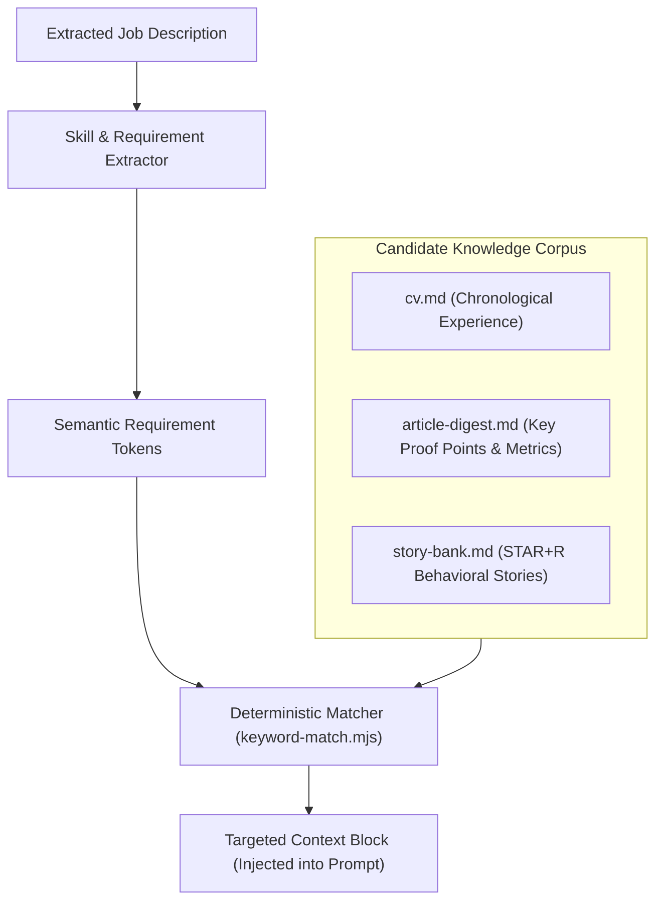

# Local Retrieval-Augmented Generation (RAG) Architecture — career-ops

## Purpose
Documents the zero-database local document retrieval and context injection architecture.

## Scope
Covers retrieval of `cv.md`, `article-digest.md`, `interview-prep/story-bank.md`, and past reports.

## Overview
career-ops implements a high-precision, local RAG pattern without the operational overhead of vector databases. By structuring candidate data into specialized semantic documents, exact proof points are injected deterministically into prompts.

## Diagrams



## Technical Details

### Document Chunking & Provenance
1. **Primary Proof Points (`article-digest.md`)**:
   - Short, high-impact quantified statements of technical accomplishments.
   - Takes precedence over `cv.md` for project-specific metrics.
2. **Behavioral STAR Stories (`story-bank.md`)**:
   - Structured according to Situation, Task, Action, Result, and Reflection.
   - Every quantified metric carries a strict provenance marker.

## Best Practices
- Maintain compact proof points; avoid injecting pages of raw text into prompt context.

## Examples
```bash
# Match candidate STAR stories to specific requirements
node match-star.mjs --role "Staff Backend Engineer"
```

## Future Enhancements
- Local BM25 + ONNX-based embedding hybrid search for larger multi-decade career histories.
