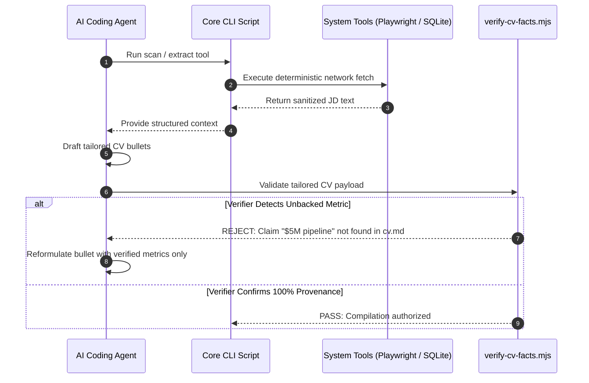

# Tool-Calling & Verification Architecture — career-ops

## Purpose
Specifies the hybrid tool-calling design, deterministic guardrails, and tool dispatch mechanics.

## Scope
Covers script tool invocations, browser extraction, and fact-checking gates.

## Overview
career-ops rejects unbounded LLM tool-calling loops. Instead, deterministic Node.js scripts handle network fetching, parsing, and verification, feeding structured data to the model and validating outputs.

## Diagrams



## Technical Details

### Deterministic Tool Guardrails
- **Bounded Research Budget**: Maximum 5 external WebSearch queries per evaluation to prevent runaway latency.
- **Strict Verification Gate (`verify-cv-facts.mjs`)**:
  - Validates that every tool name, company, and quantified figure in generated output exists in primary user files.
  - Throws an error and halts compilation if an unbacked assertion is detected.

## Best Practices
- Always place deterministic verifiers after stochastic LLM generation steps.

## Examples
```bash
# Self-test the CV fact verification engine
node verify-cv-facts.mjs --self-test
```

## Future Enhancements
- Sandboxed WebAssembly (Wasm) fact-checking runtime.
