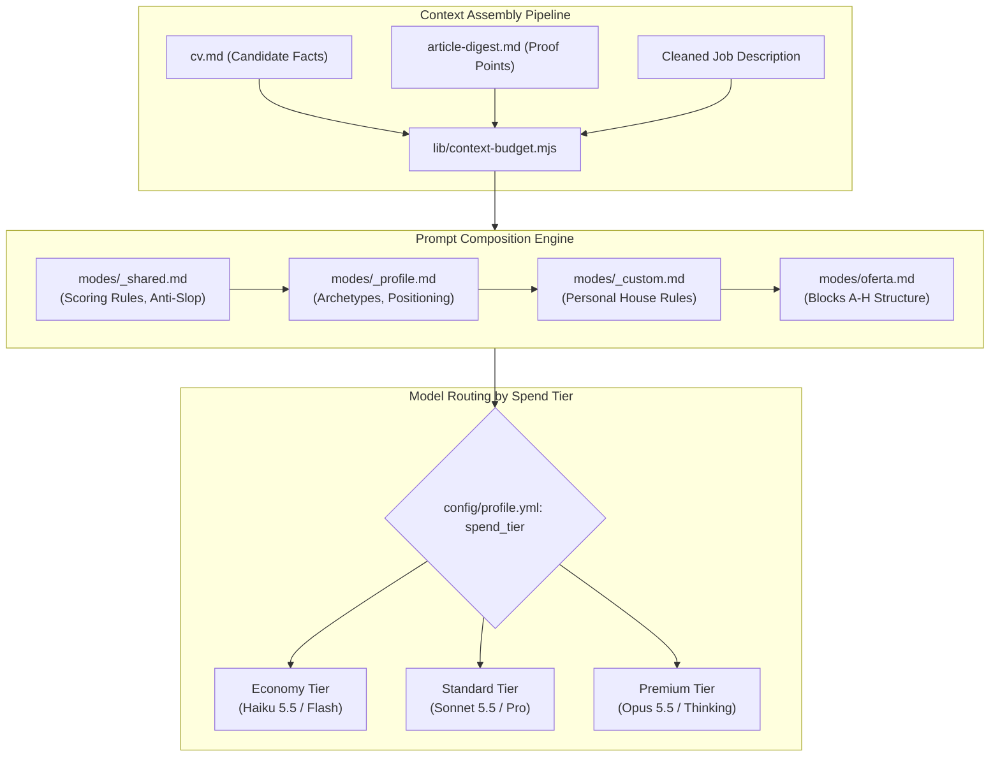

# AI Architecture — career-ops

## Purpose
Specifies the AI system architecture, prompt inheritance hierarchies, model routing by spend tier, and context budgeting mechanisms.

## Scope
Covers `modes/`, `lib/context-budget.mjs`, `lib/llm-outbound.mjs`, and model evaluators.

## Overview
career-ops rejects black-box LLM autonomy in favor of structured, deterministic AI reasoning. Prompts are organized in strict hierarchical markdown files, token usage is actively budgeted, and evaluations follow an immutable rubric rather than ad-hoc chat generation.

## Diagrams



## Technical Details

### Spend Tier Resolution
Configured in `config/profile.yml` under `spend_tier`:
- **Economy**: Fast, zero-token or low-cost evaluation (e.g., Claude Haiku, Gemini Flash, local Ollama).
- **Standard (Default)**: Balanced model (Claude Sonnet 5.5, GPT-4o).
- **Premium**: High-reasoning model with adaptive thinking (Claude Opus, Gemini Pro Extended Thinking).

### Context Budgeting & Token Management (`lib/context-budget.mjs`)
- Prevents context window overflows by trimming redundant job posting boilerplate (EEO statements, repetitive legal disclaimers).
- Injects candidate proof points dynamically based on semantic relevance to the target job description.

## Best Practices
- Never fabricate candidate metrics: "Keywords get reformulated, never fabricated."
- Strict adherence to the 5 scoring dimensions; avoid naive arithmetic averaging.

## Examples
```bash
# Run local Ollama evaluation with zero external API calls
npm run ollama:eval
```

## Future Enhancements
- Local small language model (SLM) embeddings for zero-token semantic proof point ranking.
