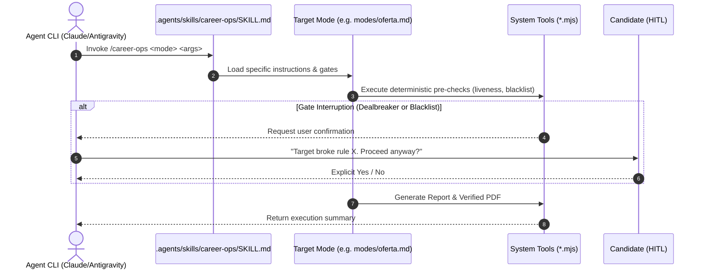

# Agent Architecture — career-ops

## Purpose
Defines the autonomous agent communication model, skill interface standard, and multi-CLI operational protocol.

## Scope
Covers `.agents/skills/career-ops/SKILL.md`, `AGENTS.md`, and subagent delegation workflows.

## Overview
career-ops follows the [open agent skill standard](https://agentskills.io). It exposes a unified skill router that allows coding agent CLIs (Claude Code, Antigravity, Cursor, Codex, OpenCode, Qwen, Grok) to invoke system capabilities deterministically.

## Diagrams



## Technical Details

### Unified Skill Router (`SKILL.md`)
- Maps human or agent intents to exact operational modes:
  - `scan`: Discovers listings across configured portals.
  - `oferta` / `job`: Full 8-block evaluation and fit scoring.
  - `apply`: Prepares tailored application answers and resumes.
  - `interview`: Matches STAR stories to JD requirements.
  - `retro`: Extracts house rules from candidate feedback.

### Multi-CLI Entry Wrappers
- `CLAUDE.md`, `CODEX.md`, `OPENCODE.md`: Lightweight shims routing into canonical `AGENTS.md`.
- `GEMINI.md`: Legacy no-op guard preventing duplicate prompt loading in Antigravity.

## Best Practices
- Headless and delegated workers must never write to `modes/_profile.md` or `modes/_custom.md`; persistent preference changes must be confirmed interactively in `retro` mode.

## Examples
```bash
# Headless one-shot agent execution
claude -p "Run career-ops oferta https://jobs.lever.co/company/job-id"
```

## Future Enhancements
- Multi-agent coordination with specialized subagents for company background research and salary verification.
