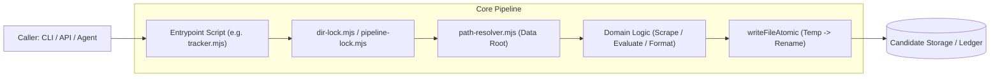

# Backend Architecture — career-ops

## Purpose
Details the execution model, service boundaries, process isolation, and CLI dispatching mechanics of the Node.js backend.

## Scope
Covers root-level `*.mjs` scripts, `lib/` utilities, and child-process workers.

## Overview
The backend operates as a decoupled collection of single-purpose ESM modules. Unlike traditional monolithic servers, career-ops executes scripts via on-demand CLI invocation, API endpoints, or headless batch workers, coordinating state through filesystem locks and append-only ledgers.

## Diagrams



## Technical Details

### Key Backend Subsystems
1. **Path Resolution Engine (`path-resolver.mjs`)**:
   - Dynamically resolves the User Layer root using environment variables (`CAREER_OPS_ROOT`), marker files (`.career-ops-data`), or falls back to repository root.
   - Refuses paths that resolve inside auto-updated plugin directories.
2. **Process Concurrency & Locks (`lib/dir-lock.mjs`)**:
   - Implements cross-platform advisory file locking with exponential backoff.
   - Prevents race conditions when multiple headless workers write to `applications.md` simultaneously.
3. **Atomic File I/O (`tracker-utils.mjs`)**:
   - Employs write-temp-then-rename semantics to ensure Markdown tables and TSV files are never left in a corrupted state if a process terminates abruptly.
4. **Child Process Execution (`lib/cli-launch.mjs`)**:
   - Manages spawning of AI coding CLIs (Claude, Grok, OpenCode) with sanitized environment variables and timeout supervision.

## Best Practices
- Never use `__dirname` directly; always resolve through `getCareerOpsRoot()`.
- Always handle process termination signals (`SIGINT`, `SIGTERM`) to clean up advisory lock files.

## Examples
```javascript
import { withPipelineLock } from './pipeline-lock.mjs';
import { writeFileAtomic } from './tracker-utils.mjs';

await withPipelineLock(async () => {
  writeFileAtomic(targetPath, updatedContent);
});
```

## Future Enhancements
- Shared worker daemon pool to eliminate Node.js process boot overhead.
