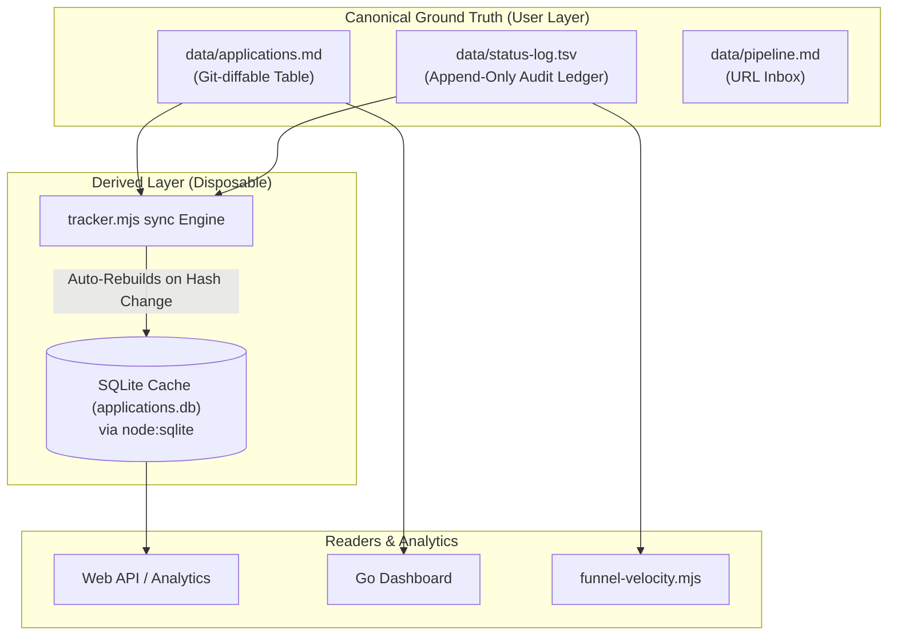

# Database & Storage Architecture — career-ops

## Purpose
Defines the dual-layer storage model: canonical human-readable flat files and the derived SQLite index.

## Scope
Covers `data/applications.md`, `data/status-log.tsv`, and the `data/applications.db` SQLite cache (RFC #918).

## Overview
In accordance with settled architecture doctrine (RFC #918), human-readable, git-diffable Markdown files are the **permanent ground truth**. Databases exist solely as derived read-caches that can be deleted at any moment without data loss.

## Diagrams



## Technical Details

### Canonical Files Schema
1. **Applications Table (`data/applications.md`)**:
   - Columns: `# | Date | Company | Role | Status | Score | PDF | Report | Notes | URL`
   - Valid statuses defined in `templates/states.yml` (e.g., Evaluated, Applied, Responded, Interview, Offer, Rejected, Discarded).
2. **Status Transition Ledger (`data/status-log.tsv`)**:
   - Columns: `{tracker_id}	{date}	{from_status}	{to_status}	{source}	{note}`
   - Guarantees complete auditability of application lifecycle stages.

### Derived SQLite Schema (`data/applications.db`)
```sql
CREATE TABLE IF NOT EXISTS applications (
  id INTEGER PRIMARY KEY,
  date TEXT NOT NULL,
  company TEXT NOT NULL,
  role TEXT NOT NULL,
  status TEXT NOT NULL,
  score REAL,
  pdf_path TEXT,
  report_path TEXT,
  notes TEXT,
  url TEXT,
  hash TEXT NOT NULL
);

CREATE TABLE IF NOT EXISTS status_events (
  id INTEGER PRIMARY KEY AUTOINCREMENT,
  app_id INTEGER NOT NULL,
  date TEXT NOT NULL,
  from_status TEXT NOT NULL,
  to_status TEXT NOT NULL,
  source TEXT NOT NULL,
  note TEXT,
  FOREIGN KEY (app_id) REFERENCES applications(id)
);
```

## Best Practices
- Never treat SQLite as authoritative. Writes must always target `applications.md` and `status-log.tsv`.
- Run `node tracker.mjs sync --check` to detect column drift or encoding corruption.

## Examples
```bash
# Query derived index with high-performance filter
node tracker.mjs query --status Interview --min-score 4.0 --json
```

## Future Enhancements
- Parquet export for local analytics and historical trend modeling.
