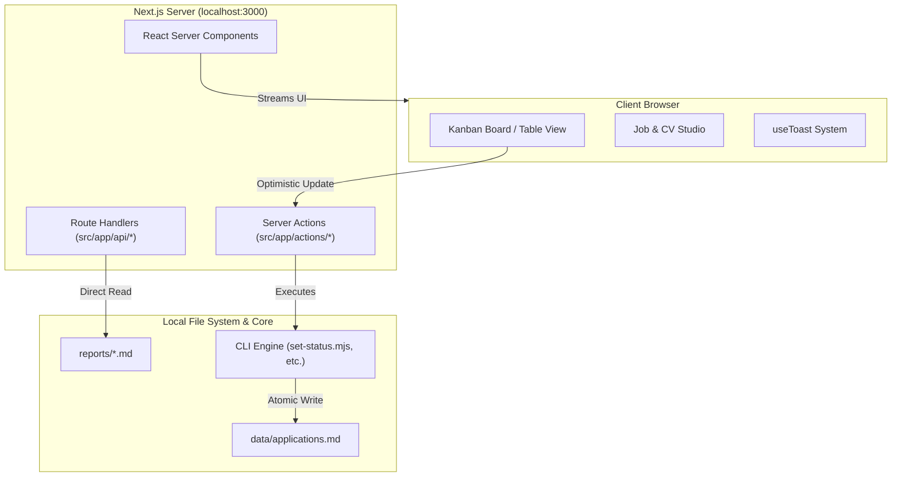

# Frontend Architecture — career-ops

## Purpose
Specifies the architecture, component hierarchy, rendering patterns, and data synchronization of the `@career-ops/web` application.

## Scope
Applies to `web/` (Next.js 16, React 19, Tailwind CSS v4, Lucide).

## Overview
The web interface is designed as an interactive, local-first presentation layer that operates directly on the local candidate workspace. It features zero client-side tracking, full SSR with React Server Components, and optimistic UI mutations for pipeline tracking.

## Diagrams



## Technical Details

### Tech Stack
- **Framework**: Next.js 16.4.1 (App Router).
- **Core Library**: React 19.2.5.
- **Styling**: Tailwind CSS v4.2.2 with custom design tokens.
- **Icons**: Lucide React.
- **PDF Rendering**: PDF.js for canvas-based in-browser preview.

### State & Data Synchronization
- **Server-Driven Revalidation**: Mutations invoke Next.js `revalidatePath` to refresh cached filesystem reads.
- **Optimistic UI Updates**: Kanban cards transition status immediately in the UI while the background API writes to `data/applications.md` via `set-status.mjs`.
- **Direct File System Access**: Server components directly import `fs` to stream Markdown and TSV data into React components without intermediate network serialization.

## Best Practices
- Keep client components at the leaves of the render tree.
- Ensure all API routes validate inputs and bind exclusively to IPv4 loopback (`127.0.0.1`).

## Examples
```typescript
// Server Action executing atomic status shift
export async function updateApplicationStatus(id: number, status: string) {
  'use server';
  await execAsync(`node set-status.mjs ${id} ${status}`);
  revalidatePath('/pipeline');
}
```

## Future Enhancements
- WebSockets / Server-Sent Events (SSE) for live streaming batch evaluation logs.
