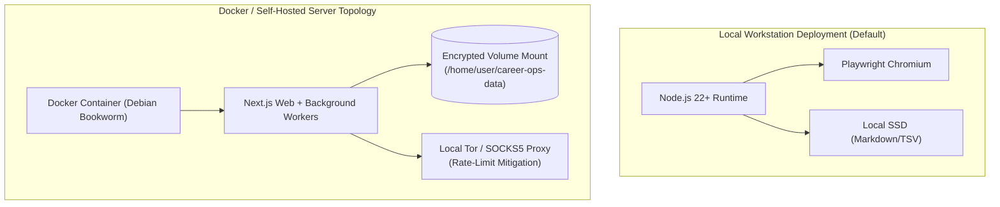

# Infrastructure Architecture — career-ops

## Purpose
Details the execution environments, deployment topologies, hardware constraints, and infrastructure scaling profiles for career-ops.

## Scope
Covers local developer environments, Docker containerization, and self-hosted server topologies.

## Overview
career-ops is engineered primarily for local workstation execution, with zero external infrastructure dependencies. For power users and teams, it can be containerized and run as a private headless service.

## Diagrams



## Technical Details

### Hardware & Runtime Requirements
- **Node.js**: `^22.13.0 || >=23.4.0` (requires built-in `node:sqlite` and strip-types support).
- **RAM**: Minimum 4GB (8GB+ recommended for parallel Playwright batch workers).
- **Storage**: < 500MB for core repository and dependencies; ~5MB per 100 evaluated job dossiers.
- **Operating Systems**: macOS (Apple Silicon / Intel), Linux (Ubuntu, Debian, Fedora, Arch, NixOS), Windows 10/11 (PowerShell & WSL2).

### Docker Infrastructure Spec
- Base image: `node:22-bookworm-slim`.
- System packages: `chromium`, `fonts-liberation`, `libnss3`.
- Non-root user: `node` (UID 1000).

## Best Practices
- When running in Docker, always mount the User Layer as an external volume to preserve data across container restarts.

## Examples
```bash
# Start local development server with specific memory ceiling
NODE_OPTIONS="--max-old-space-size=4096" npm run dev
```

## Future Enhancements
- Terraform definitions for single-click deployment to Fly.io or AWS Lightsail.
