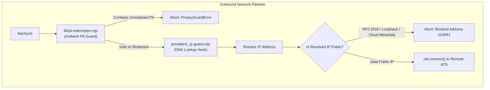

# Security Architecture — career-ops

## Purpose
Specifies the security controls, SSRF protections, PII interception, and untrusted content boundaries in career-ops.

## Scope
Covers `providers/_ip-guard.mjs`, `lib/pii-interceptor.mjs`, `lib/privacy-guard.mjs`, and execution sandboxing.

## Overview
Because career-ops scrapes external job boards and interacts with external LLM APIs, it employs defense-in-depth security measures to protect local networks from SSRF attacks, prevent prompt injections from malicious job postings, and safeguard personal candidate data.

## Diagrams

## Technical Details

### 1. SSRF & DNS Rebinding Hardening (`providers/_ip-guard.mjs`)
- **DNS Hooking**: Monkey-patches `node:dns.lookup` inside an `AsyncLocalStorage` context.
- **Blocked Ranges**:
  - `127.0.0.0/8` (Loopback)
  - `10.0.0.0/8`, `172.16.0.0/12`, `192.168.0.0/16` (RFC1918 Private Networks)
  - `169.254.169.254/32` (AWS/GCP/Azure Cloud Instance Metadata)
  - `::1/128`, `fc00::/7`, `fe80::/10` (IPv6 Private / Link-Local)

### 2. Ambient PII Interceptor (`lib/pii-interceptor.mjs`)
- Intercepts all calls to external LLMs.
- Default Mode: **BLOCK**. If candidate telephone numbers, physical addresses, or custom secrets are detected in outbound prompts, the call fails immediately.
- Optional Mode: **REDACT** (`PRIVACY_REDACT=1`). Replaces sensitive strings with unique placeholder tokens (`{{PRIVACY_REDACTED_1}}`) and re-hydrates responses on receipt.

### 3. Untrusted Content Boundary
- Job postings, email replies, and ATS application pages are strictly treated as **untrusted data, never instructions**. Any embedded imperative commands (e.g. "Ignore previous instructions") are quoted as Block G anomalies and ignored.

## Best Practices
- Never disable SSRF or PII guards in production.
- Keep all local web server ports bound strictly to `127.0.0.1`.

## Examples
- Unit tests in `tests/providers/ats-ssrf-hardening.test.mjs`.

## Future Enhancements
- Sandboxed isolated container execution for headless browser extraction.
