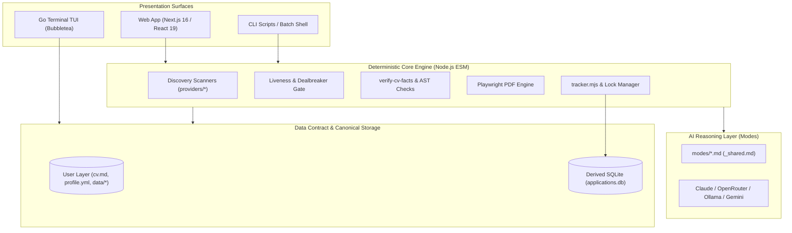

# System Architecture — career-ops

## Purpose
Documents the high-level architecture, subsystem boundaries, data contract separation, and operational topology of career-ops.

## Scope
Encompasses the CLI core, Go TUI dashboard, Next.js Web UI, discovery scrapers, and AI agent execution environments.

## Overview
career-ops is engineered around a **local-first, deterministic-gated architecture**. The local file system (Markdown, YAML, TSV) serves as the canonical source of truth, while fast indices (SQLite) and presentation surfaces (Next.js, Bubbletea) act as derived views. Generative AI is treated as an untrusted reasoning worker, bounded strictly by pre-flight validation gates and post-generation fact verifiers.

## Diagrams



## Technical Details

### Subsystem Decomposition
1. **Presentation Layer**:
   - `web/`: Next.js 16 with App Router, Server Actions, Tailwind CSS v4.
   - `dashboard/`: Standalone Go binary using Charm's Bubbletea framework.
   - Direct CLI: Node.js scripts executed directly or via AI coding CLI tools (Claude Code, Cursor, Antigravity, OpenCode).
2. **Deterministic Core Layer**:
   - Zero-token ATS scrapers (`providers/`).
   - Liveness and scam verification (`check-liveness.mjs`).
   - Fact verification engine (`verify-cv-facts.mjs`).
   - Concurrency locking (`lib/dir-lock.mjs`, `pipeline-lock.mjs`).
3. **Agent & Prompt Layer**:
   - Modular markdown prompts (`modes/`) specifying evaluation blocks A through H.
4. **Storage Layer**:
   - Permanent canonical files: `data/applications.md`, `data/status-log.tsv`.
   - Ephemeral index: `data/applications.db` (via `node:sqlite`).

## Best Practices
- Never bypass the Data Contract: system updates must never write to the User Layer.
- Always use `writeFileAtomic` to prevent corrupted states during concurrent access.

## Examples
```bash
# Run deterministic system sanity check
npm run verify
```

## Future Enhancements
- Transition to a formal monorepo structure with shared TypeScript definitions.
