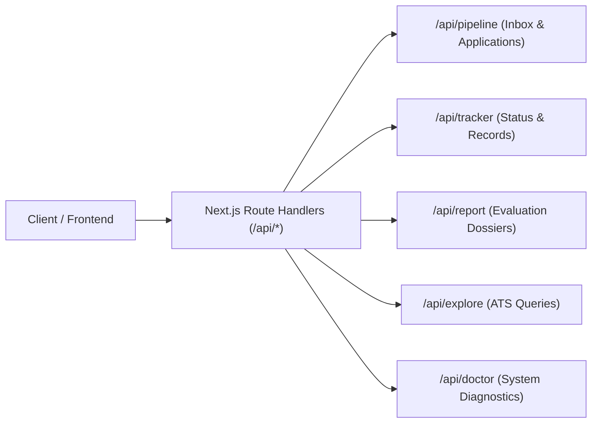

# API Reference — career-ops Web API

## Purpose
Exhaustive technical documentation of all HTTP REST endpoints exposed by `web/src/app/api/`.

## Scope
Covers endpoint URLs, supported methods, request/response structures, error responses, and authentication.

## Overview
All API routes bind to IPv4 loopback (`127.0.0.1:3000`). Endpoints orchestrate the core Node.js scripts or read directly from the candidate's User Layer files.

## Diagrams



## Technical Details

### Endpoints Catalog

#### 1. Pipeline & Tracker
- **`GET /api/pipeline`**
  - **Description**: Returns all items currently queued in `data/pipeline.md`.
  - **Response**: `{ success: true, items: [{ url: string, company: string, role: string, status: string }] }`
- **`POST /api/pipeline`**
  - **Description**: Appends a new job posting URL or text to the pipeline inbox.
  - **Request Body**: `{ url: string, notes?: string }`
  - **Response**: `{ success: true, message: "Listing added to pipeline" }`
- **`GET /api/tracker`**
  - **Description**: Fetches all applications from `data/applications.md` via SQLite index.
  - **Query Parameters**: `?status=Applied&min_score=4.0`
  - **Response**: `{ success: true, applications: Application[] }`
- **`POST /api/tracker`**
  - **Description**: Updates application status or adds notes via `set-status.mjs`.
  - **Request Body**: `{ id: number, status: string, note?: string }`
  - **Response**: `{ success: true }`

#### 2. Evaluation & Reports
- **`GET /api/report`**
  - **Description**: Reads a specific evaluation dossier markdown file.
  - **Query Parameters**: `?num=042`
  - **Response**: `{ success: true, content: string, metadata: object }`
- **`POST /api/run`**
  - **Description**: Dispatches a background evaluation job for a URL.
  - **Request Body**: `{ url: string, options?: { tier?: string } }`
  - **Response**: `{ success: true, jobId: string }`

#### 3. System & Health
- **`GET /api/doctor`**
  - **Description**: Runs system sanity checks (Node version, Playwright installation, profile validity).
  - **Response**: `{ success: true, checks: { node: boolean, playwright: boolean, profile: boolean } }`

## Best Practices
- Always return standard HTTP status codes (200 OK, 400 Bad Request, 500 Internal Error).
- Do not expose stack traces to client responses.

## Examples
```bash
# Test tracker endpoint via curl
curl http://127.0.0.1:3000/api/tracker
```

## Future Enhancements
- OpenAPI 3.1 schema generation and interactive Swagger UI.
