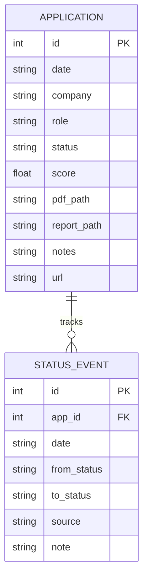

# Database & File Schema Specifications — career-ops

## Purpose
Formal specification of file layouts, column types, delimiter rules, and database schemas.

## Scope
Covers `applications.md`, `status-log.tsv`, `scan-history.tsv`, and `applications.db`.

## Overview
career-ops specifies rigorous structural definitions for its flat data files to ensure backward compatibility and reliable parsing across disparate programming languages.

## Diagrams



## Technical Details

### 1. Markdown Table Schema (`data/applications.md`)
- **Header**: `| # | Date | Company | Role | Score | Status | PDF | Report | Notes |`. Optional trailing columns `url`, `via` and `location` are added by `merge-tracker.mjs` when used; `merge-tracker.mjs --migrate-urls` and `--backfill-urls` handle the URL column.
- **Rules**:
  - `#`: integer tracker number (not the report number; see `reserve-report-num.mjs`).
  - `Date`: ISO 8601 YYYY-MM-DD.
  - `Score`: `X.X/5`, or a sentinel `N/A`, `—` or `-` for rows with no evaluation.
  - `Status`: one canonical value from `templates/states.yml`, with no bold, no dates and no extra text.
  - Do not write a literal `|` inside a cell; use ` / ` instead.
  - Rows are written by `merge-tracker.mjs` from `batch/tracker-additions/*.tsv`, and status changes go through `set-status.mjs`.

### 2. Append-Only Transition Ledger (`data/status-log.tsv`)
- **Columns**: `tracker#\tdate\tfrom\tto\tsource\tnote`. An unknown from- or to-state is the sentinel `-`.
- **Source Values**: the closed set `VALID_SOURCES` in `funnel-velocity.mjs`: `set-status`, `web`, `correction`, `backfill`, `manual`, `reply-watch`, `dedup-tracker`, `close-stale`. Any other value is parsed but excluded from the funnel. Per-writer detail belongs in the note column.
- The ledger is append-only. Corrections are new `correction` lines, never edits.

### 3. Deduplication History (`data/scan-history.tsv`)
- **Columns** (in order, from `SCAN_HISTORY_COLUMNS` in `lib/scan-history-columns.mjs`): `url`, `first_seen`, `portal`, `title`, `company`, `status`, `location`, `fingerprint`, `posted_at`, `trust_score`, `trust_flags`, `normalized_company`, `requisition_id`, `language`, `listing_key`. The columns are append-only, so older rows may be shorter. The per-column meaning is in the Scan History table of `modes/scan.md`.
- **Statuses** (default `added`, set by `formatScanHistoryRow` in `scan.mjs`): `added`, `skipped_title`, `skipped_location`, `skipped_age`, `skipped_no_apply_control`, `skipped_content`, `skipped_visa`, `skipped_country_eligibility`, `skipped_experience`, `skipped_expired`, `skipped_invalid_url`, `skipped_blocked_host`, and `cooldown:{company}:{until}`. Rows with the `skipped_*` statuses listed in `modes/scan.md` never count as seen, so those postings come back on a later scan.

## Best Practices
- Never reorder or omit columns in canonical TSV files.

## Examples
```tsv
# data/status-log.tsv line
42	2026-11-04	Evaluated	Applied	set-status	Applied via referral
```

## Future Enhancements
- Automated schema migration scripts versioned alongside code releases.
