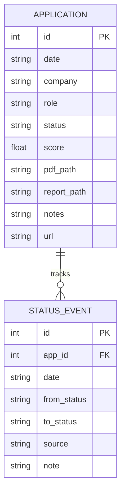

# Database & File Schema Specifications — career-ops

## Purpose
Formal specification of file layouts, column types, delimiter rules, and database schemas.

## Scope
Covers `applications.md`, `status-log.tsv`, `scan-history.tsv`, and `applications.db`.

## Overview
career-ops specifies rigorous structural definitions for its flat data files to ensure backward compatibility and reliable parsing across disparate programming languages.

## Diagrams



## Technical Details

### 1. Markdown Table Schema (`data/applications.md`)
- **Row Format**: `| {id} | {date} | {company} | {role} | {status} | {score} | {pdf} | {report} | {notes} | {url} |`
- **Rules**:
  - `id`: 1-based sequential integer.
  - `date`: ISO 8601 YYYY-MM-DD.
  - `status`: Valid string from `templates/states.yml`.
  - `score`: Floating point 1.0–5.0 or `N/A`.
  - Pipe characters (`|`) inside notes or titles must be escaped as `\|`.

### 2. Append-Only Transition Ledger (`data/status-log.tsv`)
- **Columns**: `tracker_id\tdate\tfrom\tto\tsource\tnote`
- **Source Values**: `manual`, `cli`, `web`, `batch`, `sync`.

### 3. Deduplication History (`data/scan-history.tsv`)
- **Columns**: `url\tdate\tcompany\trole\tstatus`
- **Statuses**: `evaluated`, `skipped_title`, `skipped_location`, `skipped_expired`.

## Best Practices
- Never reorder or omit columns in canonical TSV files.

## Examples
```tsv
42	2026-11-04	Stripe	Staff Engineer	Applied	4.8	[PDF](...)	[Report](...)	Applied via referral	https://stripe.com/jobs/123
```

## Future Enhancements
- Automated schema migration scripts versioned alongside code releases.
