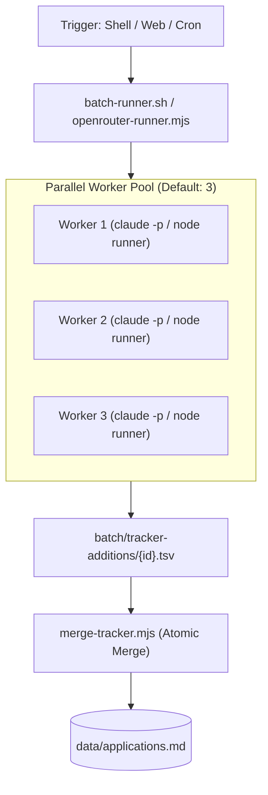

# Service Architecture — career-ops

## Purpose
Details the internal service topology, command dispatching, batch execution model, and background workers.

## Scope
Covers root execution scripts, `openrouter-runner.mjs`, and `batch/batch-runner.sh`.

## Overview
career-ops executes as an on-demand process engine rather than a daemon service. Tasks are dispatched as isolated Node.js child processes or headless AI CLI instances, coordinating execution through state ledgers.

## Diagrams



## Technical Details

### Batch Execution Pipeline (`batch/batch-runner.sh`)
1. **Queue Definition**: Reads pending target URLs from `batch/batch-input.tsv`.
2. **State & Resume**: Tracks completion status in `batch/batch-state.tsv` so interrupted runs resume cleanly.
3. **Worker Spawning**: Runs up to `--parallel` workers simultaneously.
4. **Isolated Output**: Each worker writes an independent TSV snippet to `batch/tracker-additions/{id}.tsv`.
5. **Reconciliation**: `merge-tracker.mjs` locks the primary tracker and merges all completed rows atomically.

## Best Practices
- Never allow child workers to write directly to `data/applications.md` concurrently; always use the addition spool directory.

## Examples
```bash
# Run parallel batch worker on 10 offers
./batch/batch-runner.sh --parallel 3 --max-retries 2
```

## Future Enhancements
- Node.js native worker threads replacing shell script batch runners.
