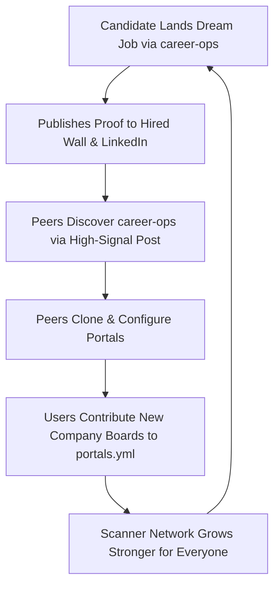

# Viral Growth Loops & Flywheel — career-ops

## Purpose
Defines the product-led growth (PLG) mechanics, viral referral loops, and user acquisition flywheels.

## Scope
Covers candidate sharing, social proof artifacts, and developer community virality.

## Overview
career-ops grows through high-signal word of mouth: candidates who land life-changing roles naturally evangelize the tool to peers.

## Diagrams

## Technical Details

### Viral Mechanisms
1. **The Ghost Job Exposer**:
   - Candidates generate a redacted, shareable infographic exposing phantom postings:
     > *"Why this job posting scored 1.5/5 on the Ghost Index. Verified by career-ops."*
   - Generates massive engagement across LinkedIn and tech Twitter.
2. **"Hired Wall" Social Proof**:
   - Candidates submit anonymous offer metrics to `docs/hired-wall.svg`, celebrating successful negotiations.
3. **Open-Source ATS Database Network Effects**:
   - Every contributor adding a company career board expands the scraper coverage for the entire community.

## Best Practices
- Ensure all public sharing mechanisms default to redacting candidate PII.

## Examples
- Santiago's original announcement post generating hundreds of GitHub stars organically.

## Future Enhancements
- Interactive web badges ("Prepared with career-ops") embedded in candidate personal portfolio sites.
