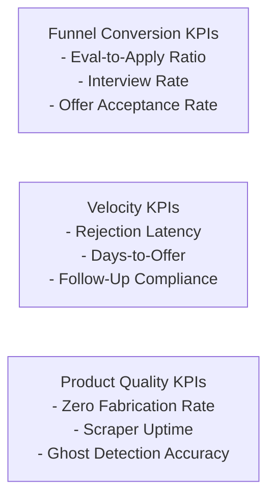

# Key Performance Indicator (KPI) Framework — career-ops

## Purpose
Establishes the quantitative metrics for measuring product effectiveness, candidate success, and engineering health.

## Scope
Applies to pipeline analytics, funnel calibration, and community health.

## Overview
Success for career-ops is measured not by hours spent in the app, but by how quickly a candidate lands an exceptional job offer with the fewest wasted applications.

## Diagrams



## Technical Details

### Core Candidate Success Metrics
- **Interview Conversion Rate**: Percentage of submitted applications that advance to a first-round interview (Benchmark: $ge 15%$, vs. industry average of $2-3%$).
- **Application Efficiency (Eval-to-Apply Ratio)**: Percentage of evaluated listings that clear the 4.0 threshold (Target: $10-15%$).
- **Rejection Latency**: Number of days between application submission and recruiter response.
- **Comp Delta**: Percentage increase between initial recruiter offer and final negotiated compensation package.

### Engineering & Community KPIs
- **Provider Coverage**: Number of supported ATS platforms and public job boards (Target: > 75).
- **Zero-Fabrication Integrity**: 100% pass rate in `verify-cv-facts.mjs` fact-checking audits.
- **CI Build Duration**: Kept below 8 minutes.

## Best Practices
- Run `node stats.mjs` regularly to track your personal pipeline conversion velocity.

## Examples
```bash
# Calculate personal funnel conversion metrics
node stats.mjs --summary
```

## Future Enhancements
- Aggregate, privacy-preserving anonymized benchmark reporting comparing candidate conversion rates against global market averages.
