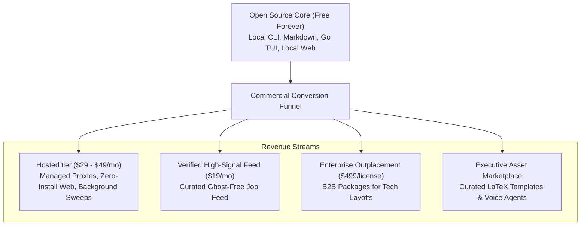

# Monetization Strategy & Business Models — career-ops

## Purpose
Establishes the commercialization roadmap, monetization pillars, and business viability for career-ops.

## Scope
Covers open-core SaaS, verified job feeds, executive template marketplaces, and B2B outplacement.

## Overview
While the core of career-ops remains 100% open-source and local-first, substantial commercial opportunity exists in eliminating infrastructure friction (Playwright binaries, proxy rotation) and providing institutional talent solutions.

## Diagrams

## Technical Details

### Commercial Pillars
1. **Hosted tier (managed SaaS)**:
   - Targets non-technical candidates or professionals on locked-down corporate laptops.
   - Provides a hosted web container with residential IP rotation, pre-installed Playwright browsers, and encrypted sync.
2. **Verified High-Signal Job Feed**:
   - A proprietary feed filtered by the Block G legitimacy engine that guarantees zero ghost postings, active recruiter responsiveness, and transparent salary disclosures.
3. **B2B Outplacement Platform**:
   - Sold to tech companies conducting layoffs. Instead of traditional, outdated outplacement agencies (Lee Hecht Harrison), tech firms gift departing engineers 6 months of CareerOps Pro.

## Best Practices
- Never cripple the open-source core: all local features must remain 100% free and open-source.

## Examples
- Open-core monetization modeled after successful developer platforms like Supabase, Tailscale, and PostHog.

## Future Enhancements
- Reverse recruiter marketplace where vetted candidates sell access to their verified dossiers.
