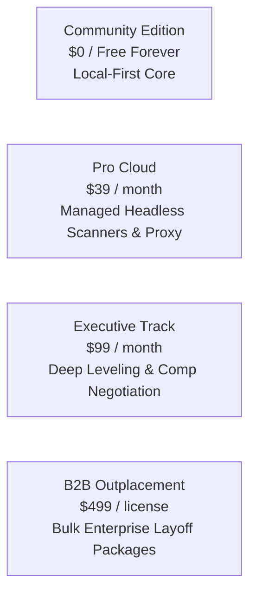

# Pricing Strategy & Tier Matrix — career-ops

## Purpose
Specifies the pricing tiers, packaging, feature entitlement matrix, and revenue projections.

## Scope
Applies to commercial hosted offerings and enterprise licensing.

## Overview
A value-based pricing strategy aligning candidate willingness-to-pay with career transition stakes.

## Diagrams

## Technical Details

### Tier Matrix

| Dimension | Community (OSS) | Pro Cloud | Executive Track | Enterprise B2B |
| :--- | :---: | :---: | :---: | :---: |
| **Price** | **$0** | **$39 / mo** | **$99 / mo** | **$499 / seat** |
| **Deployment** | Local Machine | Managed Cloud | Managed Cloud | Managed Cloud |
| **ATS Portals** | 60+ (Local IP) | 60+ (Proxy Pool) | 60+ (Proxy Pool) | Unlimited |
| **AI Model Access** | Bring Your Own Key | Included (Sonnet) | Included (Opus/Thinking) | Included |
| **Autofill Extension**| Open Source | Cloud Sync | Cloud Sync | Managed Enterprise |
| **Negotiation Scripts**| Standard | Advanced | 1-on-1 AI Coach | Cohort Analytics |

## Best Practices
- Offer a frictionless 14-day trial for Pro Cloud without requiring credit cards upfront.

## Examples
- High-intent candidates willingly invest $39–$99/month during active job searches when target salaries exceed $150k+.

## Future Enhancements
- Performance-based pricing (pay on placement) for specialized executive search tracks.
