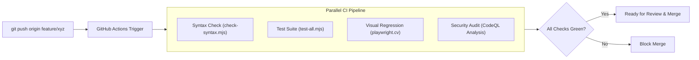

# Continuous Integration & Delivery (CI/CD) — career-ops

## Purpose
Documents the automated GitHub Actions pipelines, security scanning workflows, and pull request validation rules.

## Scope
Applies to `.github/workflows/` and automated release pipelines.

## Overview
Every pull request is subjected to rigorous automated verification: syntax linting across all 1,900+ files, unit test execution, CodeQL security scanning, CodeRabbit AI reviews, and Dependabot dependency auditing.

## Diagrams



## Technical Details

### GitHub Workflows
- **`.github/workflows/test.yml`**:
  - Matrix testing on Node 22.x and 23.x across Ubuntu and Windows runners.
  - Executes `scripts/check-syntax.mjs` and `test-all.mjs`.
- **`.github/workflows/codeql.yml`**:
  - Scans for SSRF vulnerabilities, unsafe shell executions, and path traversals.
- **`.github/workflows/cv-visual.yml`**:
  - Executes Playwright visual snapshot regression tests on generated PDFs.

## Best Practices
- Keep CI execution time under 8 minutes to maintain rapid contributor velocity.

## Examples
```bash
# Local pre-push verification matching CI
npm run lint && node test-all.mjs --quick
```

## Future Enhancements
- Automated release tag creation upon merging semver-labeled PRs.
