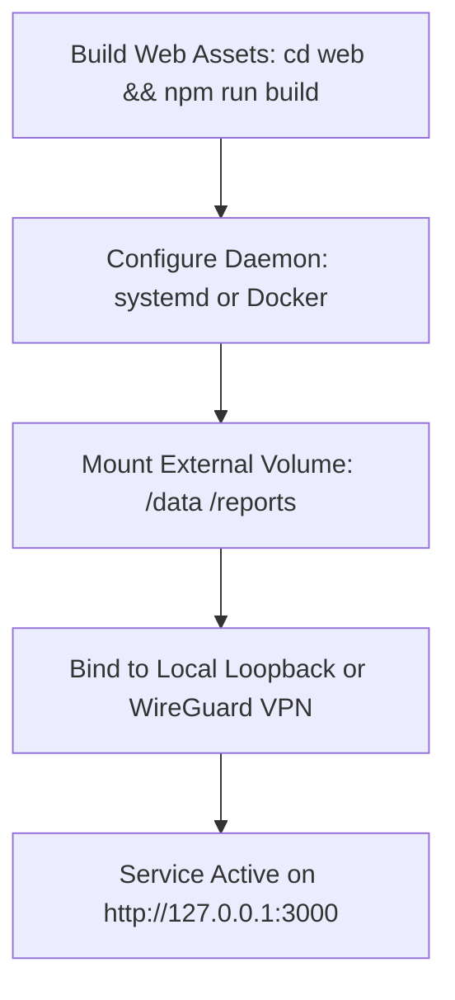

# Deployment & Operations Guide — career-ops

## Purpose
Provides instructions for deploying career-ops on workstations, self-hosted Linux servers, or Docker containers.

## Scope
Covers local production builds, systemd service units, and Docker deployment topologies.

## Overview
While career-ops is primarily a local CLI tool, power users often run it as a 24/7 background service on a home server or private cloud instance to execute scheduled scans and host the local Web UI.

## Diagrams



## Technical Details

### Production Build & Serve
```bash
# 1. Build Next.js Web UI
cd web
npm ci
npm run build

# 2. Serve production bundle on loopback
npm start
```

### Dockerfile Specification
The repository `Dockerfile` builds a development image, not a production web image:

- Base: `mcr.microsoft.com/playwright:v1.64.1-jammy`, which ships Chromium. Playwright is pinned to 1.64.1 to match it, and `PLAYWRIGHT_SKIP_BROWSER_DOWNLOAD=1` is set.
- Adds tini as the entrypoint, the Go toolchain (for `dashboard/`), and LaTeX packages. Runs as `pwuser`.
- Runs `npm ci` in a layer. The project itself is meant to be bind-mounted at `/app`, so the image has no `CMD` for the web UI and does not `EXPOSE` a port. Its default command is `bash`.
- `docker-compose.yml` mounts the project into `/app` and keeps `tail -f /dev/null` running so you can `docker compose exec` into it. It publishes no ports.

## Best Practices
- Never expose the web server port directly to the public internet without an authenticated WireGuard VPN or HTTPS reverse proxy. The dashboard has no login (see `Authentication.md`).
- The web server binds to `127.0.0.1` by default, which is unreachable through a Docker published port. Binding `0.0.0.0` inside the container is required for `-p` to work, and that widens exposure, so publish the port on the host's loopback interface only.

## Examples
```bash
# Build the image from the repository root
docker build -t career-ops:local .

# Run the dashboard in the container. -H 0.0.0.0 is needed so the published port
# reaches it; publishing on 127.0.0.1 keeps it reachable from this machine only.
# Requests arrive with Host: localhost:3000, which the origin guard accepts.
docker run --rm -p 127.0.0.1:3000:3000 \
  -v "$PWD":/app -w /app/web \
  career-ops:local sh -c 'npm ci && npm run dev -- -H 0.0.0.0'
```

To reach the dashboard from another machine, add that host to `CAREER_OPS_WEB_ALLOWED_HOSTS` (`-e CAREER_OPS_WEB_ALLOWED_HOSTS=<host-ip>`), publish on all interfaces, and put an authenticating reverse proxy in front.

## Future Enhancements
- Pre-built multi-arch Docker images published to GitHub Container Registry (GHCR).
