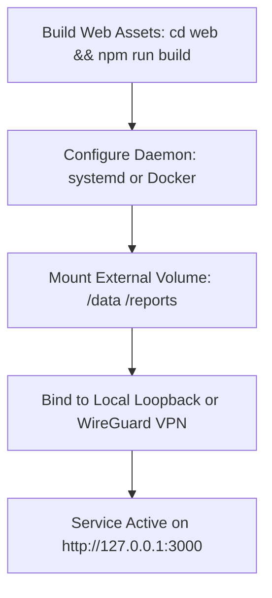

# Deployment & Operations Guide — career-ops

## Purpose
Provides instructions for deploying career-ops on workstations, self-hosted Linux servers, or Docker containers.

## Scope
Covers local production builds, systemd service units, and Docker deployment topologies.

## Overview
While career-ops is primarily a local CLI tool, power users often run it as a 24/7 background service on a home server or private cloud instance to execute scheduled scans and host the local Web UI.

## Diagrams



## Technical Details

### Production Build & Serve
```bash
# 1. Build Next.js Web UI
cd web
npm ci
npm run build

# 2. Serve production bundle on loopback
npm start
```

### Dockerfile Specification
```dockerfile
FROM node:22-bookworm-slim

WORKDIR /app

# Install system dependencies for Playwright Chromium
RUN apt-get update && apt-get install -y \
    chromium \
    fonts-liberation \
    libnss3 \
    && rm -rf /var/lib/apt/lists/*

ENV PLAYWRIGHT_SKIP_BROWSER_DOWNLOAD=1 \
    PUPPETEER_EXECUTABLE_PATH=/usr/bin/chromium

COPY package*.json ./
RUN npm ci

COPY . .

EXPOSE 3000
CMD ["node", "web/server.mjs", "start"]
```

## Best Practices
- Never expose the web server port directly to the public internet without an authenticated WireGuard VPN or HTTPS reverse proxy.

## Examples
```bash
# Run container with external data volume
docker run -d -p 3000:3000 -v ~/my-career-data:/app/data career-ops:latest
```

## Future Enhancements
- Pre-built multi-arch Docker images published to GitHub Container Registry (GHCR).
