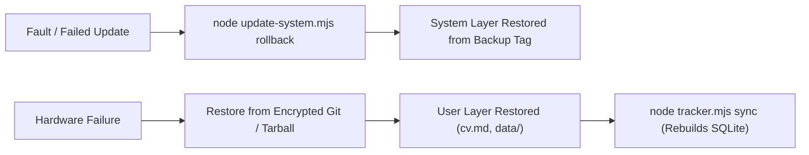

# Disaster Recovery & Backup Strategies — career-ops

## Purpose
Establishes backup procedures, data restoration protocols, and rollback mechanisms.

## Scope
Covers the User Layer (`data/`, `cv.md`, `config/`, `reports/`) and `update-system.mjs rollback`.

## Overview
A candidate's job search dossier represents months of intellectual effort. career-ops ensures that all state is stored in plain, git-friendly files that can be backed up or restored with standard tools.

## Diagrams



## Technical Details

### 1. Self-Update Rollback (`update-system.mjs rollback`)
- Automatically takes a git snapshot prior to executing any system upgrade.
- If an upgrade introduces a regression, running `node update-system.mjs rollback` restores the previous stable release cleanly.

### 2. User Layer Backup Procedure
- All candidate data lives strictly in the User Layer:
  - `cv.md`, `article-digest.md`
  - `config/profile.yml`, `config/cv-facts.json`
  - `data/applications.md`, `data/status-log.tsv`
  - `reports/`, `output/`, `interview-prep/`
- Backing up this directory tree ensures complete recovery.

## Best Practices
- Maintain a private, encrypted git repository for your User Layer files.
- Never store backups in public cloud storage without client-side encryption.

## Examples
```bash
# Roll back to previous version
npm run rollback
```

## Future Enhancements
- Automated client-side encrypted backup snapshots to private S3/GCS buckets.
