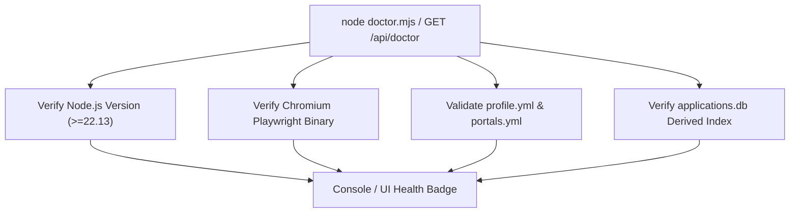

# System Health & Monitoring — career-ops

## Purpose
Details health monitoring, system diagnostics, error telemetry, and logging standards.

## Scope
Covers `doctor.mjs`, `/api/doctor`, and `data/scan-runs.tsv`.

## Overview
Because career-ops is local-first, it rejects invasive cloud telemetry. System health and run metrics are recorded locally in structured TSV logs for easy inspection by the candidate.

## Diagrams



## Technical Details

### Diagnostic Capabilities (`doctor.mjs`)
- Asserts Node.js runtime compatibility.
- Confirms Playwright Chromium binary presence.
- Verifies integrity of candidate configuration files.
- Probes network reachability of `portals.yml` entries only with `--strict` (`node doctor.mjs --strict`). A default run makes no network requests.

### Local Run Metrics (`data/scan-runs.tsv`)
- Records timestamp, provider, listings harvested, listings skipped, and execution duration for every scan sweep.

## Best Practices
- Run `npm run doctor` immediately after updating career-ops to detect missing system dependencies.

## Examples
```bash
# Execute local doctor diagnostics
npm run doctor
```

## Future Enhancements
- OpenTelemetry exporter for power users with Prometheus/Grafana home servers.
