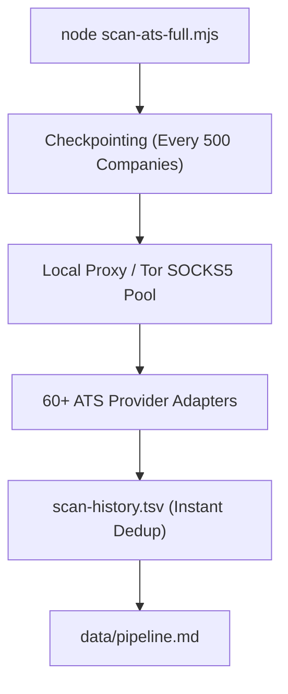

# Scaling Architecture & High Throughput — career-ops

## Purpose
Guides users on scaling scan volumes, running parallel batch workers, and mitigating ATS rate limits.

## Scope
Covers `batch/batch-runner.sh`, `scan-ats-full.mjs`, and proxy configurations.

## Overview
When candidates sweep large ATS databases (e.g., 5,000+ companies across Ashby, Greenhouse, and Lever), career-ops uses memory-bounded concurrency, persistent checkpoints, and SOCKS5 proxy rotation.

## Diagrams



## Technical Details

### Scaling Techniques
1. **Batch Sweep Checkpointing**:
   - `scan-ats-full.mjs` checkpoints progress every 500 companies. If terminated or rate-limited, passing `--resume` restarts from the exact stoppage point.
2. **Headless Browser Sharing**:
   - `generate-pdf.mjs --batch` renders dozens of CVs through a single shared Chromium instance, reducing generation time by 70%.
3. **Outbound Proxy Support**:
   - Outbound requests honor `HTTP_PROXY` and `HTTPS_PROXY` environment variables, allowing routing through residential IP pools.

## Best Practices
- Never exceed 5 concurrent Playwright workers on machines with less than 16GB of RAM.

## Examples
```bash
# Resume interrupted full-dataset ATS sweep
node scan-ats-full.mjs --resume
```

## Future Enhancements
- Distributed worker mesh using libp2p for collaborative public job board indexing.
