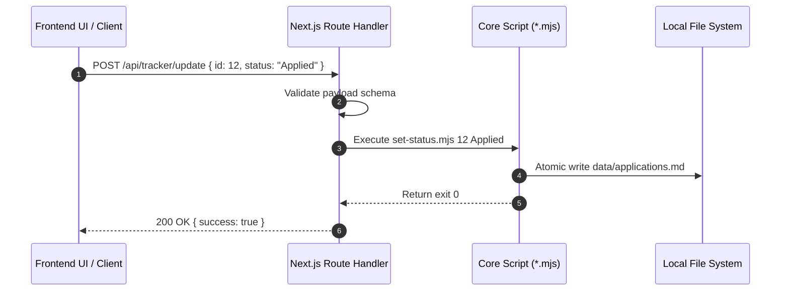

# API Development Guide — career-ops

## Purpose
Guides developers on authoring, testing, and securing Next.js route handlers in `web/src/app/api/`.

## Scope
Applies to all HTTP endpoints exposed by the Web UI.

## Overview
All Web UI API routes operate locally, binding to `127.0.0.1`. Route handlers act as orchestrators that execute core CLI scripts or read local Markdown files directly, returning standardized JSON payloads.

## Diagrams



## Technical Details

### API Route Conventions
1. **Directory Structure**: `web/src/app/api/{resource}/route.ts`.
2. **HTTP Methods**: Explicitly export `GET`, `POST`, `DELETE`, etc.
3. **Response Envelope**: Standardized JSON responses:
   ```typescript
   interface ApiResponse<T> {
     success: boolean;
     data?: T;
     error?: string;
   }
   ```
4. **Input Validation**: Validate query params and JSON bodies before triggering filesystem or CLI operations.

## Best Practices
- Never expose sensitive system paths in API error messages.
- Always handle child process exit codes gracefully.

## Examples
```typescript
import { NextResponse } from 'next/server';
import { execFile } from 'node:child_process';
import { promisify } from 'node:util';

const execFileAsync = promisify(execFile);

export async function POST(request: Request) {
  try {
    const { id, status } = await request.json();
    await execFileAsync('node', ['set-status.mjs', String(id), status]);
    return NextResponse.json({ success: true });
  } catch (err: any) {
    return NextResponse.json({ success: false, error: err.message }, { status: 500 });
  }
}
```

## Future Enhancements
- Zod schema validation across all API route handlers.
