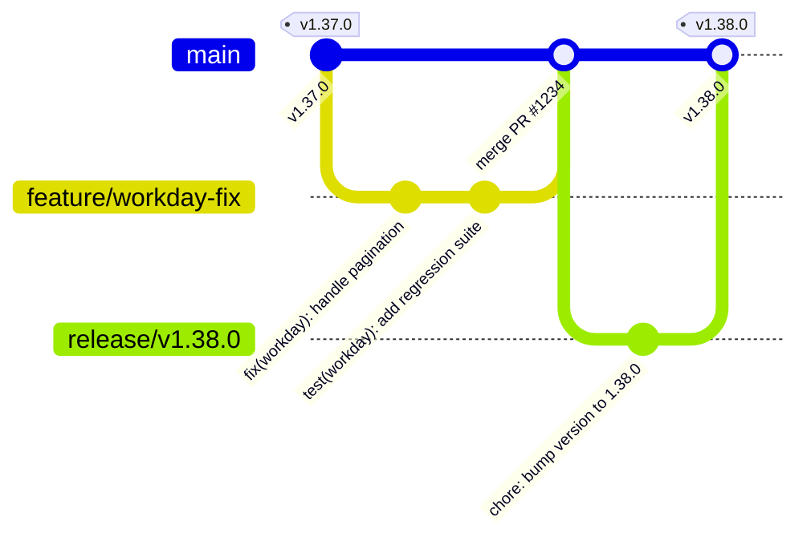

# Branching & Release Strategy — career-ops

## Purpose
Documents git branching conventions, pull request guidelines, semantic versioning, and release workflows.

## Scope
Applies to core maintainers, community contributors, and automated release systems.

## Overview
career-ops follows a **trunk-based development** model with tagged production releases. Because users update their local installations via `update-system.mjs`, release tags must guarantee backward compatibility and complete User Layer isolation.

## Diagrams



## Technical Details

### Branches
- `main`: Authoritative development branch. All PRs target `main`.
- `feature/*` / `fix/*`: Short-lived developer feature branches.
- Tags: `vX.Y.Z` denotes official production releases consumed by `update-system.mjs`.

### Semantic Versioning (SemVer)
- **MAJOR (v2.0.0)**: Breaking changes to the Data Contract, schema changes requiring manual migration, or minimum Node.js runtime floor bumps.
- **MINOR (v1.39.0)**: New providers, new evaluation blocks, new web UI features, non-breaking CLI flags.
- **PATCH (v1.38.1)**: Bug fixes, scraper regex adjustments, security patches.

## Best Practices
- Never commit directly to `main`.
- Every PR must pass `test-all.mjs` and CodeQL scans prior to merge.

## Examples
```bash
# Update local installation to latest stable release
node update-system.mjs check
node update-system.mjs apply --confirm
```

## Future Enhancements
- Automated release note generation integrated with GitHub Releases.
