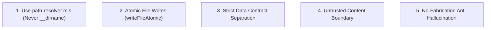

# Coding Standards & Conventions — career-ops

## Purpose
Defines code style, module conventions, error handling standards, and architectural hygiene for career-ops.

## Scope
Applies to all JavaScript (`.mjs`), TypeScript (`.ts`, `.tsx`), and Go code in the repository.

## Overview
Consistency is critical in a repository containing over 1,900 ESM files. We enforce strict path resolution, atomic file writes, deterministic error handling, and separation of user and system layers.

## Diagrams



## Technical Details

### Key Standards
1. **ESM Imports**: All JavaScript files must use explicit `.mjs` or `.js` extensions in import specifiers.
2. **Path Resolution**: Never construct absolute paths using `process.cwd()` or `__dirname` for User Layer files. Always call:
   ```javascript
   import { getCareerOpsRoot, resolveTrackerPath } from './path-resolver.mjs';
   const root = getCareerOpsRoot();
   const tracker = resolveTrackerPath(root);
   ```
3. **Atomic Writes**: Any script updating Markdown tables or JSON files must write to a temporary file first and rename atomically to avoid partial writes.
4. **No Process.exit in Tests**: Discovered test suites must use `pass()` and `fail()` from `tests/helpers.mjs` and never invoke `process.exit()`.

## Best Practices
- Preserve existing comments and docstrings.
- Ensure all public functions carry descriptive JSDoc type annotations.

## Examples
```javascript
// Good: Safe atomic file write
import { writeFileAtomic } from './tracker-utils.mjs';
writeFileAtomic(canonicalPath, data);

// Bad: Corruptible write
fs.writeFileSync(canonicalPath, data);
```

## Future Enhancements
- Gradual adoption of strict TypeScript checking (`tsc --checkJs`) across all `lib/` modules.
