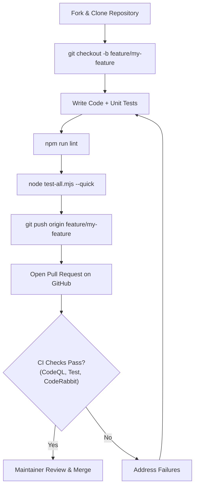

# Contribution Guide — career-ops

## Purpose
Provides guidelines for community developers contributing bug fixes, new job providers, features, or documentation.

## Scope
Covers issue triage, coding standards, PR templates, and licensing.

## Overview
We welcome community contributions! The most impactful way to contribute is by adding new job board adapters to `providers/` or refining evaluation modes.

## Diagrams

## Technical Details

### Contribution Checklist
1. **Source Indexing Policy**: Ensure target job sources are public, free for candidates, and comply with `robots.txt`.
2. **Provider Contract**: Must export `name`, `detect(url)`, and `fetchJobs(boardId)`.
3. **Dedicated Test**: Every provider must include a test suite in `tests/providers/{name}.test.mjs`.
4. **Data Contract Compliance**: Verify no changes touch User Layer files (`DATA_CONTRACT.md`).

## Best Practices
- Keep PRs focused on a single concern.
- Reference relevant GitHub issue numbers in commit messages and descriptions.

## Examples
- See `providers/ashby.mjs` and `tests/providers/ashby.test.mjs` as gold-standard reference implementations.

## Future Enhancements
- Contributor recognition badges on the community showcase board.
