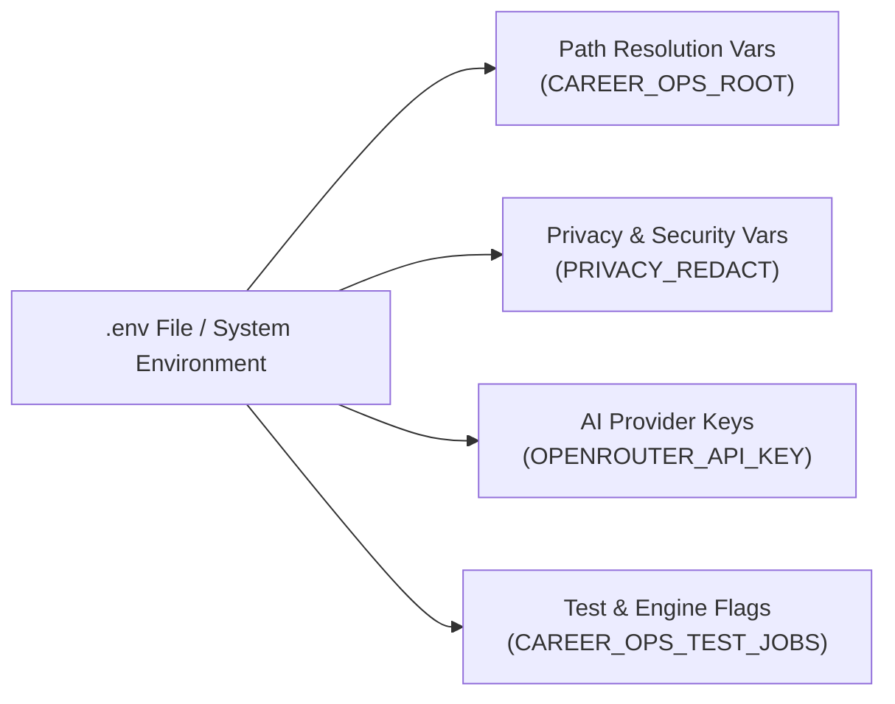

# Environment Variables Reference — career-ops

## Purpose
Exhaustive reference of all configuration flags, API keys, and environment variables recognized by career-ops.

## Scope
Covers runtime paths, privacy controls, AI API keys, and testing overrides.

## Overview
career-ops reads configuration from environment variables or a local `.env` file in the workspace root.

## Diagrams



## Technical Details

### Comprehensive Variable Reference

| Variable | Default | Purpose |
| :--- | :--- | :--- |
| `CAREER_OPS_ROOT` | `process.cwd()` | Explicit override for the User Layer data root. |
| `CAREER_OPS_TRACKER` | `{ROOT}/data/applications.md` | Explicit path to the canonical applications tracker file. |
| `PRIVACY_REDACT` | `0` (Block) | Set to `1` to enable placeholder token redaction instead of blocking outbound PII. |
| `OPENROUTER_API_KEY` | - | API key for OpenRouter models (`openrouter-runner.mjs`). |
| `GEMINI_API_KEY` | - | API key for Google Gemini evaluation (`gemini-eval.mjs`). |
| `OPENAI_API_KEY` | - | API key for OpenAI-compatible evaluation endpoints. |
| `PLAYWRIGHT_SKIP_BROWSER_DOWNLOAD` | `false` | Set to `1` to skip automatic Chromium download during `npm install`. |
| `CAREER_OPS_TEST_JOBS` | CPU count | Maximum concurrent worker processes for `test-all.mjs`. |
| `CAREER_OPS_HEADLESS` | `0` | Signals to modes that execution is unattended (no interactive prompts). |

## Best Practices
- Never commit production API keys to git.
- Use `.env.example` as the template for new deployments.

## Examples
```bash
# Example .env configuration
CAREER_OPS_ROOT=/path/to/my-job-search
PRIVACY_REDACT=1
OPENROUTER_API_KEY=sk-or-v1-xxxxxxxxxxxx
```

## Future Enhancements
- Encrypted secrets management using local OS keyrings.
