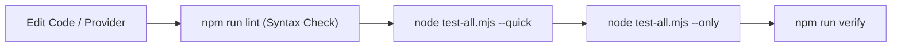

# Local Development Guide — career-ops

## Purpose
Guides developers on day-to-day coding, debugging, running tests, and adding features to career-ops.

## Scope
Covers CLI development, Web UI development, provider authoring, and test execution.

## Overview
Developing on career-ops involves working with Node.js ESM modules, Next.js components, or Go TUI models. A tight feedback loop is maintained via automated syntax checkers and fast test filtering.

## Diagrams



## Technical Details

### Development Commands
```bash
# 1. Check syntax across all 1,900+ .mjs files (< 5s)
npm run lint

# 2. Run fast test suite (skips dashboard build)
node test-all.mjs --quick

# 3. Run tests matching a specific pattern
node test-all.mjs --only providers/ashby

# 4. Start Next.js local development server
cd web
npm run dev
# Open http://localhost:3000
```

### Developing a New Provider
1. Create `providers/{name}.mjs`.
2. Follow the contract in `providers/ADDING_A_PROVIDER.md`.
3. Create corresponding test in `tests/providers/{name}.test.mjs`.
4. Test discovery with `node test-all.mjs --only providers/{name}`.

## Best Practices
- Place new tests in `tests/` as `*.test.mjs` files; do not edit the legacy inline sections of `test-all.mjs`.
- Always verify SSRF guards when adding HTTP network calls.

## Examples
```bash
# Test visual CV rendering
npm run test:cv-visual
```

## Future Enhancements
- Dockerized local development environment with hot-reloading for all services.
