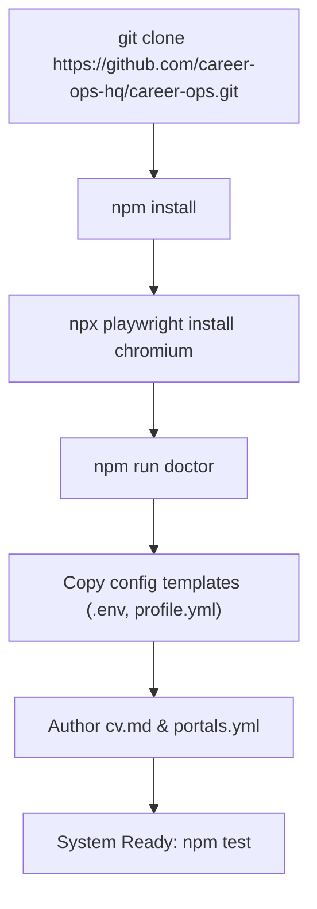

# Setup & Installation Guide — career-ops

## Purpose
Provides end-to-end instructions for installing and configuring career-ops on a local machine.

## Scope
Covers prerequisites, Node.js installation, Playwright browser setup, Go TUI compilation, and initial configuration.

## Overview
career-ops runs locally on your workstation. It requires Node.js 22.13+, Playwright Chromium (for PDF generation and web extraction), and optionally Go (for the terminal dashboard).

## Diagrams



## Technical Details

### Prerequisites
- **Node.js**: Version `^22.13.0 || >=23.4.0`.
- **Git**: Required for updater tracking.
- **Go (Optional)**: Version 1.22+ if compiling the terminal TUI in `dashboard/`.

### Installation Steps
```bash
# 1. Clone repository
git clone https://github.com/career-ops-hq/career-ops.git
cd career-ops

# 2. Install dependencies & Playwright Chromium
npm install

# 3. Run automated system diagnostics
npm run doctor

# 4. Initialize candidate profile & environment
cp .env.example .env
cp config/profile.example.yml config/profile.yml
cp cv-facts.example.json config/cv-facts.json
```

## Best Practices
- Never commit `.env` or personal files in `data/` to a public git fork.
- Ensure `npm run doctor` passes all health checks before starting evaluations.

## Examples
```bash
# Run doctor verification
node doctor.mjs
```

## Future Enhancements
- Interactive single-command setup wizard (`npm run init`).
