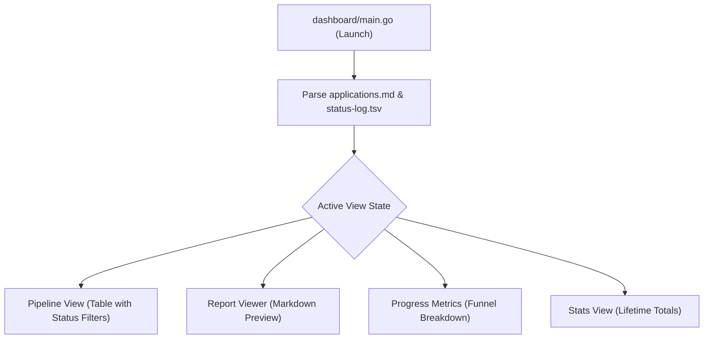

# Dashboard Design & TUI Specifications — career-ops

## Purpose
Details the design specifications, keyboard navigation, and architecture of the Go Bubbletea terminal TUI in `dashboard/`.

## Scope
Applies to `dashboard/main.go` and `dashboard/internal/`.

## Overview
For power users who prefer the terminal, career-ops provides an ultra-fast, zero-dependency Go TUI dashboard. It compiles into a standalone binary and visualizes application stages with keyboard-driven productivity.

## Diagrams



## Technical Details

### Architecture & Packages
- **Framework**: Charm Bubbletea (`github.com/charmbracelet/bubbletea`).
- **Styling**: Lipgloss (`github.com/charmbracelet/lipgloss`).
- **Data Parser**: Custom Markdown table parser in `dashboard/internal/data/tracker.go`.

### Keyboard Controls
- `Tab` / `Shift+Tab`: Cycle through status filter tabs (All, Applied, Interview, Top >= 4, Skip, Rejected).
- `j` / `k` or `Down` / `Up`: Navigate rows.
- `Enter`: Open full markdown evaluation report.
- `s`: Open interactive status picker.
- `d` / `D`: Open generated PDF in system viewer.
- `q` / `Ctrl+C`: Quit dashboard.

## Best Practices
- Handle missing files gracefully: if `applications.md` cannot be read, preserve previous state and display an inline banner rather than crashing.

## Examples
```bash
# Build and serve Go TUI dashboard
npm run serve:dashboard
```

## Future Enhancements
- Cross-compiled single-binary releases distributed via Homebrew and Scoop.
