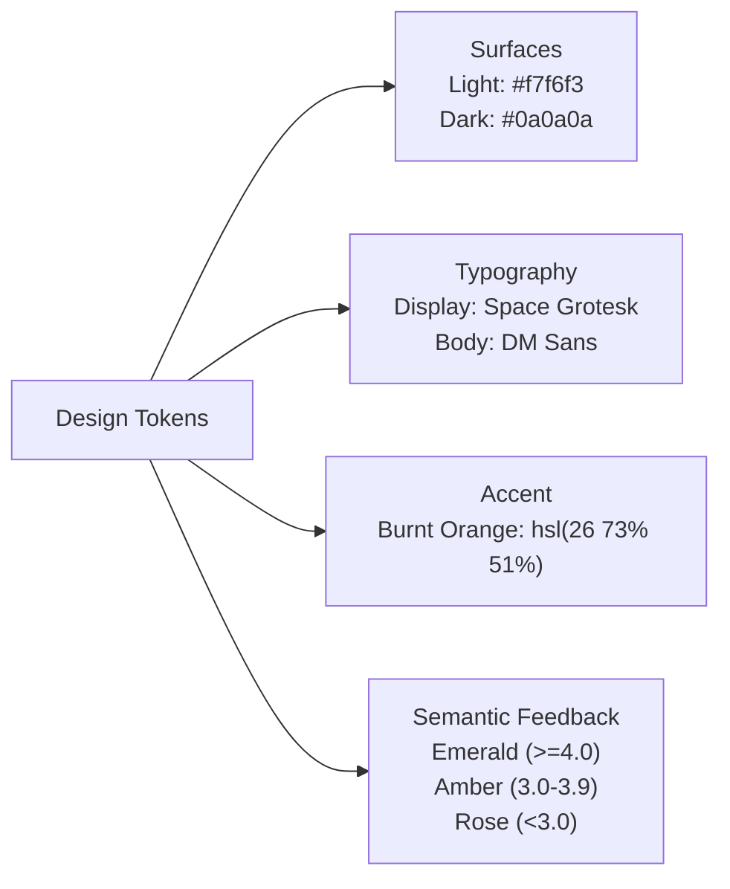

# Design System & Style Tokens — career-ops

## Purpose
Establishes the visual language, design tokens, color palette, typography, and layout rules for career-ops web and documents.

## Scope
Applies to `web/`, HTML CV templates, and PDF rendering engines.

## Overview
The career-ops design language is inspired by high-end editorial and terminal tools: warm neutral surfaces, deep zinc text, monospace data accents, and a distinctive burnt orange highlight.

## Diagrams



## Technical Details

### Color Tokens
- **Background Light**: `#f7f6f3` (warm, editorial off-white).
- **Background Dark**: `#0a0a0a` / `#161616` (deep charcoal/zinc).
- **Accent Primary**: `hsl(26 73% 51%)` (burnt orange).
- **Text Primary Light**: `#18181b` (zinc-900).
- **Text Primary Dark**: `#f4f4f5` (zinc-100).

### Typography
- **Headings / Numbers**: Space Grotesk (geometric, technical).
- **Body Prose**: DM Sans (high readability at small sizes).
- **Monospace**: JetBrains Mono or system monospace (for reports, JSON, and diffs).

## Best Practices
- Avoid pure harsh blacks (`#000000`) and pure whites (`#ffffff`) on primary reading canvases.
- Maintain high contrast ratios (WCAG AAA) for all critical score badges and status labels.

## Examples
```css
/* globals.css token definition */
:root {
  --background: #f7f6f3;
  --foreground: #18181b;
  --primary: hsl(26 73% 51%);
  --font-display: 'Space Grotesk', sans-serif;
  --font-sans: 'DM Sans', sans-serif;
}
```

## Future Enhancements
- User-selectable themes (Minimalist, Terminal Monochrome, Executive Navy).
