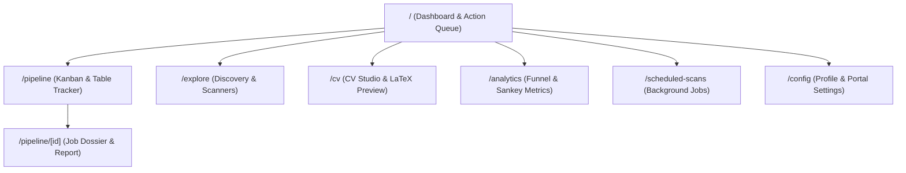

# Routing Architecture — career-ops

## Purpose
Documents the Next.js App Router tree, page layouts, route groups, and dynamic routing conventions.

## Scope
Applies to `web/src/app/`.

## Overview
The web application uses Next.js 16 App Router. Routes are organized around the candidate's core operating workflow: Inbox, Pipeline, Discovery, Resume Studio, and Analytics.

## Diagrams



## Technical Details

### Route Tree Map
- `/`: Today's action queue, pending tasks, follow-up alerts, and pipeline summary.
- `/pipeline`: Full application tracker with Table and Kanban board views.
- `/pipeline/[id]`: Deep inspection view for a specific application report and tailored PDF.
- `/explore`: Interactive zero-token scanner search and public ATS harvest viewer.
- `/cv`: Master CV editor (`cv.md`), PDF uploader, and fact verification inspector.
- `/analytics`: Funnel velocity, interview conversion rates, and rejection latency charts.
- `/scheduled-scans`: Configuration for local cron-like background portal sweeps.
- `/config`: Candidate profile settings, archetype definitions, and portal config.

## Best Practices
- Use `loading.tsx` for instant visual transitions with skeleton fallbacks.
- Implement `error.tsx` boundary handlers for graceful filesystem error containment.

## Examples
```typescript
// Dynamic route parameter extraction
export default async function JobDetailPage({ params }: { params: { id: string } }) {
  const { id } = await params;
  const report = await getReportForApp(parseInt(id, 10));
  return <JobDossierView report={report} />;
}
```

## Future Enhancements
- Multi-profile routing (`/profile/[profileId]/pipeline`) for dual-career candidates.
