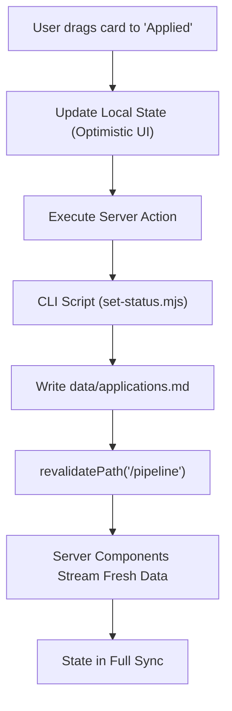

# Frontend State Management — career-ops

## Purpose
Details how state is initialized, cached, mutated, and synchronized with the local filesystem in the Web UI.

## Scope
Covers React 19 server actions, optimistic UI updates, client hooks, and local storage persistence.

## Overview
career-ops avoids bloated client-side state stores (Redux, MobX). Instead, it relies on React Server Components for data fetching, Server Actions for optimistic mutations, and lightweight React Context for ephemeral client state.

## Diagrams



## Technical Details

### State Patterns
1. **Server-Side File State**:
   - Application data is fetched directly on the server during page rendering using `fs/promises`.
   - Next.js caching ensures fast page transitions while honoring `revalidatePath`.
2. **Optimistic Status Transitions**:
   - The Kanban board uses React's `useOptimistic` hook to update column state instantly before the server acknowledges the disk write.
3. **Local Storage Preferences**:
   - Remembers user preferences (active view mode: Table vs. Kanban; evaluation detail level: Full vs. Essentials) locally in browser `localStorage`.

## Best Practices
- Never duplicate disk data in client React state; fetch at the server level.
- Always provide rollback logic if a Server Action fails.

## Examples
```tsx
const [optimisticJobs, setOptimisticJobs] = useOptimistic(
  jobs,
  (state, update: { id: number; status: string }) =>
    state.map(job => (job.id === update.id ? { ...job, status: update.status } : job))
);
```

## Future Enhancements
- File system watcher integration triggering automated client-side refreshes via WebSockets.
