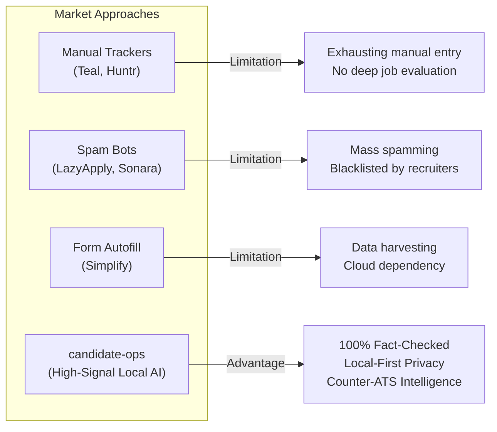

# Competitive Analysis & Market Benchmark — career-ops

## Purpose
Examines the competitive landscape, benchmarking career-ops against incumbent job search platforms, resume builders, and automated application tools.

## Scope
Evaluates LinkedIn, Simplify, Teal, Sonara, LazyApply, LoopCV, Huntr, and CareerFlow.

## Overview
The job application tech stack is divided into two distinct failure modes: passive tracker boards (Teal, Huntr) that require tedious manual entry, and aggressive spam bots (LazyApply, Sonara) that burn candidate reputation. career-ops represents a third way: high-intelligence, local-first candidate operations.

## Diagrams

## Technical Details

### Comprehensive Feature Benchmark

| Capability | career-ops | Teal | Simplify | Huntr | LazyApply / Sonara | LinkedIn |
| :--- | :---: | :---: | :---: | :---: | :---: | :---: |
| **Privacy / Local-First** | **100% Local** | Cloud | Cloud | Cloud | Cloud | Cloud |
| **Zero-Token Scanners** | **60+ ATS APIs** | None | Aggregator | None | Aggregator | Proprietary |
| **Anti-Ghost Job Check** | **Yes (Block G)** | No | No | No | No | No |
| **Fact-Verified Resumes** | **Deterministic** | Unverified AI | Basic | None | Generic Template | None |
| **STAR Story Provenance**| **Built-in** | None | None | None | None | None |
| **Open Source** | **MIT** | Proprietary | Proprietary | Proprietary | Proprietary | Proprietary |
| **Auto-Submit Policy** | **Strict HITL** | Manual | Autofill | Manual | Blind Auto-Submit | EasyApply |

### Competitor Deep Dives
- **Teal / Huntr**: Excellent visual kanban boards, but surface-level AI. They encourage users to match keywords without verifying whether the candidate actually possesses the skills.
- **Simplify**: Outstanding autofill browser extension, but candidate data is monetized in the cloud. Lacks deep strategic evaluation.
- **Sonara / LazyApply**: Automates form submissions blindly. Recruiters have deployed reverse-detection models that instantly reject candidates using these tools.

## Best Practices
- Position career-ops as the "anti-spam, counter-ATS" platform for professionals who care about their reputation.

## Examples
- High-level ATS matching reports showing missing vs. present competencies without keyword stuffing.

## Future Enhancements
- Bridge the convenience gap by developing an open-source, local-first browser extension for autofill.
