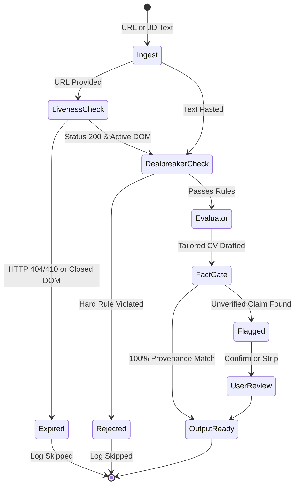

# Feature Specifications — career-ops

## Purpose
Provides detailed engineering specifications for core features in career-ops.

## Scope
Covers Scanner Ingestion, Liveness/Anti-Ghost Gating, Fact-Checked Resume Tailoring, and Story Bank Provenance.

## Overview
Technical requirements, algorithms, data contracts, and failure handling for primary platform features.

## Diagrams



## Technical Details

### 1. Zero-Token Discovery Scanners (`scan.mjs`, `providers/*`)
- **Specification**: Ingests postings directly from ATS endpoints without LLM assistance.
- **Provider Interface**:
  ```typescript
  interface Provider {
    name: string;
    detect: (url: string) => boolean;
    fetchJobs: (boardId: string, options?: FetchOptions) => Promise<Job[]>;
  }
  ```
- **Rate Limiting & SSRF**: All requests must pass through `providers/_http.mjs` with DNS lookup guards.

### 2. Fact Verification Engine (`verify-cv-facts.mjs`)
- **Specification**: Validates that all tools, languages, companies, and quantified claims in a tailored resume exist in primary source files (`cv.md`, `article-digest.md`).
- **Algorithm**:
  1. Tokenizes generated document into noun phrases, numeric claims, and tool fragments.
  2. Compares extracted entities against ground-truth corpus.
  3. Rejects compile step if any novel claim is introduced.

### 3. STAR+R Story Bank Provenance (`lib/story-bank.mjs`)
- **Specification**: Requires explicit provenance markers on all quantified claims in interview stories:
  `**Provenance:** source: cv.md | user-stated YYYY-MM-DD | derived-unverified | user-cannot-confirm`

## Best Practices
- Never allow a derived story to promote unverified numbers into a primary resume.

## Examples
- Unit tests in `tests/verify-cv-facts-structured-fields.test.mjs`.

## Future Enhancements
- AST-based NLP parser replacing heuristic regexes in fact verification.
