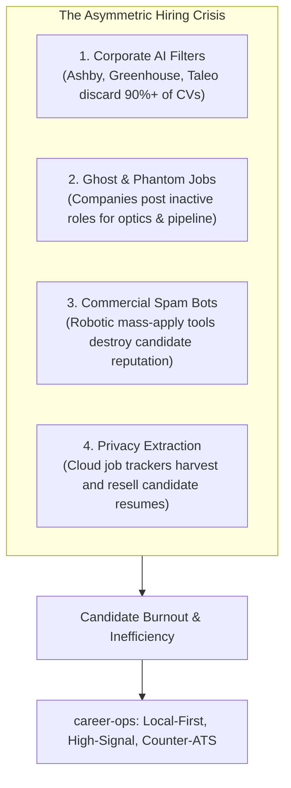
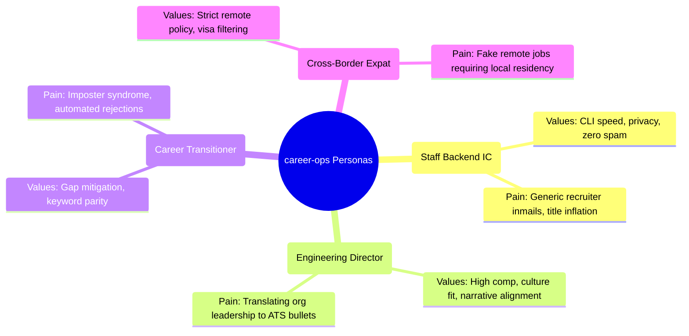
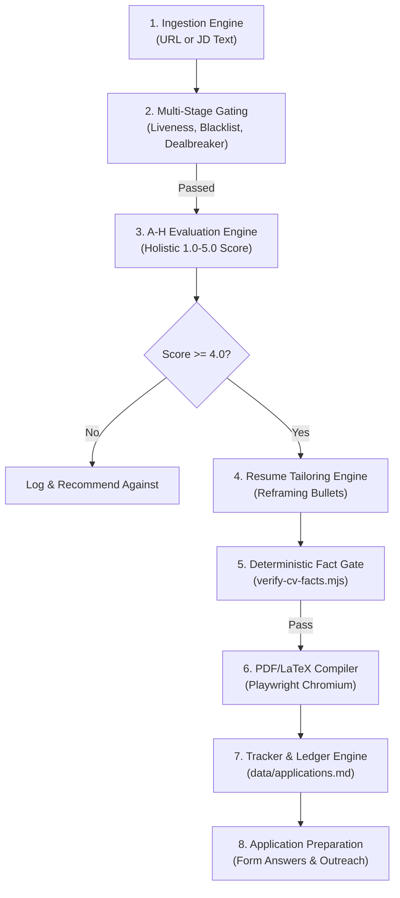
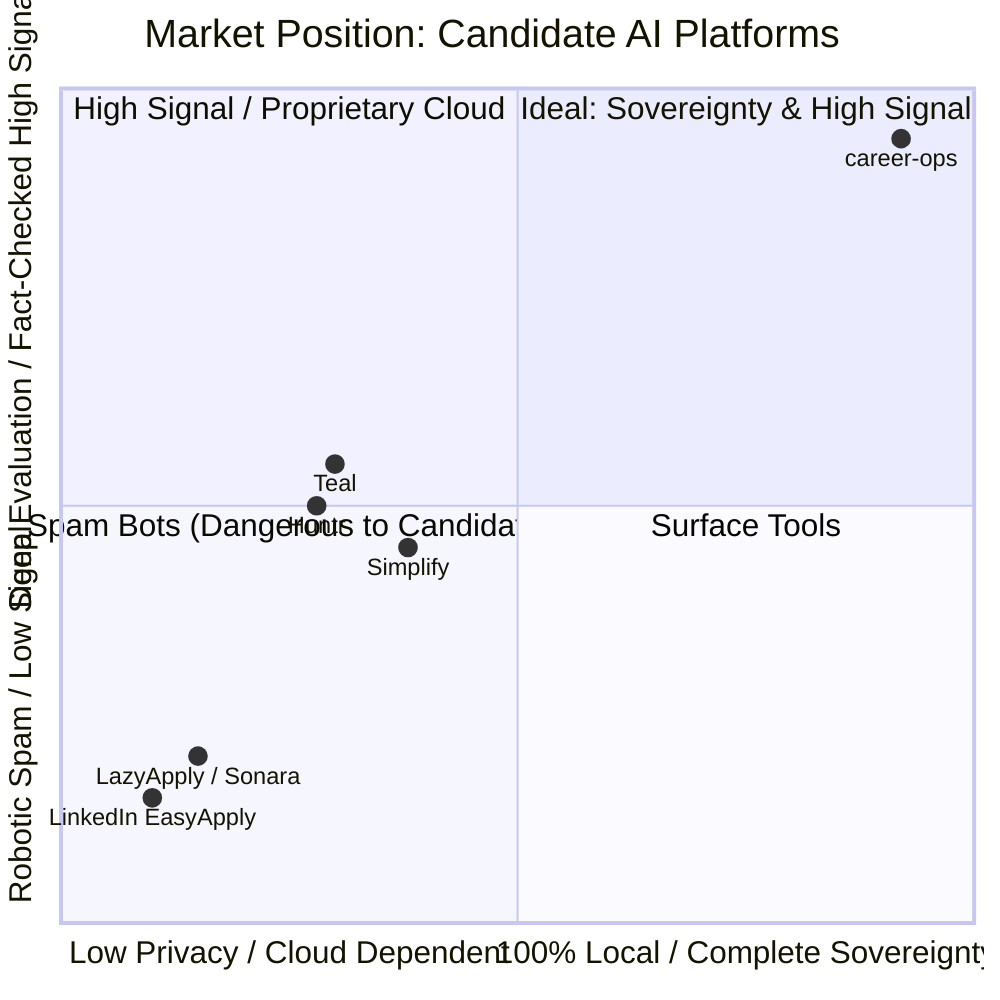

# Product Requirements Document (PRD) — career-ops

> **Document Status**: Production / Approved  
> **Target Version**: v1.38.0  
> **Author**: Staff Engineer & Product Strategy Lead  
> **Reviewers**: CTO, QA Lead, DevOps Architect  

---

## 1. Executive Summary & Purpose

`career-ops` is an open-source, local-first candidate operations system. Its purpose is to level the asymmetric technological playing field between corporate recruiting systems and job seekers.

Employers currently deploy enterprise-grade AI filters, applicant tracking systems (ATS), and automated resume parsers to screen thousands of applicants in seconds. In response, predatory commercial job bots spam hundreds of generic applications, degrading candidate reputations and flooding recruiters with low-quality noise.

`career-ops` provides an alternative: an **elite, local-first AI system** that runs directly on the candidate's machine, evaluates job postings across 8 deep dimensions, filters out ghost jobs, verifies every resume claim against ground-truth facts, and prepares tailored application materials—while strictly requiring human review and submission.

---

## 2. Problem Statement & User Pain Points

1. **The Ghost Job Epidemic**: Over 30% of public job listings are inactive, unmonitored, or published for regulatory optics. Candidates waste hours tailoring applications for phantom openings.
2. **Asymmetric ATS Keyword Filtering**: Legacy ATS systems (Taleo, iCIMS, Workday) fail to parse modern multi-column PDF layouts and reject qualified candidates due to minor phrasing variances.
3. **The Hallucination Danger in AI Resumes**: Generic LLM resume tools invent skills, scale metrics, and job titles. When candidates cannot substantiate these claims in technical interviews, their candidacies collapse.
4. **Cloud Privacy Vulnerabilities**: Cloud platforms (Teal, Huntr, Simplify) require candidates to upload their complete career history, compensation targets, and contact information to third-party databases.

---

## 3. Product Vision & Core Tenets

- **Vision**: To empower every professional with an enterprise-grade AI search agent that maximizes career outcomes while preserving complete data sovereignty.
- **The Core Tenets**:
  1. **Candidate Sovereignty**: All data lives locally in plain text (Markdown, YAML, TSV).
  2. **Deterministic Fact Grounding**: Generative AI is bounded by deterministic code: *"Keywords get reformulated, never fabricated."*
  3. **High-Signal Engagement**: We reject the "spray and pray" doctrine. 10 tailored, fact-verified applications outperform 500 spam submissions.
  4. **Human-in-the-Loop (HITL)**: career-ops prepares and evaluates; the human verifies and clicks Submit.

---

## 4. User Personas

### 4.1 Alex — The Staff / Principal Engineer
- **Experience**: 12+ years building distributed backend systems.
- **Environment**: macOS/Linux, Neovim/VSCode, terminal power-user.
- **Needs**: Bounded research budgets, zero-token CLI portal sweeps, deep technical requirement gap analysis.

### 4.2 Priya — The Engineering Director / Product Leader
- **Experience**: 10+ years managing teams of 25+ engineers and product leads.
- **Environment**: macOS, browser-heavy, spreadsheet trackers.
- **Needs**: Visual Kanban tracking, STAR story bank provenance, executive leveling strategies, compensation negotiation scripts.

### 4.3 Marcus — The Career Transitioner
- **Experience**: 4 years in data analytics transitioning into ML Engineering.
- **Environment**: Windows 11 / WSL2, Python, VSCode.
- **Needs**: ATS keyword coverage diagnostics (`keyword-match.mjs`), clear gap mitigation tactics, structured cover letter synthesis.

### 4.4 Elena — The Cross-Border Remote Worker
- **Experience**: Senior Full-Stack Engineer seeking global remote US/EU contracts.
- **Environment**: Linux, Docker, multiple timezone coordination.
- **Needs**: Automated location policy filtering, work-authorization contradiction checks, currency/comp arbitrage analysis.

---

## 5. Functional Requirements & Feature Specifications

### 5.1 Ingestion & Discovery Engine
- **FR-1.1**: The system must ingest job postings from direct URLs or raw pasted text.
- **FR-1.2**: Must support zero-token scraping across 60+ public ATS providers (Ashby, Greenhouse, Lever, Workday, BambooHR, SmartRecruiters) without calling LLM APIs.
- **FR-1.3**: The full dataset reverse-ATS scanner (`scan-ats-full.mjs`) must checkpoint progress every 500 companies and support resumption via `--resume`.

### 5.2 Multi-Stage Pre-Flight Gating
- **FR-2.1 (Liveness Gate)**: When given a URL, the system must deterministically verify that the posting is live (HTTP 200, active application button, absence of "closed" DOM markers) before executing LLM evaluations.
- **FR-2.2 (Blacklist Gate)**: The system must check candidate-defined company names and domain patterns in `data/blacklist.md`. Matches halt execution immediately.
- **FR-2.3 (Dealbreaker Gate)**: Hard constraints (minimum salary, remote policy, work authorization) defined in `config/profile.yml` must be checked against JD text. If violated, execution stops with an actionable alert.

### 5.3 Deep Evaluation Engine (Blocks A–H)
- **FR-3.1**: Every evaluated job must produce a structured Markdown dossier (`reports/{NNN}-{company}-{date}.md`) containing:
  - **Block A**: Role summary, archetype match, culture screen, PcD quota checks.
  - **Block B**: Requirements matrix (importance rating, candidate proof, gap mitigation).
  - **Block C**: Leveling strategy (IC vs. Management, title calibration).
  - **Block D**: Compensation research (bounded WebSearch vs. market quartiles).
  - **Block E**: CV personalization plan (mapping proof points from `cv.md`).
  - **Block F**: STAR+R behavioral interview preparation.
  - **Block G**: Posting legitimacy screening (scam signals, age, repost churn).
  - **Block H**: Draft application form answers (conditional on score $\ge 4.5$).
- **FR-3.2 (Holistic Fit Score)**: Must assign an integrated 1.0–5.0 score across 5 dimensions (CV Match, North Star, Comp, Culture, Red Flags). Arithmetic averaging of sections is strictly prohibited.
- **FR-3.3 (Evidence Confidence)**: Must classify supporting evidence as `supported`, `partial`, or `unknown`.

### 5.4 Zero-Fabrication Resume Tailoring & Verification
- **FR-4.1**: For listings scoring $\ge 4.0$, the system must generate a tailored CV payload reframing existing experience to match JD vocabulary.
- **FR-4.2 (The Fact Gate)**: `verify-cv-facts.mjs` must scan the generated document and assert that every tool, framework, company name, date range, and quantified metric exists in `cv.md` or `article-digest.md`. Any novel claim halts compilation with exit code 1.
- **FR-4.3**: Tailored resumes must maintain strict chronological ordering unless explicitly overridden.

### 5.5 Rendering & Document Compilation
- **FR-5.1**: `generate-pdf.mjs` must render clean HTML templates into single-column, ATS-parseable PDFs using Playwright Chromium.
- **FR-5.2**: The system must enforce a strict page budget (default: 2 pages) and report visual overflow warnings.
- **FR-5.3**: `generate-latex.mjs` must validate and compile LaTeX resumes using `pdflatex` or emit Overleaf-ready bundles.

### 5.6 Tracking & Transition Ledger
- **FR-6.1**: Every evaluated role must be recorded in `data/applications.md` with columns: `# | Date | Company | Role | Status | Score | PDF | Report | Notes | URL`.
- **FR-6.2**: All status mutations must append an immutable audit record to `data/status-log.tsv`.
- **FR-6.3**: `tracker.mjs` must build a derived SQLite index (`applications.db`) for sub-millisecond queries, rebuilding automatically on source file hash changes.

---

## 6. Non-Functional Requirements (NFRs)

| Dimension | Specification | Verification Mechanism |
| :--- | :--- | :--- |
| **Privacy & Security** | Zero outbound leakage of candidate PII; dial-time SSRF blocking of private IP ranges and cloud metadata. | `lib/pii-interceptor.mjs` and `providers/_ip-guard.mjs`. |
| **Performance** | Syntax check $< 5$s for 1,960+ files; SQLite index sync $< 100$ms for 500 apps; PDF compile $< 2$s. | `check-syntax.mjs`, `tracker.mjs sync`, and Playwright benchmarks. |
| **Resource Footprint** | Peak RAM $< 2.5$GB during 3-worker parallel batch runs; disk storage $< 500$MB. | OS process monitoring and Docker memory caps. |
| **Portability** | Full feature parity across macOS, Linux (Ubuntu, Debian, Arch, NixOS), and Windows 10/11 (PowerShell & WSL2). | GitHub Actions cross-platform matrix (`test.yml`). |
| **Reliability** | Atomic file writes (`writeFileAtomic`) to prevent corruption during unexpected shutdowns. | `tracker-utils.mjs` write-temp-then-rename tests. |

---

## 7. Competitive Benchmark

- **Teal / Huntr**: Effective manual trackers, but superficial AI matching that promotes unverified keyword stuffing; proprietary cloud.
- **Simplify**: Great browser autofill, but collects candidate profile data in the cloud; lacks deep strategic job evaluation.
- **Sonara / LazyApply**: Blind auto-submission bots that trigger immediate blacklisting by corporate ATS screening algorithms.
- **career-ops**: The only platform combining 100% local-first privacy, zero-token multi-board discovery, anti-ghost screening, and deterministic fact verification.

---

## 8. Success Metrics & Key Performance Indicators (KPIs)

1. **Candidate Outcome KPIs**:
   - **Interview Callback Rate**: $\ge 15\%$ of submitted applications advancing to first-round interviews (vs. industry baseline of $2-3\%$).
   - **Eval-to-Apply Efficiency**: $10–15\%$ of evaluated listings clearing the $\ge 4.0$ threshold (saving 85%+ of application effort).
   - **Compensation Delta**: $\ge 10\%$ increase in final offer compensation through data-backed negotiation scripts.
2. **Platform & System KPIs**:
   - **Zero Fabrication Rate**: $100\%$ pass rate in `verify-cv-facts.mjs` audits across all generated resumes.
   - **Scraper Uptime**: $\ge 95\%$ of provider adapters successfully parsing job boards in monthly sweeps.
   - **Test Execution Velocity**: Complete test suite execution under 8 minutes in CI.
