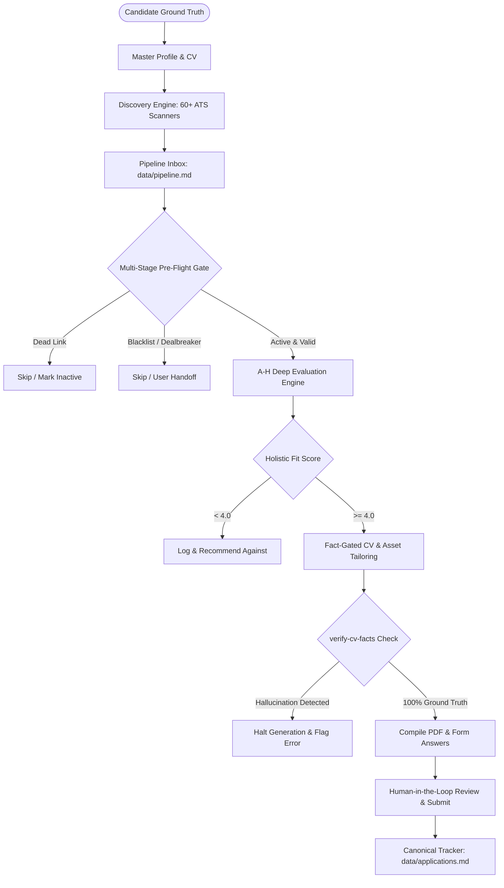

# Product Requirements Document (PRD) — career-ops

## Purpose
This document establishes the product requirements, system capabilities, constraints, and functional specifications for **career-ops**, the open-source, local-first AI job search automation platform.

## Scope
Covers candidate profile modeling, zero-token portal discovery, multi-stage evaluation gating, anti-ghost posting validation, deterministic CV tailoring, ATS compliance, and human-in-the-loop tracking.

## Overview
Job hunting in the modern era is fundamentally broken: applicant tracking systems (ATS) deploy algorithmic filters, LinkedIn and job boards are saturated with phantom/ghost listings, and predatory commercial tools spam hundreds of generic resumes that ruin candidate reputation. **career-ops** reverses this dynamic: it gives candidates an elite AI operating system that evaluates jobs deeply, verifies every resume claim against ground-truth facts, and prepares bespoke application materials without ever auto-submitting.

## Diagrams



## Technical Details

### Functional Requirements
1. **User Layer Isolation (Data Contract)**: Candidate personal files (`cv.md`, `config/profile.yml`, `data/applications.md`) must reside in an immutable layer that system updates never overwrite.
2. **Zero-Token Discovery**: Ingest postings from Ashby, Greenhouse, Lever, Workday, and 50+ other providers via direct REST/RSS endpoints with zero LLM API cost.
3. **Pre-Flight Liveness & Dealbreaker Gate**: Verify HTTP status and page DOM for closure indicators before spending any inference tokens.
4. **Holistic 5-Dimension Scoring**:
   - Match with CV
   - North Star alignment (Target Archetypes)
   - Compensation vs market
   - Cultural signals & remote policy
   - Red flags / risk adjustments
5. **Legitimacy Screening (Block G)**: Classify posting as High Confidence, Proceed with Caution, or Suspicious based on posting age, repost cadence, and layoff history.
6. **Strict Fact Gate**: Zero tolerance for manufactured metrics. Every skill or number in tailored output must trace directly to primary user files.

### Non-Functional Requirements
- **Local-First & Offline Resilience**: Core operations must run without central servers or proprietary database services.
- **Privacy Enforcement**: Outbound requests to LLM APIs must be intercepted to strip or block sensitive PII unless opted-in.
- **Cross-Platform Compatibility**: Complete operational parity across macOS, Linux, and Windows 10/11.

## Best Practices
- Never bypass the human submission step: the agent prepares, the human reviews and submits.
- Maintain an append-only transaction ledger (`data/status-log.tsv`) alongside Markdown tables.

## Examples
```bash
# Run portal scan
node scan.mjs

# Evaluate specific job URL
node openrouter-runner.mjs evaluate https://jobs.ashbyhq.com/example/123

# Generate fact-verified PDF
node generate-pdf.mjs output/tailored-cv.html output/tailored-cv.pdf --format=letter
```

## Future Enhancements
- Chrome extension for 1-click ATS form prefill.
- Local voice-to-voice interview coaching agent.
- Client-side zero-knowledge encrypted backup sync.
