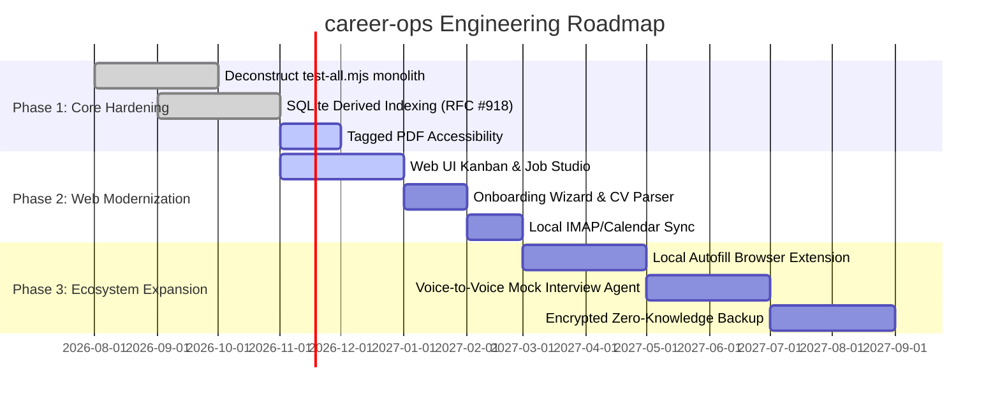

# Product Roadmap — career-ops

## Purpose
Outlines the strategic development phases, feature releases, and technical milestones for career-ops.

## Scope
Spans Core CLI, Modern Web UI, Local DevOps, and Future AI capabilities.

## Overview
Our roadmap transitions career-ops from an elite CLI power-tool for developers into an accessible, institutional-grade career command center.

## Diagrams

## Technical Details

### Phase 1: Core Engine & Developer Ergonomics (Q4 2026)
- **Monolith Deconstruction**: Split the 20,000-line `test-all.mjs` file into modular suites under `tests/`.
- **Accessibility Hardening**: Add semantic PDF tags to Playwright Chromium rendering for screen reader compliance.
- **CLI Doctor**: Automated self-healing environment diagnosis.

### Phase 2: Web Modernization & Local Inbound (Q1 2027)
- **Production Web UI**: Graduate `@career-ops/web` from alpha to primary interface.
- **Local Email Ingestion**: Zero-cloud IMAP reader for local rejection/interview invite classification.
- **Visual CV Studio**: Side-by-side Markdown editing with live PDF preview.

### Phase 3: The Last-Mile Bridge & Voice Agent (Q2–Q3 2027)
- **Companion Browser Extension**: 1-click ATS prefill without cloud data leakage.
- **Local Audio Mock Interviewer**: WebRTC/Whisper voice agent that grills candidates using their STAR story bank.

## Best Practices
- Every new feature must preserve the local-first data contract.

## Examples
- Release tracking via `node update-system.mjs check`.

## Future Enhancements
- Decentralized talent network protocols.
