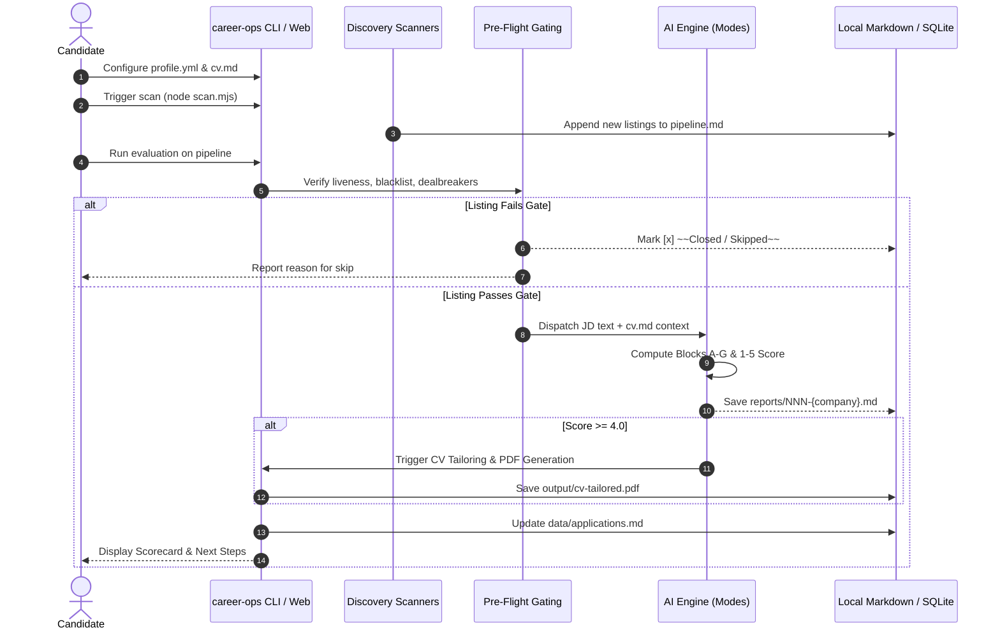

# User Journeys — career-ops

## Purpose
Documents the standard user interaction flows across the job search lifecycle.

## Scope
Covers onboarding, job discovery, evaluation, application asset generation, and post-application tracking.

## Overview
The career-ops user journey is designed as a high-signal funnel where low-probability listings are disqualified early and high-fit listings receive exhaustive preparation.

## Diagrams



## Technical Details

### Journey Phase 1: Onboarding & Calibration
1. User clones repository and runs `npm run doctor`.
2. Master resume is imported to `cv.md`.
3. Candidate defines compensation floors, target archetypes, and dealbreakers in `config/profile.yml`.
4. User seeds STAR stories into `interview-prep/story-bank.md`.

### Journey Phase 2: Ingestion & Filtering
1. Automatic or manual ingestion populates `data/pipeline.md`.
2. `check-liveness.mjs` strips dead links without wasting LLM tokens.
3. `data/blacklist.md` prevents evaluating unwanted employers.

### Journey Phase 3: Evaluation & Asset Prep
1. `modes/oferta.md` executes structured evaluation.
2. `verify-cv-facts.mjs` verifies candidate claims.
3. Playwright renders pixel-perfect, ATS-compliant PDF.

### Journey Phase 4: Follow-up & Retro
1. Candidate logs submission status via `node set-status.mjs`.
2. `followup-cadence.mjs` calculates optimal follow-up dates.
3. `modes/retro.md` captures lessons from rejections or interviewer feedback.

## Best Practices
- Never bypass the liveness gate: dead URLs waste token budget and pollute reports.

## Examples
```bash
# Run full evaluation pipeline
npm run or:pipeline
```

## Future Enhancements
- Interactive visual step-through in the Web UI with live streaming tokens.
