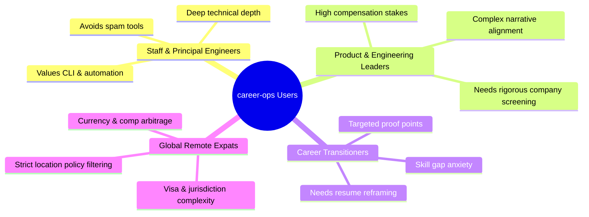

# User Personas — career-ops

## Purpose
Defines the target user segments, behavioral archetypes, pain points, and technical contexts for career-ops.

## Scope
Informs UI design, CLI ergonomics, prompt tuning, and product prioritization.

## Overview
career-ops serves diverse candidates who share one common trait: a refusal to compromise on data privacy or application quality.

## Diagrams

## Technical Details

### 1. The Staff/Principal Engineer ("Alex")
- **Profile**: 12+ years experience, Senior/Staff backend architect.
- **Tech Stack**: Linux/macOS, Neovim/VSCode, terminal power-user.
- **Pain Points**: Sifting through generic recruiter inmails, identifying real technical challenges vs. buzzword-stuffed job specs, evaluating comp packages accurately.
- **career-ops Usage**: CLI batch runner, customized `_profile.md` targeting Staff/Principal archetypes, zero-token scanners for curated startup lists.

### 2. The Engineering Manager / Product Leader ("Priya")
- **Profile**: 10+ years experience, manages 25+ engineers, looking for Director/VP roles.
- **Tech Stack**: Mac, web tools, spreadsheet trackers.
- **Pain Points**: Translating organizational leadership into quantified ATS bullets, navigating lengthy executive interview loops.
- **career-ops Usage**: Web UI (/pipeline), STAR story bank provenance tracking, negotiation scripts.

### 3. The Career Pivoter / Tech Transitioner ("Marcus")
- **Profile**: 4 years experience in data analytics transitioning into ML Engineering.
- **Tech Stack**: Windows/WSL, Python, Jupyter.
- **Pain Points**: Keyword mismatch in ATS systems, lack of confidence in translating transferrable skills.
- **career-ops Usage**: Block B gap analysis, `keyword-match.mjs`, targeted CV bullet reordering.

### 4. The Cross-Border Remote Worker ("Elena")
- **Profile**: Staff Engineer based in Eastern Europe/Asia seeking US/EU remote roles.
- **Tech Stack**: Linux, Docker, multiple timezone coordination.
- **Pain Points**: Filtering out fake "remote" jobs that secretly require local citizenship or residency.
- **career-ops Usage**: Location policy hard filters in `profile.yml`, Block G legitimacy screening.

## Best Practices
- Design interfaces with dual affordances: terminal-first for Alex and Elena; visual Web UI for Priya and Marcus.

## Examples
- Configuration in `config/profile.yml` tailoring location policy to global remote hubs.

## Future Enhancements
- Persona-specific onboarding templates for Executive, IC Engineer, and Product Manager tracks.
